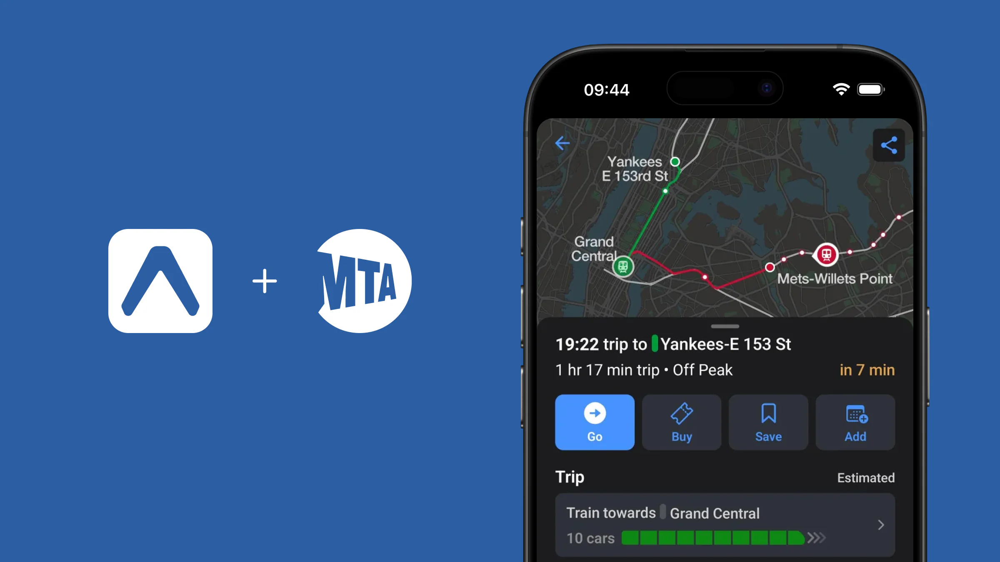

# Eine Filialprüfungs-App mit React Native und Expo bauen

Eine Ladenkette prüft täglich Licht, Preisschilder, Gänge und Notausgänge. Mitarbeitende haken Punkte am Telefon ab, schreiben eine Notiz und speichern den Bericht. Dieser Formular- und Datenablauf passt gut zu React Native und Expo.

## 1. Was beide Werkzeuge leisten

React Native baut native Android- und iOS-Oberflächen mit React und TypeScript. Expo ergänzt Projekterstellung, Entwicklungsserver, Geräte-APIs, Builds und Updates.


## 2. Drei reale Produkte

Shopify POS bedient physische Geschäfte, Discord teilt Produktcode zwischen Android und iOS, und MTA TrainTime zeigt Expo in einer offiziellen Verkehrs-App.




## 3. Projekt und Checkliste erstellen

```bash
npx create-expo-app@latest store-inspection
cd store-inspection
npm run web
```

> Mache aus dem Beispiel eine Filialprüfung. Zeige Filiale, heutigen Fortschritt und eine Start-Schaltfläche.

> Ergänze Licht, Preisschilder, Gänge und Notausgänge. Ein Tippen ändert Status und Fortschritt.


## 4. Einen Bericht speichern

> Ergänze Notiz und Speichern. Zeige danach Zeit, Anzahl erledigter Punkte und Notiz als Karte.


> Speichere Fortschritt und Berichte auf dem Gerät und stelle sie beim Öffnen wieder her. Noch kein Server.

`AsyncStorage` genügt für wenige Werte; `expo-sqlite` eignet sich für Beziehungen zwischen Prüfungen, Details und ausstehenden Aufträgen.

## 5. Foto und Backend danach hinzufügen

> Erlaube ein Foto an einem offenen Punkt, mit Vorschau und Entfernen.

> Verbinde die vorhandene Anmeldung und zeige nur vom Server zugewiesene Filialen.

Mobile Token gehören in `SecureStore`. Unternehmensgeheimnisse gehören weder in die App noch in `EXPO_PUBLIC_`-Variablen. Offline-Synchronisierung folgt erst nach stabilem lokalen Speichern und API-Zugriff.

## 6. Auf echten Geräten abschließen

Expo Go hilft am Anfang; eigener nativer Code braucht einen development build. Vor Veröffentlichung werden Tastatur, Rechte, Fotos, Neustart, schwaches Netz, Abmeldung und Upgrade auf Android und iPhone geprüft.

Der Prototyp wurde mit Expo SDK 57, TypeScript und echtem Web-Export getestet. Ohne Android-Emulator und iOS-Simulator-Runtime werden mobile Builds und Signierung nicht als abgeschlossen bezeichnet.
