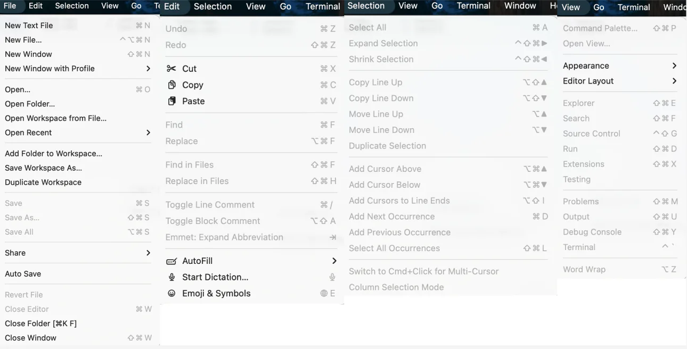
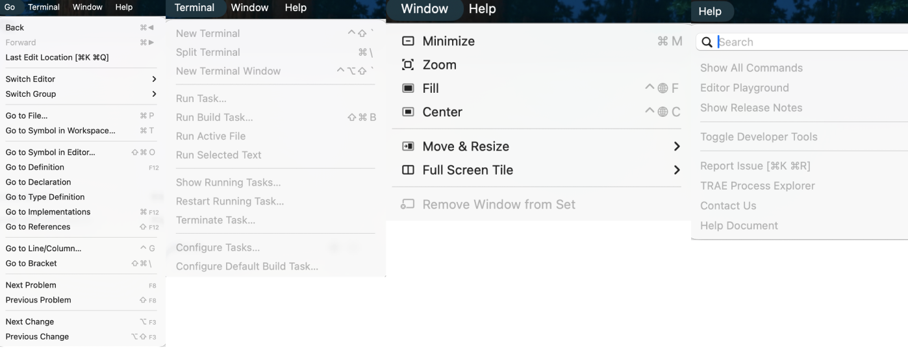

# IDE 활용 입문

::: tip 💡 학습 가이드
이 장에서는 프로그래머의 핵심 생산성 도구인 **통합 개발 환경 (IDE)** 에 대해 깊이 있게 알아봅니다. IDE의 설계 철학부터 시작하여 핵심 구성 요소를 하나씩 분석하고, 가상 IDE를 통해 그 작동 원리를 시연합니다.
:::

## 모르는 것을 만나면 어떻게 하나요 (How to solve problems) 접근법

IDE를 학습하고 사용하는 과정에서 이해할 수 없는 버튼, 메뉴 또는 코드 오류를 만날 수 있습니다. 이때 **당황하지 말고 AI 어시스턴트를 활용하는 것이 가장 효율적인 해결책**입니다.

**추천 방법: 스크린샷으로 AI에게 묻기**

요즘 AI(ChatGPT, Claude, DeepSeek 등)는 강력한 이미지 인식 능력을 갖추고 있습니다. 모르는 인터페이스 요소나 복잡한 코드 조각을 만나면:

1.  **스크린샷**: 이해할 수 없는 부분 캡처 (예: 이상한 아이콘이나 복잡한 설정 코드).
2.  **질문**: 이미지를 AI에 보내고 "이것은 무엇인가요? 무슨 용도인가요?" 또는 "이 코드에서 xxx는 무엇을 하나요?"라고 묻기.
3.  **추가 질문**: AI의 답변이 너무 전문적이어서 이해하기 어렵다면, "일상적인 언어로 설명해 주세요. 가능하면 일상생활의 예를 들어주세요."라고 계속 질문.

<AiHelpDemo />

---

## 0. 서론:IDE 도입 동기
소프트웨어 개발 과정에서 프로그래머는 코드 작성, 파일 관리, 컴파일/실행, 오류 디버깅 등을 빈번하게 수행합니다. 이 작업들이 각각 다른 독립 소프트웨어에서 이루어져야 한다면 (예: 메모장으로 코드 작성, 명령줄로 컴파일, 파일 탐색기로 파일 관리), 효율이 매우 낮고 오류가 발생하기 쉽습니다.

**IDE (Integrated Development Environment)** 의 핵심 가치는 **통합**에 있습니다. 소프트웨어 개발에 필요한 다양한 도구(편집기, 컴파일러, 디버거, 파일 관리자 등)를 하나의 통합된 그래픽 인터페이스에 모아 원스톱 작업 경험을 제공합니다.

**VS Code가 바로 가장 인기 있는 IDE 중 하나입니다.** 본질적으로 가벼운 코드 편집기지만, 강력한 플러그인 시스템을 통해 IDE의 모든 핵심 기능(코드 편집, 디버깅, 버전 관리 등)을 갖추었기 때문에 현대 프론트엔드와 풀스택 개발의首选 IDE로 널리 인정받고 있습니다.

요컨대 IDE는 개발자의 생산성을 극대화하고, 서로 다른 도구 간 전환하는 시간 비용을 줄이는 것을 목표로 합니다.

> 🔗 **리소스 다운로드**:
>
> - [VS Code 공식 다운로드](https://code.visualstudio.com/Download)
> - [VS Code 웹 버전 체험](https://vscode.dev/)
>
> **VS Code (Visual Studio Code)** 는 Microsoft가 개발한 무료, 오픈소스, 크로스 플랫폼 코드 편집기입니다. **가볍고, 플러그인이 풍부하며, 실행 속도가 빠르다는** 특징으로 전 세계에서 가장 인기 있는 개발 도구 중 하나가 되었습니다. Python, JavaScript, C++ 등 무엇을 작성하든 VS Code는 플러그인 설치를 통해 가장 적합한 "필수 도구"로 변신할 수 있습니다.

---

## 1. 핵심 인터페이스 분석

현대 IDE(VS Code 기준)의 인터페이스 레이아웃은 정교하게 설계되어 일반적으로 다음 네 가지 핵심 영역을 포함합니다:

1. **사이드바 (Sidebar)**: 리소스 관리
   프로젝트의 파일 트리를 보여주며, 파일 생성, 이름 변경, 이동, 삭제를 지원하고 프로젝트 구조에 대한 전역 뷰와 빠른 접근을 제공합니다.

2. **편집 영역 (Editor Area)**: 코드 창작
   코드를 작성하고 수정하는 핵심 영역입니다. 구문 강조, 스마트 코드 자동완성, 문법 검사 등의 기능을 지원하여 효율적이고 지능적인 코드 작성 환경을 제공합니다.

3. **하단 패널 (Panel)**: 실행과 피드백
   시스템과의 상호작용 및 실행 결과 확인. 터미널(Terminal), 출력(Output) 등을 포함하여 명령 실행, 로그 확인 및 디버깅에 사용됩니다.

4. **액티비티 바 (Activity Bar)**: 기능 탐색
   인터페이스 맨 왼쪽에 위치하며, 파일 탐색기, 검색, Git 관리 등의 아이콘을 포함하여 "코드 작성"과 "코드 커밋" 같은 다양한 작업 컨텍스트 간 빠른 전환을 제공합니다.

---

## 2. 인터랙티브 데모: 기능 체험

백문이 불여일견. IDE의 편리함을 진정으로 느끼실 수 있도록 **가상의 VS Code 환경**을 준비했습니다.

**다음 작업을 시도해 보세요**:

1.  우측 상단의 **"▶ 자동 둘러보기 시작"** 을 클릭하여 커서를 따라 각 영역을 알아보세요.
2.  **자유 탐색**: 좌측 아이콘을 클릭하여 뷰를 전환하거나, 파일명을 클릭하여 코드를 열어보세요.
3.  **통합 체험**: 파일 관리, 코드 편집, 터미널 실행이 모두 같은 창 안에서 원활하게 연결되는 것을 발견할 것입니다.
4.  **플러그인 설치**: 드롭다운 메뉴에서 **"플러그인 설치 (Extensions)"** 모드를 선택하고, 가상 스토어에서 Python 플러그인을 설치하는 것을 체험해 보세요.

<ClientOnly>
  <VirtualVSCodeDemo />
</ClientOnly>

---

## 3. 핵심 메커니즘: 왜 VS Code는 모든 것을 할 수 있는가 동기

궁금할 수 있습니다: 왜 같은 소프트웨어로 Python도 쓰고, C++도 쓰고, 웹 개발도 할 수 있을까요? 어떻게 가능한 건가요?
사실 VS Code의 설계 철학은 한 문장으로 요약할 수 있습니다: **"핵심은 극도로 간결하게, 능력은 외부에서 추가".**

### 3.1 극도로 간결한 핵심: 그냥 "도화지"일 뿐

방금 다운로드한 VS Code에 플러그인을 하나도 설치하지 않으면, 사실 **프로그래밍을 이해하지 못합니다**.
이때의 VS Code는 본질적으로 그냥 **기능이 강력한 텍스트 편집기**일 뿐입니다.

- 글자를 표시하는 것(렌더링)을 담당합니다.
- 파일을 관리하는 것(IO)을 담당합니다.
- 하지만 `print("Hello")`가 Python 코드인지, `int main()`이 C++ 진입점인지는 모릅니다.

### 3.2 플러그인 시스템: "영혼" 주입

VS Code가 코드를 "이해"하게 하려면 **플러그인 (Extensions)** 을 설치해야 합니다.
플러그인은 전문 **번역가**와 같습니다:

- **Python 플러그인**: VS Code에게 변수가 무엇인지, 함수가 무엇인지, `.py` 파일을 어떻게 실행하는지 알려줍니다.
- **C++ 플러그인**: VS Code에게 컴파일러를 어떻게 호출하는지, 메모리를 어떻게 디버깅하는지 알려줍니다.

이 설계 덕분에 VS Code는 매우 가볍습니다 — Java를 작성하지 않으면 Java 실행 환경을 가질 필요가 없습니다.

### 3.3 배후의 과정: 코드에서 실행까지

<ClientOnly>
  <IdeArchitectureDemo />
</ClientOnly>

구체적인 시나리오를 통해 VS Code, 플러그인, 그리고 하위 환경이 어떻게 협력하는지 살펴봅시다.
Python 코드 한 줄을 작성하고 **실행** 또는 **디버깅**을 클릭한다고 가정해 봅시다:

#### 1. 언어 인식 (Activation)

VS Code가 `.py` 확장자를 감지하고 **Python 플러그인**을 자동으로 활성화합니다. 플러그인이 즉시 편집기를 인계받아 구문 분석을 시작하고 코드에 다른 색상을 입히며(구문 강조) 스마트 제안을 제공합니다.

#### 2. 작업 위임 (Delegation)

명령을 내리면, 플러그인 자체가 직접 코드를 실행하는 것이 아니라 작업을 하위의 전문 도구에 **위임**합니다:

- **실행 모드**: 플러그인이 명령(예: `python main.py`)을 생성하여 시스템의 **터미널**에 보내 실행합니다.
- **디버그 모드**: 플러그인이 **디버그 어댑터 (Debug Adapter)** 를 시작합니다. 이것은 "감시 프로브"와 같아서 Python 인터프리터 내부에 연결하여 코드를 한 줄씩 제어할 수 있게 합니다.

#### 3. 결과 피드백 (Feedback)

Python 인터프리터(또는 컴파일러)가 코드 실행을 마치고 결과(또는 오류 정보)를 플러그인에 반환합니다. 플러그인이 이 정보를 다시 "운반"하여 VS Code의 **하단 터미널 패널**에 표시합니다.

### 3.4 요약: "레스토랑"에 비유하기

위 공식이 약간 추상적으로 느껴진다면, 코드를 작성하는 과정을 **레스토랑에서 식사하는 것**에 비유할 수 있습니다:

1.  **VS Code는 "레스토랑 홀"**:
    - 인테리어가 화려하고 환경이 쾌적합니다(코드 하이라이트, 예쁜 테마).
    - **하지만 홀 자체는 음식을 생산하지 않습니다**. 여기에 앉아 있는 것은 더 편안하게 "주문"(코드 작성)하기 위해서입니다.

2.  **환경 (Python/Node)은 "주방"**:
    - 여기가 진정으로 **요리(코드 실행)** 가 이루어지는 곳입니다.
    - 레스토랑에 주방이 없으면(Python 미설치), 홀에서 아무리 기다려도 식사를 할 수 없습니다.

3.  **플러그인은 "웨이터"**:
    - 홀과 주방을 연결합니다.
    - 메뉴를 이해하고 주방에 가서 "3번 테이블에서 'main.py 실행'을 주문했습니다!"라고 전합니다.
    - 요리가 완성되면 결과(따끈따끈한 음식)를 다시 가져다줍니다.

**결론**:

- VS Code만 설치 = **홀만 있고 주방 없음** (볼 수만 있고 먹을 수는 없음).
- Python만 설치 = **주방만 있고 홀 없음** (먹을 수는 있지만 부엌 바닥에 쪼그려 앉아 먹어야 함, 경험 매우 나쁨).
- **VS Code + 플러그인 + Python 설치 = 완벽한 식사 경험.**

---

# 부록: Visual Studio Code 메뉴 모음 분석

각 옵션의 의미를 이해하기 쉽게, 여기서 메뉴 모음을 상세히 분석합니다:

  
File(파일): 프로젝트와 파일의 열기/저장/작업공간 관리

이 메뉴는 주로 다음을 담당합니다: **파일 생성/열기**, **프로젝트 폴더(Folder) 열기**, **작업공간(Workspace) 관리**, **저장과 닫기**.

> 가장 많이 사용하는 것은: Open Folder(폴더 열기)로 프로젝트를 열고; Open...(열기...)로 개별 파일을 열고; Save / Save All(저장/모두 저장)으로 수정을 저장하며; 마지막으로 Close Editor / Close Folder(편집기 닫기/폴더 닫기)로 작업을 종료합니다. 작업공간(Workspace), 작업공간 복사 등은 프로젝트가 많아진 후 천천히 사용해도 되며, 처음부터 모두 이해할 필요는 없습니다.

- **New Text File(새 텍스트 파일)**: 이름 없는 텍스트 버퍼를 생성하여 임시 기록이나 빠른 붙여넣기에 사용합니다.
- **New File...(새 파일...)**: 프로젝트에 새 파일을 만듭니다 (일반적으로 경로 선택/이름 지정 필요).
- **New Window(새 창)**: 새 VS Code 창 인스턴스를 엽니다.
- **New Window with Profile(프로필로 새 창 열기)**: 지정한 Profile(확장/설정 조합)로 새 창을 열며, 다른 강좌/프로젝트의 환경 분리에 적합합니다.
- **Open...(열기...)**: 단일 파일을 열어 편집합니다.
- **Open Folder...(폴더 열기...)**: 폴더를 프로젝트 루트 디렉토리로 엽니다 (가장 많이 사용하는 "프로젝트 열기" 방법).
- **Open Workspace from File...(파일에서 작업공간 열기...)**: `.code-workspace` 파일을 열어 다중 폴더/특정 설정의 작업공간을 로드합니다.
- **Open Recent(최근 파일 열기)**: 최근에 열었던 파일/폴더/작업공간에 빠르게 접근합니다.
- **Add Folder to Workspace...(작업공간에 폴더 추가...)**: 다른 폴더를 현재 작업공간에 추가합니다 (multi-root workspace 형성).
- **Save Workspace As...(작업공간을 다른 이름으로 저장...)**: 현재 작업공간 구조를 `.code-workspace` 파일로 저장하여 공유/재사용에 편리합니다.
- **Duplicate Workspace(작업공간 복제)**: 현재 작업공간 설정을 복사합니다 (비슷한 프로젝트 환경 구축에 자주 사용).
- **Save(저장)**: 현재 파일의 변경 사항을 저장합니다.
- **Save As...(다른 이름으로 저장...)**: 현재 파일을 새 이름/새 경로로 저장합니다.
- **Save All(모두 저장)**: 열려 있고 수정된 모든 파일을 저장합니다.

- **Share(공유)**: 공유/협업 관련 진입점 (구체적인 내용은 버전과 확장에 따라 다름).
- **Auto Save(자동 저장)**: 자동 저장 전략 전환 (예: 지연 저장/포커스 잃을 때 저장).
- **Revert File(파일 되돌리기)**: 현재 파일의 저장되지 않은 수정을 버리고 디스크 버전으로 되돌립니다.
- **Close Editor(편집기 닫기)**: 현재 탭을 닫습니다.
- **Close Folder(폴더 닫기)**: 현재 프로젝트 폴더를 닫습니다 (작업공간이 비어 있게 됨).
- **Close Window(창 닫기)**: 현재 VS Code 창을 닫습니다.

  
Edit(편집): 기본 편집, 찾기/바꾸기, 주석과 빠른 편집 동작

이 메뉴는 주로 다음을 담당합니다: **실행 취소/다시 실행**, **잘라내기/복사/붙여넣기**, **찾기/바꾸기**, **주석과 편집기 동작**(편집 효율 향상).

- **Undo / Redo(실행 취소 / 다시 실행)**: 코드를 잘못 썼을 때 되돌리는 약, 가장 기본적인 조작.
- **Cut / Copy / Paste(잘라내기 / 복사 / 붙여넣기)**: 텍스트 운반공.
- **Find / Replace(찾기 / 바꾸기)**: 현재 파일에서 검색하거나 일괄 수정합니다.
- **Find in Files / Replace in Files(파일에서 찾기 / 파일에서 바꾸기)**: 전역(프로젝트 전체) 검색과 바꾸기, 매우 강력하지만 신중하게 사용해야 합니다.
- **Toggle Line Comment(줄 주석 전환)**: `Ctrl + /`, 현재 줄을 빠르게 주석 처리/해제합니다.
- **Toggle Block Comment(블록 주석 전환)**: `Shift + Alt + A`, 선택 영역을 빠르게 주석 처리/해제합니다.
- **Emmet: Expand Abbreviation(Emmet 확장)**: HTML/CSS 개발의 필수 도구, 약어를 입력하고 Tab을 누르면 코드가 전개됩니다.

  
Selection(선택): 멀티 커서와 스마트 선택

이 메뉴은 주로 다음을 담당합니다: **커서 제어**, **여러 줄 편집**, **선택 영역 확대/축소**. VS Code의 효율성을 높이는 핵심 기능입니다.

- **Select All(모두 선택)**: 현재 파일의 모든 내용을 선택합니다.
- **Expand Selection / Shrink Selection(선택 확대 / 선택 축소)**: 구문 구조를 스마트하게 인식하여 선택 범위를 단계적으로 확대하거나 축소합니다 (예: 단어 -> 문자열 -> 괄호 안 -> 전체 줄 -> 함수 본문).
- **Copy Line Up / Down(위/아래로 줄 복사)**: 현재 줄을 빠르게 복제합니다.
- **Move Line Up / Down(위/아래로 줄 이동)**: `Alt + ↑ / ↓`, 잘라내기-붙여넣기 없이 코드 줄 순서를 직접 조정합니다.
- **Add Cursor Above / Below(위/아래에 커서 추가)**: `Ctrl + Alt + ↑ / ↓`, 멀티 커서 모드를 활성화하여 여러 줄을 동시에 편집합니다.
- **Add Cursor to Line Ends(줄 끝에 커서 추가)**: 여러 줄 텍스트를 선택한 후, 각 줄의 끝에 커서를 추가합니다.

  
View(보기): 인터페이스 레이아웃과 패널 제어

이 메뉴은 주로 다음을 담당합니다: **사이드바/패널 켜기/끄기**, **레이아웃 조정**, **명령 팔레트**, **출력과 디버그 콘솔**.

- **Command Palette...(명령 팔레트...)**: `Ctrl + Shift + P` / `F1`, VS Code의 총지휘 센터, 모든 명령을 검색하고 실행할 수 있습니다.
- **Open View...(뷰 열기...)**: 특정 사이드바 뷰(예: 파일 탐색기, 소스 제어)를 빠르게 엽니다.
- **Appearance(외观)**: 전체 화면, 메뉴 모음 표시/숨기기, 사이드바 위치, 확대/축소 수준(Zoom In/Out) 제어.
- **Editor Layout(편집기 레이아웃)**: 편집기 분할(Split Up/Down/Left/Right)로 코드를 나란히 비교할 수 있습니다.
- **Explorer / Search / Source Control / Run / Extensions**: 액티비티 바(Activity Bar)의 뷰를 직접 전환합니다.
- **Problems / Output / Debug Console / Terminal**: 하단 패널(Panel)의 표시 내용을 직접 제어합니다.
- **Word Wrap(자동 줄바꿈)**: `Alt + Z`, 긴 코드 줄을 자동으로 줄바꿈하여 표시할지 제어합니다 (실제 파일 내용에는 영향 없음).

  
Go(이동): 코드 탐색과 점프

이 메뉴은 주로 다음을 담당합니다: **파일 간 점프**, **기호(함수/변수) 간 점프**.

- **Back / Forward(뒤로 / 앞으로)**: 브라우저처럼 커서의 과거 위치 사이를 점프합니다.
- **Switch Editor...(편집기 전환...)**: 열려 있는 탭 사이를 빠르게 전환합니다.
- **Go to File...(파일로 이동...)**: `Ctrl + P`, 파일 이름을 입력하여 파일을 빠르게 엽니다.
- **Go to Symbol in Editor...(편집기의 기호로 이동...)**: `Ctrl + Shift + O`, 현재 파일의 함수/클래스/변수를 나열하여 빠르게 점프합니다.
- **Go to Definition(정의로 이동)**: `F12`, 커서 위치의 변수나 함수의 정의 위치로 점프합니다.
- **Go to References(참조로 이동)**: `Shift + F12`, 해당 변수나 함수가 어디에서 사용되었는지 확인합니다.
- **Go to Line/Column...(줄/열로 이동...)**: `Ctrl + G`, 지정한 줄 번호로 점프합니다.

  
Run(실행): 디버깅과 실행

이 메뉴은 주로 다음을 담당합니다: **디버깅 시작**, **중단점 관리**.

- **Start Debugging(디버깅 시작)**: `F5`, 디버그 모드로 프로그램을 실행합니다 (중단점, 변수 감시 지원).
- **Run Without Debugging(디버그 없이 실행)**: `Ctrl + F5`, 디버거를 연결하지 않고 프로그램을 직접 실행합니다 (약간 빠름).
- **Stop Debugging(디버깅 중지)**: 현재 디버그 세션을 강제로 종료합니다.
- **Restart Debugging(디버깅 재시작)**: 다시 실행합니다.
- **Toggle Breakpoint(중단점 전환)**: `F9`, 현재 줄에 빨간 점(중단점)을 설정하거나 해제합니다.
- **New Breakpoint(새 중단점)**: 조건부 중단점, 로그 중단점 등 고급 기능을 지원합니다.

  
Terminal(터미널): 통합 명령줄

이 메뉴은 주로 다음을 담당합니다: **새 터미널 생성**, **터미널 창 관리**.

- **New Terminal(새 터미널)**: 하단 패널에 새로운 Shell(PowerShell/Bash/Zsh)을 엽니다.
- **Split Terminal(터미널 분할)**: 같은 터미널 패널에서 좌우/상하로 분할하여 여러 명령을 동시에 실행합니다.
- **Run Task...(작업 실행...)**: `tasks.json`에 정의된 빌드/테스트 작업을 실행합니다.

  
Help(도움말): 문서와 피드백

- **Welcome(환영)**: 환영 페이지를 엽니다 (시작 가이드, 최근 프로젝트 포함).
- **Show All Commands(모든 명령 표시)**: 명령 팔레트와 동일.
- **Documentation(문서)**: 공식 문서로 이동합니다.
- **Editor Playground(편집기 연습장)**: 대화형 튜토리얼, 편집 기술 학습.
- **Check for Updates...(업데이트 확인...)**: 수동으로 업데이트를 확인합니다.
- **About(정보)**: 버전 번호, 빌드 시간, Electron/Node 버전 정보를 확인합니다.

