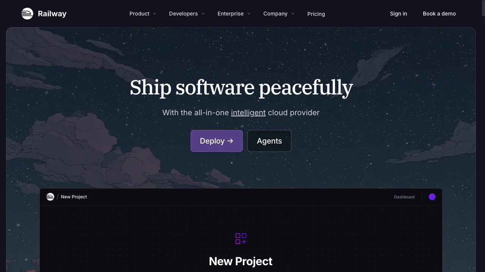
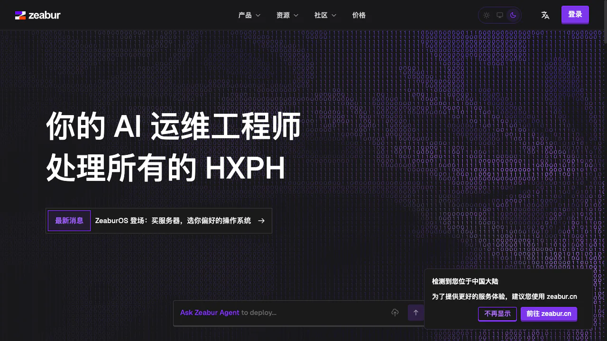
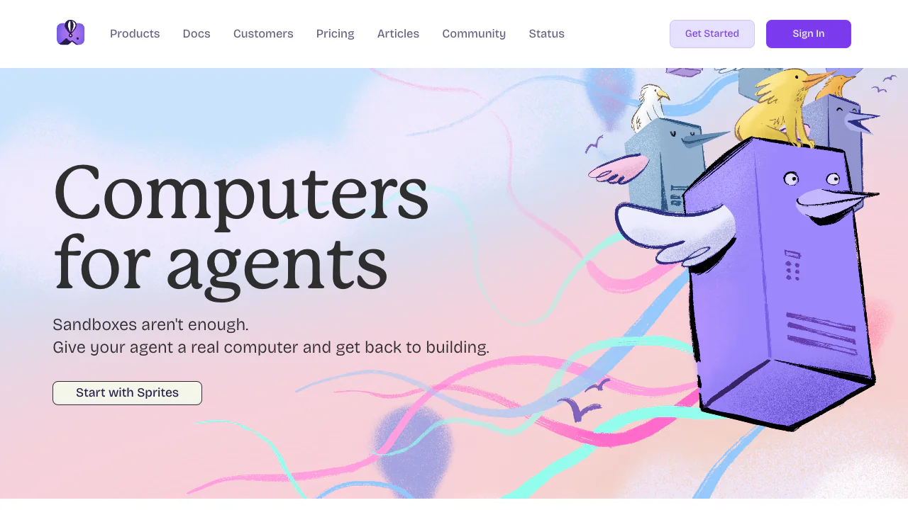
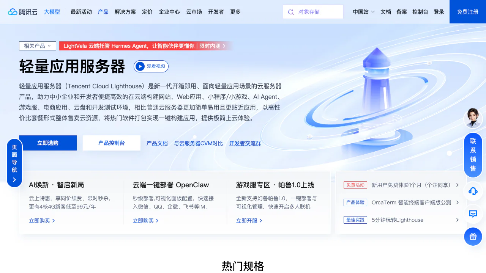
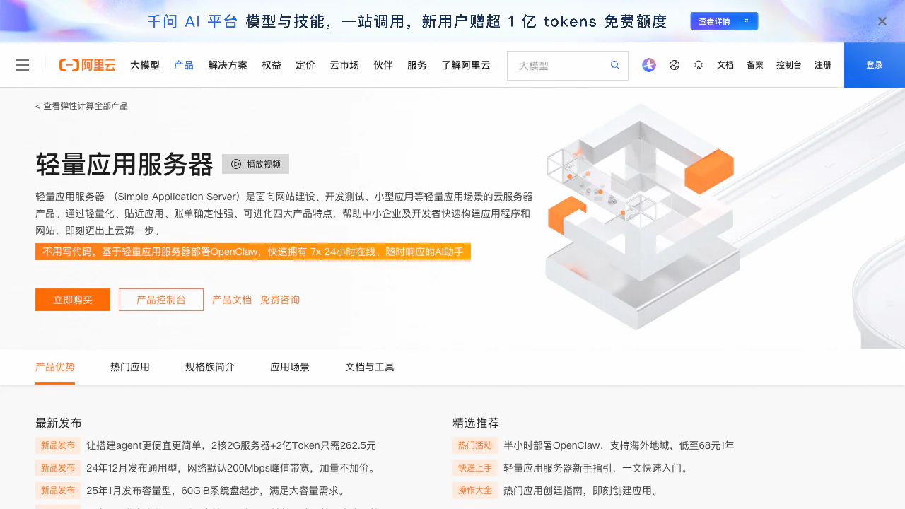

<script setup>
import RelatedArticlesSection from '../../../../.vitepress/theme/components/RelatedArticlesSection.vue'
import { relatedArticlesMap } from '../../../../.vitepress/theme/data/relatedArticles'
</script>

# 把网站发到网上（进阶方式）：自己买台 VPS 服务器搭建发布

> 💡 **什么叫"把网站发到网上"？** 也叫"上线"或"部署发布"。你在本地电脑写好的网站，只有你自己能打开；**"发到网上"就是把它放到一台 24 小时开机的服务器上，让任何一个人在浏览器里输入网址就能访问到**——就像你写了一篇 Word 文档只有自己电脑能看，发到公众号/博客后所有人都能看一样，只不过这次发上去的是一个完整的网站。

上一章我们学了最简单的"一键发布"方式（用 Vercel/Zeabur 这类平台，连仓库即上线），这一章讲更灵活、也更彻底的方式：**自己买一台云服务器，从头到尾把网站搭起来发布出去**。你会学到怎么选服务器、怎么连接上去、怎么装环境、怎么配 Nginx、怎么绑域名开 HTTPS——搞懂之后，没有任何平台能限制你，想跑什么服务就跑什么。

---

# 0. 先选对：部署平台全景决策图

选平台之前，先回答三个问题：

1. **你的项目需要 24 小时在线吗？**
   - 不需要（用户访问时才响应，比如文档站、博客、普通网站）→ 选 **静态托管/PaaS**
   - 需要（定时任务、爬虫、Telegram/Discord Bot、WebSocket 服务）→ 选 **常驻型 PaaS 或 VPS**

2. **你需要 GPU 吗？**
   - 不需要（只调用 OpenAI/Anthropic API）→ 普通平台即可
   - 需要（自己跑开源模型、生成图片/视频）→ 选 **GPU 云平台**（Modal、Replicate、AutoDL 等）

3. **你的用户主要在哪里？**
   - 国内 → 优先国内云（阿里云/腾讯云）或 Cloudflare（国内访问快）
   - 海外 → Vercel/Railway/Fly.io/AWS 随便选
   - 都有 → 用 CDN，国内放国内，海外放海外

根据这三个问题，对应下面的决策路径：

```
你的项目是什么类型？
│
├─ 纯前端静态站（Vite/React/Vue 构建产物）
│   ├─ 完全免费 → Cloudflare Pages（无限带宽）/ GitHub Pages
│   ├─ Next.js 项目 → Vercel（官方平台，体验最好）
│   └─ 国内用户为主 → Cloudflare Pages 或 国内 OSS+CDN
│
├─ 有后端 API，但不需要 24 小时常驻（请求触发）
│   ├─ Node.js/Python API → Vercel Functions / Cloudflare Workers
│   └─ 全栈框架（Next.js/Nuxt/SvelteKit）→ Vercel
│
├─ 需要常驻进程（Bot、定时任务、WebSocket）
│   ├─ 不想管服务器 → Railway / Render / Fly.io
│   ├─ 想完全控制 & 省钱 → 买 VPS（腾讯云轻量/阿里云轻量/Vultr/Hetzner）
│   └─ 国内项目 → 腾讯云轻量应用服务器
│
├─ 需要跑 AI 模型/需要 GPU
│   ├─ 推理 API → Modal / Replicate / Hugging Face Inference
│   ├─ 国内 GPU → AutoDL（便宜）/ 阿里云 PAI
│   └─ 训练/Fine-tune → Modal / Lambda Labs / 国内 GPU 云
│
└─ 大型生产项目
    └─ AWS/GCP/阿里云 + Kubernetes（找运维或让 AI 帮你写 Terraform）
```

---

# 1. 免费/低成本部署平台详解（不用买服务器）

对于大多数个人项目、Demo、作品集，你**完全不需要买服务器**。这一节详细介绍各个免费/低成本平台，告诉你怎么注册、怎么用、有什么坑。

## 1.1 Vercel — Next.js 官方平台，前端首选


**官网**：https://vercel.com

**适合什么：** Next.js 项目、React/Vue 前端、带 Serverless Functions 的全栈应用、AI Chatbot（响应快的）

**怎么用：**
1. 用 GitHub 账号登录 Vercel
2. 点击 "Add New..." → "Project"
3. 选择你的 GitHub 仓库
4. Vercel 自动检测框架（Next.js/Vite/React 等），填好环境变量
5. 点 "Deploy"，等 1-2 分钟就上线了，自动给你一个 `xxx.vercel.app` 域名

**免费额度（Hobby 计划）：**
- 100 GB 带宽/月
- 100 小时构建时间/月
- Serverless Function 执行时长 **10 秒**（这是最关键的限制！）
- 自动 HTTPS、全球 CDN、PR 预览链接

**付费（Pro，$20/月）：**
- Function 执行时长延长到 60-300 秒
- 1 TB 带宽
- 团队协作功能

**⚠️ 关键限制（新手常踩的坑）：**
- **Serverless Function 超时 10 秒**：AI API 调用超过 10 秒就会断（免费版）。Pro 版 $20/月可延长到 60 秒，300 秒需额外付费
- **不能跑常驻进程**：没有 cron、没有 WebSocket 长连接、没有永远在线的 Bot
- **冷启动**：长时间没人访问的 Function 首次请求会慢一点
- **AI 项目成本**：AI 流式输出耗带宽，用户多了之后 Pro 版账单可能飙到 $200/月

**结论**：部署前端页面、文档站、快速 Demo → Vercel 是最丝滑的选择。但需要常驻进程或长时间 AI 调用的 Agent → 不要选 Vercel。

## 1.2 Cloudflare Pages — 无限带宽，国内访问快


**官网**：https://pages.cloudflare.com

**适合什么：** 静态站点、需要大带宽的项目、国内用户为主的网站、Edge Functions

**免费额度：**
- **无限带宽**（这是最大卖点！）
- 500 次构建/月
- Unlimited 请求数
- Cloudflare Workers 100,000 请求/天
- 全球 300+ 边缘节点，国内访问速度比 Vercel/Netlify 快很多

**怎么用：**
1. 注册 Cloudflare 账号（免费）
2. 进入 Workers & Pages → Create → Pages → Connect to Git
3. 选择仓库，设置构建命令（Vite 是 `npm run build`，输出目录 `dist`）
4. 点 Save and Deploy

**配套的 Workers AI：** Cloudflare 还提供在边缘节点直接跑开源 AI 模型的能力（Llama 3、Mistral、Stable Diffusion 等），免费额度每天 10,000 神经元（推理单位）。适合不想依赖 OpenAI API、想在边缘跑小模型的场景。

**结论**：静态站首选，尤其是面向国内用户的项目，Cloudflare Pages 的国内访问速度和无限带宽是杀手锏。

## 1.3 Netlify — 老牌静态托管，插件生态丰富


**官网**：https://www.netlify.com

**免费额度：** 100 GB 带宽/月 + 300 分钟构建时间

**特点：** 插件市场非常丰富（表单处理、图片优化、A/B 测试等），支持分支预览，企业级功能多。适合需要更多内置功能的静态站项目。

**和 Vercel 的区别：** Netlify 更中立，不绑定特定框架；Vercel 对 Next.js 有深度优化。纯静态站选哪个都行。

## 1.4 Railway — 部署后端的最佳体验（常驻服务）



**官网**：https://railway.app

**适合什么：** 需要常驻运行的后端服务、Node.js/Python/Go API、Discord/Telegram Bot、需要数据库的全栈项目

**怎么用：**
1. GitHub 账号登录
2. New Project → Deploy from GitHub repo（或选模板）
3. Railway 自动检测你的项目类型，自动安装依赖、构建、启动
4. 可以一键添加 PostgreSQL/Redis/MySQL/MongoDB 数据库
5. 自动给域名，也可以绑定自定义域名

**定价：**
- 新用户注册送 **$5 试用额度**（不是永久免费）
- 之后按用量计费，大概 $5/月起（一个最小规格的常驻服务 + 数据库）
- 空闲 5 分钟后休眠（免费试用期间）；付费后不睡眠

**⚠️ 关键限制：**
- 没有真正的永久免费层，$5 用完就停
- 按用量计费，成本不可预测（但对小项目来说通常在 $5-15/月）
- 没有原生 GPU 支持

**结论**：部署后端 API、Bot、需要数据库的全栈应用，Railway 的体验是最好的——连 GitHub 自动部署、内置数据库、日志监控全有，不用写 Dockerfile。适合不想折腾服务器但需要比 Vercel 更灵活的场景。

## 1.5 Zeabur — 国内开发者友好的 PaaS



**官网**：https://zeabur.com

**适合什么：** 国内开发者、需要国内访问速度的项目、从 Vercel/Heroku 迁移的项目

**特点：**
- 国产 PaaS 平台，中文界面，国内访问速度好
- 支持 Node.js、Python、Go、Rust、Docker 等几乎所有语言
- 一键部署常见模板（WordPress、Ghost、Uptime Kuma 等）
- 内置 MySQL/PostgreSQL/Redis/MongoDB 数据库
- 免费额度可用，付费方案 ¥30/月起

**怎么用：** 我们已经在 [上一章](./../zeabur-deployment/) 详细讲过 Zeabur 的使用方法，这里不再赘述。

## 1.6 Render — 750 小时免费，但会休眠

**官网**：https://render.com

**适合什么：** 学习阶段、个人项目、不介意冷启动的小项目

**免费额度：**
- Web Service：750 小时/月（一个实例可以一直跑）
- PostgreSQL：免费 90 天（⚠️ 到期数据库被删！）
- 静态站：完全免费，100 GB 带宽

**⚠️ 关键问题：**
- **15 分钟无访问就休眠**，首次唤醒需要 10-30 秒冷启动（用户体验差）
- 免费数据库 90 天后被删除，记得备份！
- 冷启动期间用户看到的就是转圈或超时

**结论**：适合开发测试、课程作业，但不要把面向用户的生产项目放在免费层。付费 $7/月起，可以关闭休眠。

## 1.7 Fly.io — 真正 7×24 在线的免费容器



**官网**：https://fly.io

**适合什么：** 需要全球分布的低延迟服务、想要真正 7×24 小时免费运行的容器、能接受一点学习曲线

**免费额度：**
- 3 台微型共享 VM（micro-1x，256 MB 内存）
- **不限运行时间**（不像 Render 会休眠）
- 160 GB 出站流量/月
- 3 GB 持久化卷
- 全球 30+ 数据中心可选
- 支持 GPU（A100/H100）

**怎么用：**
1. 注册需要绑信用卡（不扣钱，验证身份）
2. 安装 flyctl CLI
3. 在项目目录写 `fly.toml` 配置文件（AI 可以帮你生成）
4. `fly launch` → 自动构建 Docker 镜像、分配 IP、部署
5. `fly deploy` 更新，`fly logs` 看日志

**⚠️ 注意：**
- 需要会写 Dockerfile 或使用 buildpack
- 学习曲线比 Railway 陡
- 超出免费额度按量计费，但小项目基本不会超

**结论**：如果你需要一个**真正 24 小时在线**的免费容器跑 Bot/API/定时任务，Fly.io 是目前最好的免费选择。缺点是需要学一下 flyctl 命令行和 Docker。

## 1.8 其他值得了解的免费/低成本平台

| 平台 | 类型 | 免费额度 | 特点 |
|------|------|---------|------|
| **GitHub Pages** | 静态站 | 无限（100GB 软限制） | 最省心，推 GitHub 就上线，适合博客/文档 |
| **Hugging Face Spaces** | AI 应用 | 免费 CPU 小实例 | 专门部署 AI Demo（Gradio/Streamlit），社区活跃 |
| **Modal** | AI/Serverless GPU | $30/月额度 | Python 函数即服务，GPU 冷启动 < 4 秒，适合 AI 推理 |
| **Replicate** | AI 模型托管 | 按调用付费 | 把模型变成 API，不用管基础设施 |
| **Denoland Deploy** | Deno/Edge | 免费 100k 请求/天 | Deno 官方平台，TypeScript 原生支持 |
| **Koyeb** | 全栈 PaaS | 免费 1 个服务 | 支持 Docker，全球边缘部署 |
| **Railway 模板** | 一键部署 | - | 有上百个开源项目模板，点一下就部署（如 Uptime Kuma、Plausible） |
| **Supabase** | 后端即服务 | 免费 500MB 数据库 | Firebase 的开源替代品，Postgres+Auth+Storage |
| **Neon** | Serverless Postgres | 免费 500MB | 分支数据库，适合 Serverless 架构 |
| **Upstash** | Serverless Redis | 免费 10k 命令/天 | 按请求计费的 Redis，适合 Serverless 项目 |

---

# 2. 国内云服务器详细购买指南

如果你需要完全控制服务器环境、跑自定义服务、或者 PaaS 满足不了需求，那就买一台自己的云服务器。这一节手把手教你怎么在国内三大云厂商买服务器。

## 2.1 选哪家？国内三大云厂商对比

### 腾讯云轻量应用服务器（推荐新手）



**官网**：https://cloud.tencent.com/product/lighthouse

**推荐理由：**
- **最便宜**：新用户 2核2G 4M 带宽只要 99 元/年，秒杀最低 38 元/年
- **操作最简单**：控制台直观，一键应用镜像（WordPress、宝塔面板、Docker 等开箱即用）
- **带宽给得大方**：入门款 4-5 Mbps，锐驰型套餐有 200 Mbps 无限流量
- **微信生态整合好**：部署小程序后端、公众号服务很方便

**怎么买：**
1. 注册腾讯云账号，完成实名认证
2. 打开轻量应用服务器购买页：https://cloud.tencent.com/product/lighthouse
3. 点击「立即选购」
4. 选择配置：
   - **地域**：离你的用户最近的（南方选广州、北方选北京、海外选香港/新加坡）
   - **镜像**：选「系统镜像」→ **Ubuntu 22.04 LTS**（最推荐新手）
   - **套餐**：入门选 2核2G 4M 套餐（~99元/年）；预算够选 2核4G 5M（~198元/年）
   - **时长**：建议直接买 1 年，新用户折扣只有首单
5. 确认订单，付款
6. 购买成功后，进入「控制台」→「轻量应用服务器」就能看到你的服务器了
7. **重置密码**：点进服务器详情 → 重置密码（设一个强密码）
8. **配置防火墙**：在「防火墙」标签页添加规则：
   - TCP:80（HTTP）
   - TCP:443（HTTPS）
   - TCP:22（SSH）
   - 其他端口按需开放（比如 3000 调试用）

**学生优惠：** 完成学生认证后 2核2G 4M 约 10 元/月。访问 https://cloud.tencent.com/act/campus 申请。

### 阿里云轻量应用服务器



**官网**：https://www.aliyun.com/product/swas

**推荐理由：**
- **文档最丰富**：网上教程最多，遇到问题容易搜到答案
- **免费学生机**：学生认证（学信网）后 2核2G 免费 1-3 个月，还有 300 元代金券
- **稳定性好**：ESSD 云盘性能强，企业级稳定性
- **生态最全**：配套的 CDN、OSS、RDS、域名等服务最完善

**怎么买：**
1. 注册阿里云账号，完成实名认证
2. 学生用户先去「飞天加速计划」领免费券：https://university.aliyun.com/
3. 打开轻量应用服务器：https://www.aliyun.com/product/swas
4. 点击「立即购买」
5. 选择配置：
   - **地域**：同腾讯云，选近的。香港/新加坡免备案但带宽小
   - **镜像**：Ubuntu 22.04 LTS
   - **套餐**：入门 2核2G 3M ~99 元/年
6. 付款后到控制台查看服务器
7. **重置密码**：实例详情 → 重置实例密码
8. **配置防火墙**：「安全组」/「防火墙」放行 22、80、443 端口

**学生免费领：** 访问 https://university.aliyun.com/ → 学生认证 → 领 300 元券 → 0 元购机。

### 华为云耀云服务器 HECS

**官网**：https://www.huaweicloud.com/product/hecs.html

**推荐理由：**
- 企业级稳定性，安全防护能力强
- 学生价约 9 元/月（1核2G）
- 不限制 CPU 使用率（部分厂商突发性能实例会限速）
- 可选鲲鹏 ARM 架构（国产化需求时有用）

**不足：** 文档和社区不如阿里云/腾讯云丰富，新手入门资料较少。

## 2.2 海外 VPS 选择（不想备案/面向海外用户）

如果你的用户主要在海外，或者不想做备案（国内服务器必须备案才能用 80/443 端口），选海外 VPS：

| 厂商 | 入门价格 | 特点 | 适合人群 |
|------|---------|------|---------|
| **Vultr** | $2.5/月（IPv6 only）/ $5/月 | 按小时计费，随时销毁，20+ 全球节点 | 新手练手、快速测试 |
| **DigitalOcean** | $4/月 | 文档极佳，社区教程多，Droplet 一键部署 | 想学习的人 |
| **Hetzner** | €3.49/月（CX22） | 性价比之王，欧洲厂商，网络稳定 | 追求性价比的长期项目 |
| **AWS Lightsail** | $3.5/月（首年免费） | 亚马逊旗下，免费 1 年 | 想用 AWS 生态的人 |
| **RackNerd** | ~$10/年（年付） | 超低价，适合非核心项目练手 | 纯练手、预算极低 |
| **雨云** | ¥10/月起 | 国内厂商运营的海外 VPS，支付宝付款方便 | 国内用户图方便 |


**Vultr 购买流程（其他海外厂商类似）：**
1. 访问 https://www.vultr.com/ 注册账号（需要邮箱+信用卡/PayPal）
2. 点击 "Deploy Server"
3. 选择：
   - **Server Type**: Ubuntu 22.04 LTS
   - **Server Size**: $5/月的 Regular Performance（1 vCPU / 1GB 内存，足够入门）
   - **Location**: 选离用户近的（Tokyo/Singapore 对国内速度好一些；美西对国内延迟高但便宜）
4. 不用加额外选项，点 "Deploy Now"
5. 等 1-2 分钟，服务器创建完成，在 Products 页面能看到 IP 和密码
6. 海外 VPS 没有额外的「安全组」，系统装好防火墙默认关闭，连上后自己配 `ufw`

**⚠️ 注意：** 海外 VPS 不备案，但从国内访问延迟较高（香港 ~50ms，新加坡 ~100ms，美西 ~200ms）。对延迟敏感的项目建议用国内服务器+备案。

## 2.3 备案问题（国内服务器必须了解）

**什么是备案？** 中国大陆的服务器要绑定域名对外提供 Web 服务（80/443 端口），必须在工信部做 ICP 备案，免费但需要 7-20 天审核。

**备案规则：**
- 用国内节点（阿里云/腾讯云/华为云国内地域）→ **必须备案**才能通过域名访问 80/443
- 用中国香港/海外节点 → **不需要备案**，域名直接解析就能用
- 备案免费，在云厂商控制台提交资料（身份证、人脸核验、域名信息）
- 备案期间域名不能访问，可以先买服务器配环境
- 个人备案和企业备案流程类似，个人备案不能做经营性网站

**建议：**
- 面向国内用户 → 买国内服务器 + 花 2-3 周备案（备案期间可以开发）
- 想快速上线/面向海外 → 香港节点或海外 VPS，跳过备案
- 不想备案但想要国内速度 → Cloudflare Pages（CDN 国内有节点）

---

# 3. 连接服务器 & 基础环境配置

## 3.1 第一次 SSH 连接服务器

买好服务器后，你会拿到：
- **公网 IP 地址**（比如 `123.45.67.89`）
- **登录用户名**（Ubuntu 镜像默认是 `root` 或 `ubuntu`）
- **登录密码**（你在购买时设置的，或者在控制台重置的）

**如果你用 macOS / Linux：** 直接打开终端，输入：

```bash
ssh root@你的服务器IP
# 例如：ssh root@123.45.67.89
```

**如果你用 Windows：** 推荐用 Windows Terminal + 内置 OpenSSH（Win10/11 自带），或使用 FinalShell（中文、图形化）、Xshell 等工具。

第一次连接会提示：

```
The authenticity of host '123.45.67.89 (123.45.67.89)' can't be established.
ED25519 key fingerprint is SHA256:xxxxxx.
Are you sure you want to continue connecting (yes/no/[fingerprint])?
```

输入 `yes` 回车，然后输入密码。看到类似这样的提示符，就说明登录成功了：

```
Welcome to Ubuntu 22.04.3 LTS!
root@your-server:~#
```

**配置 SSH 密钥登录（推荐，免密码+更安全）：**

```bash
# 在你本地电脑执行（不是服务器上）
# 生成密钥（如果已经有就跳过）
ssh-keygen -t ed25519

# 把公钥传到服务器
ssh-copy-id root@你的服务器IP

# 之后就可以免密码登录了
ssh root@你的服务器IP
```

> 🎯 **AI 辅助提示**：如果你连不上服务器，直接把报错信息复制给 AI：「我 ssh root@xxx 连接不上，报错是 xxx，帮我排查」。AI 会从网络、安全组、防火墙、密钥权限等角度一步步帮你找原因。

## 3.2 配置安全组/防火墙（非常重要！）

**云厂商安全组（控制台操作）：** 购买服务器后，一定要在云厂商控制台的「安全组」/「防火墙」里放行端口：

| 端口 | 用途 | 建议 |
|------|------|------|
| **22** | SSH 登录 | 必开，建议限制为自己的 IP |
| **80** | HTTP 访问 | 必开 |
| **443** | HTTPS 访问 | 必开 |
| **3000-3999** | Node.js 开发端口 | 调试时临时开，部署完关闭 |
| **8080** | 常见备用端口 | 按需 |

**服务器内部防火墙（登录后执行）：**

```bash
# 安装 ufw
apt install -y ufw

# 允许 SSH、HTTP、HTTPS
ufw allow ssh
ufw allow http
ufw allow https

# 启用防火墙
ufw enable

# 查看状态
ufw status
```

> ⚠️ 安全组是云厂商层面的防火墙，ufw 是服务器内部的防火墙。**两层都需要放行才能访问。新手最常见的坑就是程序跑起来了但访问不到，90% 是安全组没开端口。**

## 3.3 初始化服务器环境

登录服务器后，你可以**直接把下面这段话复制给你的 AI 编程助手**，让它帮你生成完整初始化命令：

> 「我刚买了一台 Ubuntu 22.04 的云服务器，打算部署一个 [Node.js/Python/...] 项目，帮我写出完整的初始化命令，包括：更新系统、创建非 root 用户、配置 SSH 密钥登录、安装 Docker/Nginx/Node.js、配置基础防火墙。」

下面是一个典型的初始化流程，供你参考理解：

```bash
# 1. 更新系统 & 安装基础工具
apt update && apt upgrade -y
apt install -y curl wget git vim ufw build-essential

# 2. 创建普通用户（不要一直用 root）
adduser yourname
usermod -aG sudo yourname

# 3. 安装 Node.js（用 nvm，不要用 apt）
curl -o- https://raw.githubusercontent.com/nvm-sh/nvm/v0.40.1/install.sh | bash
source ~/.bashrc
nvm install 20
node -v  # 验证

# 4. 安装 Nginx
apt install -y nginx
systemctl start nginx
systemctl enable nginx
# 浏览器访问 http://你的IP，应该看到 Nginx 欢迎页

# 5. 安装 Docker（如果用容器部署）
curl -fsSL https://get.docker.com | sh
usermod -aG docker yourname  # 免 sudo
docker --version
```

---

# 4. 三种典型部署场景实操

环境配好之后，我们来看三种常见的部署方式。

## 4.1 场景一：部署纯前端静态站（Vite/React/Vue）

`npm run build` 后会生成 `dist/` 目录，里面是纯 HTML/CSS/JS 文件。

**把代码传到服务器：**

```bash
# 方式一：在本地用 rsync 传到服务器
rsync -avz --exclude=node_modules ./dist/ yourname@你的IP:/var/www/myapp/

# 方式二：在服务器上 git clone（推荐，更新方便）
cd /var/www
sudo git clone https://github.com/你的用户名/你的仓库.git myapp
cd myapp
npm install
npm run build
```

**配置 Nginx：**

```bash
sudo vim /etc/nginx/sites-available/myapp
```

写入：

```nginx
server {
    listen 80;
    server_name 你的IP或域名;

    root /var/www/myapp/dist;
    index index.html;

    location / {
        try_files $uri $uri/ /index.html;  # 前端路由 history 模式
    }

    location ~* \.(js|css|png|jpg|jpeg|gif|ico|svg|woff2?)$ {
        expires 1y;
        add_header Cache-Control "public, immutable";
    }
}
```

启用：

```bash
sudo ln -s /etc/nginx/sites-available/myapp /etc/nginx/sites-enabled/
sudo nginx -t && sudo systemctl reload nginx
```

## 4.2 场景二：部署 Node.js 后端服务

后端需要持续运行，关键是让它在后台不停止。

**用 PM2（最推荐新手）：**

```bash
npm install -g pm2
cd /path/to/your/app
npm install
npm run build  # TypeScript 项目需要
pm2 start dist/main.js --name "myapp"
pm2 startup && pm2 save  # 开机自启
pm2 logs myapp  # 看日志
```

**用 Nginx 反向代理：**

```nginx
server {
    listen 80;
    server_name api.yourdomain.com;

    location / {
        proxy_pass http://127.0.0.1:3000;
        proxy_http_version 1.1;
        proxy_set_header Upgrade $http_upgrade;
        proxy_set_header Connection 'upgrade';
        proxy_set_header Host $host;
        proxy_set_header X-Real-IP $remote_addr;
        proxy_set_header X-Forwarded-For $proxy_add_x_forwarded_for;
        proxy_set_header X-Forwarded-Proto $scheme;
    }
}
```

## 4.3 场景三：Docker Compose 一键部署全栈

不想在服务器上装各种环境？用 Docker：

```dockerfile
# Dockerfile
FROM node:20-alpine
WORKDIR /app
COPY package*.json ./
RUN npm ci
COPY . .
RUN npm run build
EXPOSE 3000
CMD ["node", "dist/main.js"]
```

```yaml
# docker-compose.yml
version: '3.8'
services:
  app:
    build: .
    ports:
      - "3000:3000"
    environment:
      - DATABASE_URL=postgresql://postgres:pass@db:5432/myapp
    depends_on: [db, redis]
    restart: always

  db:
    image: postgres:16-alpine
    environment:
      POSTGRES_PASSWORD: pass
      POSTGRES_DB: myapp
    volumes:
      - postgres_data:/var/lib/postgresql/data
    restart: always

  redis:
    image: redis:7-alpine
    restart: always

  nginx:
    image: nginx:alpine
    ports:
      - "80:80"
      - "443:443"
    volumes:
      - ./nginx.conf:/etc/nginx/conf.d/default.conf
      - ./frontend/dist:/usr/share/nginx/html
    depends_on: [app]
    restart: always

volumes:
  postgres_data:
```

启动：`docker compose up -d`。查看日志：`docker compose logs -f`。

---

# 5. 域名 & HTTPS

## 5.1 买域名 & 解析

在阿里云万网、腾讯云、Namecheap、Cloudflare、GoDaddy 等平台买域名（.com 约 55-75 元/年，.cn 约 29 元/年）。

在域名控制台添加 **A 记录**：

| 记录类型 | 主机记录 | 记录值 |
|---------|---------|--------|
| A | @ | 你的服务器 IP |
| A | www | 你的服务器 IP |
| A | api | 你的服务器 IP（后端 API） |

## 5.2 一键 HTTPS（Let's Encrypt 免费证书）

```bash
sudo apt install -y certbot python3-certbot-nginx
sudo certbot --nginx -d yourdomain.com -d www.yourdomain.com -d api.yourdomain.com
# 选 2（Redirect）自动把 HTTP 跳转到 HTTPS
sudo certbot renew --dry-run  # 测试自动续期
```

---

# 6. 云厂商常见服务功能全解析（不只是服务器！）

买了云服务器之后，你会发现云厂商控制台里有上百种产品，名字听起来都很专业（ECS、OSS、CDN、RDS、SLB…），新手往往不知道是干嘛的、什么时候该用。这一节我们把最常见的服务逐个讲清楚，**国内以阿里云/腾讯云为例，海外以 AWS 为例**，帮你建立云服务的「地图感」。

## 6.1 一张表搞懂：云服务全家福

先看全景。一个完整的 Web 应用在云上通常长这样：

```
用户 ──→ CDN（静态资源加速）──→ 负载均衡 SLB/ALB ──→ 云服务器 ECS/EC2（你的应用）
                │                        │                │
                │                        │                ├── 对象存储 OSS/S3（图片/文件）
                │                        │                ├── 云数据库 RDS/RDS（MySQL/Postgres）
                │                        │                └── 缓存 Redis/ElastiCache
                │                        │
                │                        └── 容器服务 ACK/EKS（Kubernetes，进阶）
                │
                └── 域名解析 DNS/DNS（把域名指向你的服务）
                     + SSL 证书（HTTPS 加密）
```

下面逐个解释每个服务是什么、什么时候用、怎么操作。

## 6.2 计算类：跑你代码的地方

### 云服务器 ECS / CVM / EC2

这就是我们前面一直在说的「VPS」「云服务器」。

| 厂商 | 产品名 | 说明 |
|------|--------|------|
| 阿里云 | ECS（弹性计算服务） | 最通用的云服务器，可以自由选配置、装系统 |
| 腾讯云 | CVM（云服务器）/ Lighthouse（轻量应用服务器） | CVM 更灵活，Lighthouse 更简单适合新手 |
| 华为云 | ECS / HECS（云耀） | HECS 类似轻量服务器 |
| AWS | EC2（Elastic Compute Cloud） | AWS 的虚拟服务器，类型极多（通用/计算优化/内存优化/GPU） |

**什么时候用：** 需要自己掌控运行环境、跑自定义服务、24小时在线的进程。

**怎么操作（以腾讯云轻量为例）：**
1. 进入「轻量应用服务器」控制台
2. 点「新建」选镜像（推荐 Ubuntu 22.04）、套餐、地域
3. 购买后在实例列表里看到公网 IP
4. 点「重置密码」设置 root 密码
5. 点「防火墙」添加端口规则（22/80/443）
6. SSH 连接上去开始部署

### Serverless 函数计算 / Lambda

不用买服务器，上传代码，按调用次数和运行时间付费。请求来了才运行，没请求不花钱。

| 厂商 | 产品名 |
|------|--------|
| 阿里云 | 函数计算 FC |
| 腾讯云 | 云函数 SCF |
| AWS | Lambda |

**什么时候用：** 偶尔被触发的任务（比如 Webhook 处理、图片压缩、定时任务）、流量波动大的 API。不适合需要常驻的服务（比如 WebSocket Bot）。

### 容器服务 / EKS / ACK

如果你的项目用了 Docker，且规模变大需要管理多个容器，用 Kubernetes（K8s）编排。

| 厂商 | 产品名 |
|------|--------|
| 阿里云 | ACK（容器服务 Kubernetes 版） |
| 腾讯云 | TKE |
| AWS | EKS（Elastic Kubernetes Service）|

**什么时候用：** 多服务微服务架构、需要自动扩缩容、团队有运维能力。个人/小项目用不上，一台 VPS + Docker Compose 就够了。

## 6.3 存储类：放文件和数据的地方

### 对象存储 OSS / COS / S3 ⭐ 最常用

**这是除了服务器之外最常用的服务**，用来存放图片、视频、PDF、前端打包后的静态文件等「大文件」。**不要把用户上传的文件存在服务器本地磁盘上！** 服务器重装/迁移/扩容时很容易丢。

| 厂商 | 产品名 | 免费额度 | 费用 |
|------|--------|---------|------|
| 阿里云 | OSS（对象存储服务）| 新用户 5GB 标准存储 6 个月 | 标准存储约 ¥0.12/GB/月 |
| 腾讯云 | COS（对象存储） | 新用户 50GB 6 个月 | 标准存储约 ¥0.118/GB/月 |
| AWS | S3（Simple Storage Service）| 5GB（Free Tier，12个月）| 标准存储约 $0.023/GB/月 |

**它能做什么：**
- 存放用户上传的图片/头像/附件（博客配图、商品图片、用户头像）
- 托管前端静态网站（把 `dist/` 目录直接传上去，开启「静态网站托管」功能就能访问）
- 备份数据库导出文件
- 和 CDN 配合，让全世界用户快速下载你的文件
- 生成临时链接分享私有文件

**怎么操作（以阿里云 OSS 为例）：**
1. 进入 OSS 控制台，点「创建 Bucket」
2. 填写 Bucket 名称（全局唯一，比如 `myapp-images`）
3. 地域选离你服务器近的
4. 存储类型选「标准存储」
5. 读写权限：**初期建议「公共读」**（图片可以直接访问），敏感文件用「私有」
6. 创建完成后，进入 Bucket →「文件管理」→「上传文件」
7. 上传后每个文件都有一个 URL，比如 `https://myapp-images.oss-cn-hangzhou.aliyuncs.com/avatar.jpg`
8. 前端代码里直接用这个 URL 显示图片

**配合 CDN 加速：** 给 OSS Bucket 绑定自定义域名 + CDN，用户访问图片时从最近的 CDN 节点获取，速度快且省 OSS 流量费。

**用代码操作（Node.js 示例，让 AI 帮你写具体逻辑）：**

```javascript
// 安装 SDK: npm install ali-oss
const OSS = require('ali-oss');
const client = new OSS({
  region: 'oss-cn-hangzhou',
  accessKeyId: '你的AccessKey',
  accessKeySecret: '你的AccessKeySecret',
  bucket: 'myapp-images'
});

// 上传文件
async function uploadFile(localPath, ossPath) {
  const result = await client.put(ossPath, localPath);
  return result.url; // 返回文件的公网 URL
}
```

> ⚠️ **重要安全提醒：** AccessKey 相当于你的 OSS 密码，**绝对不要硬编码在前端代码或提交到 Git**！放在服务端环境变量里。如果不小心泄露了，立即到 RAM 控制台禁用旧 Key 并生成新的。

**AWS S3 操作（同样流程）：**
1. AWS 控制台搜索 S3 → Create bucket
2. 填名字、选区域（如 us-east-1）、取消勾选 "Block all public access"（如果需要公开访问）
3. 上传文件后可以通过 `https://bucket-name.s3.region.amazonaws.com/file.jpg` 访问
4. SDK 用 `aws-sdk` 或 `@aws-sdk/client-s3`

### 云硬盘 / 云盘 / EBS

挂载在云服务器上的块存储（类似电脑的硬盘）。服务器自带的系统盘通常 40-60GB，不够用时你可以额外买「数据盘」挂载上去。

- 阿里云：云盘（高效云盘/ESSD/SSD）
- 腾讯云：云硬盘 CBS
- AWS：EBS（Elastic Block Store）

**什么时候用：** 服务器磁盘不够、需要额外存储空间、需要独立于服务器生命周期保留数据（服务器删了数据盘还在）。

### 文件存储 / NAS / EFS

多台服务器可以同时挂载的共享文件存储。适合多台 Web 服务器共享同一份上传文件。

- 阿里云：NAS（网络附加存储）
- 腾讯云：CFS
- AWS：EFS（Elastic File System）

个人小项目一般用不上，单台服务器 + OSS 足够。

## 6.4 数据库类：存结构化数据

### 云数据库 RDS / Cloud Database ⭐ 常用

**不要把数据库装在同一台 VPS 上跑生产环境！** 虽然技术上可以（我们前面的教程就是在 VPS 上装 PostgreSQL），但生产环境用云数据库更省心：自动备份、高可用、监控告警、一键扩容。

| 厂商 | 产品名 | 支持的数据库 | 免费/入门 |
|------|--------|------------|----------|
| 阿里云 | RDS | MySQL、PostgreSQL、SQL Server、MariaDB | 新用户免费试用 1-3 个月 |
| 腾讯云 | TDSQL-C（原CynosDB）/ 云数据库 MySQL | MySQL、PostgreSQL、MariaDB | 新用户 1核1G 约 ¥30/月 |
| AWS | RDS（Relational Database Service） | MySQL、PostgreSQL、MariaDB、SQL Server、Oracle、Aurora | Free Tier 12 个月（t2.micro/t3.micro） |

**什么时候用：** 生产环境的数据库（特别是有用户数据、不能丢数据的场景）。

**怎么操作（以阿里云 RDS 为例）：**
1. RDS 控制台 → 创建实例
2. 选数据库引擎（MySQL 8.0 最常用）、规格（入门选 1核2G）、存储空间
3. 创建后设置「白名单」把你的服务器 IP 加进去（重要！否则连不上）
4. 创建数据库账号和密码
5. 在「数据库管理」里创建数据库名
6. 拿到连接地址（类似 `rm-xxxxx.mysql.rds.aliyuncs.com:3306`）
7. 修改你项目的 `.env` 里的 `DATABASE_URL` 指向这个地址

> 💡 **vibecoding 提示：** 告诉 AI「我有一个阿里云 RDS MySQL 实例，连接地址是 xxx，账号是 xxx，帮我写 Node.js/Python 连接代码和数据库初始化迁移脚本」。

### 缓存 Redis / ElastiCache

内存数据库，用来缓存热点数据（减少数据库查询）、存 Session/Token、做消息队列、排行榜等。

- 阿里云：云数据库 Redis 版
- 腾讯云：云数据库 Redis
- AWS：ElastiCache for Redis

入门可以直接在 VPS 上 `apt install redis-server`，生产环境/高可用场景用云 Redis。

## 6.5 网络类：让用户访问更快更安全

### CDN（内容分发网络）⭐ 常用

把你的静态资源（图片、CSS、JS、视频）缓存到全球/全国的边缘节点，用户访问时从最近的节点拿，速度飞快。

- 阿里云：CDN / DCDN（全站加速）
- 腾讯云：CDN / EdgeOne（边缘安全加速）
- AWS：CloudFront

**什么时候用：**
- 网站有图片/视频等大文件
- 用户分布在全国各地/全球各地
- 想减少服务器带宽压力（CDN 帮你扛流量）
- 前面提到的 Cloudflare Pages 本质上就是 CDN + 静态托管

**怎么配置（以腾讯云 CDN 为例）：**
1. CDN 控制台 → 添加域名 → 填入你的域名（比如 `static.yourdomain.com`）
2. 源站类型选「COS源」或「自有源」（填你的服务器 IP）
3. 等待配置下发（约 5-10 分钟）
4. 去域名解析控制台，给 `static.yourdomain.com` 添加 CNAME 记录，指向 CDN 分配给你的 CNAME 地址
5. 配置完成，访问 `static.yourdomain.com/images/xxx.jpg` 就是 CDN 加速了

### 负载均衡 SLB / CLB / ALB / ELB

当你有多台后端服务器时，负载均衡器把流量均匀分发到各台服务器上，还能自动踢掉挂掉的服务器。

- 阿里云：SLB（服务器负载均衡）/ ALB（应用型）
- 腾讯云：CLB（负载均衡）
- AWS：ELB（Elastic Load Balancing：ALB/NLB/Gateway LB）

个人项目只有一台服务器时用不上，用户多了、需要多台服务器时再考虑。

### DNS 域名解析 / Cloud DNS

把域名翻译成 IP 地址的服务。买域名的地方通常自带免费 DNS 解析，但也可以换成更专业的。

- 阿里云：云解析 DNS（万网域名自带）
- 腾讯云：DNSPod（腾讯云旗下）
- AWS：Route 53
- 第三方推荐：Cloudflare DNS（免费、全球最快之一）

**怎么操作：** 在域名控制台添加解析记录：

| 记录类型 | 作用 | 示例 |
|---------|------|------|
| **A 记录** | 域名 → IPv4 地址 | `@ → 123.45.67.89` |
| **AAAA 记录** | 域名 → IPv6 地址 | `@ → 2400:xxxx::` |
| **CNAME 记录** | 域名 → 另一个域名（常用于 CDN） | `static → static.cdn.com` |
| **MX 记录** | 邮件服务器（用企业邮箱需要配） | - |
| **TXT 记录** | 任意文本（验证域名所有权、配置 SPF/DKIM 等） | - |

### SSL 证书服务

HTTPS 需要的 SSL 证书。

- 阿里云/腾讯云：免费 SSL 证书（Let's Encrypt 或云厂商免费证书，有效期 3-12 个月）
- AWS：ACM（AWS Certificate Manager，免费）
- 通用免费方案：Certbot + Let's Encrypt（我们前面第 5 章的方法，90 天自动续期）

我们前面用的 `certbot --nginx` 就是最通用的免费方案，不用专门去云厂商买证书。

### VPC（私有网络）/ VPC

在云上划一个隔离的虚拟局域网，你的服务器、数据库都在里面，更安全。新用户创建云产品时一般会默认创建一个 VPC，不用你操心。进阶用法（比如公有子网/私有子网分离、NAT 网关）需要专门学习。

## 6.6 其他常用服务

### 域名注册 / Domain

买域名的地方。
- 国内：阿里云万网、腾讯云（DNSPod）、华为云
- 海外：Namecheap、Cloudflare Registrar、GoDaddy、Google Domains（已迁移到 Squarespace）
- 建议：国内用户用国内注册商（方便备案），海外项目用 Namecheap 或 Cloudflare（便宜、免费隐私保护）

### 邮件服务 / SES

不要在服务器上自己搭邮件服务器（大概率被当成垃圾邮件）。用专业的邮件发送服务：
- 国内：阿里云邮件推送、腾讯云 SES
- 海外：AWS SES、SendGrid、Mailgun、Resend
- 用途：注册验证邮件、通知邮件、营销邮件

### 短信服务 / SMS

发送验证码短信、通知短信：
- 国内：阿里云短信服务、腾讯云短信
- 海外：AWS SNS、Twilio
- 国内发短信需要企业资质/签名备案，个人开发者比较难申请到。个人项目可以用邮件/邮箱验证码代替短信。

### 监控/日志 / CloudWatch

监控服务器的 CPU/内存/磁盘使用率，查看应用日志，设置告警（CPU 太高、服务挂了就通知你）：
- 阿里云：云监控、SLS（日志服务）
- 腾讯云：云监控、CLS（日志服务）
- AWS：CloudWatch

入门阶段：可以用 PM2 自带的监控 + Uptime Kuma（开源监控工具，一个 Docker 就能跑）。

### 对象存储的进阶用法：图片处理/视频转码

云厂商的 OSS/S3 通常还附带媒体处理能力：
- 阿里云 OSS：图片处理（缩略图/水印/格式转换）、视频转码（需配合 MPS）
- 腾讯云 COS：数据万象 CI（图片处理/内容审核/人脸识别）
- AWS S3：配合 Lambda 自动生成缩略图

**示例**：你上传了一张 5MB 的原图 `photo.jpg`，访问时在 URL 后面加参数 `?x-oss-process=image/resize,w_300` 就能直接拿到 300px 宽的缩略图，不用你自己处理。

## 6.7 国内 vs 海外：两套生态对照速查

做项目时经常需要在国内云和海外云之间对照，这个表帮你快速找到对应服务：

| 功能类别 | 阿里云 | 腾讯云 | AWS | 免费/低价替代 |
|---------|--------|--------|-----|-------------|
| 云服务器 | ECS | CVM / Lighthouse | EC2 | Vultr / DigitalOcean / Hetzner |
| 对象存储 | OSS | COS | S3 | Cloudflare R2（免出站流量费）|
| 关系数据库 | RDS | 云数据库 | RDS | Supabase / Neon / PlanetScale |
| 缓存 Redis | 云 Redis | 云 Redis | ElastiCache | Upstash（Serverless Redis）|
| CDN | CDN | CDN / EdgeOne | CloudFront | Cloudflare CDN（免费）|
| 负载均衡 | SLB/ALB | CLB | ELB | Nginx 自建 / Caddy |
| Serverless | 函数计算 FC | 云函数 SCF | Lambda | Cloudflare Workers |
| 容器/K8s | ACK | TKE | EKS | Fly.io / Railway |
| DNS 解析 | 云解析 | DNSPod | Route 53 | Cloudflare DNS（免费）|
| SSL 证书 | 免费证书 | 免费证书 | ACM（免费）| Let's Encrypt（免费）|
| 邮件推送 | 邮件推送 | SES | SES | Resend / SendGrid 免费额度 |
| 短信服务 | 短信服务 | 短信 | SNS | Twilio |
| 监控 | 云监控 | 云监控 | CloudWatch | Uptime Kuma（自建开源）|
| AI 模型/API | 通义千问、百炼 | 混元、TI平台 | Bedrock | OpenAI API / Anthropic API |
| 域名注册 | 万网 | DNSPod | Route 53 | Namecheap / Cloudflare |

## 6.8 新手常见疑问

**Q：我应该把所有服务都用云厂商的，还是都在 VPS 上自己搭？**

**个人项目/学习阶段：** VPS 自己搭就行（Docker Compose 一把梭），省钱且能学到东西。
**面向用户的生产项目：** 数据库和对象存储建议用云服务（自动备份、稳定），应用层还是可以跑在 VPS 上。
**预算充足/团队项目：** 尽量用云托管服务（RDS/Redis/OSS），把精力放在写业务代码上而不是运维上。

**Q：AWS 免费套餐怎么用？**

AWS 给新用户 12 个月的 Free Tier，包含：
- EC2：t2.micro/t3.micro 每月 750 小时（相当于一台一直跑）
- S3：5GB 标准存储
- RDS：750 小时 db.t2.micro/t3.micro + 20GB 存储
- Lambda：每月 100 万次请求免费
- CloudFront：50GB 出站流量 + 200万次请求/月

但注意：**AWS Free Tier 到期后自动按标准费率计费**，不用了记得销毁资源，不然月底账单会很惊喜。建议设置账单告警（Billing Dashboard → Budgets）。

**Q：国内云和海外云怎么选？**

- 用户在国内 → 用国内云（阿里云/腾讯云）+ 备案，访问速度快且合规
- 用户在海外 → 用 AWS/Vultr/Fly.io/Cloudflare 等海外服务
- 两边都有用户 → 前端用 Cloudflare CDN，国内放阿里云/腾讯云海外节点（香港/新加坡），海外用 AWS，通过 GeoDNS 分流
- 不想备案但要国内能访问 → Cloudflare Pages（静态站）或香港节点 VPS，但速度不如国内备案服务器

---

# 7. AI Agent 专用部署平台

如果你部署的是 AI Agent（不只是普通 Web 应用），有些平台专门为 AI 工作负载设计：

## 7.1 Modal — Python AI/ML 的 Serverless GPU

**官网**：https://modal.com

**适合：** 需要 GPU 推理、定时任务、批量数据处理的 Python AI 项目

**特点：**
- 用 Python 装饰器定义函数，`modal deploy` 一键部署
- GPU 容器冷启动约 1 秒，按毫秒计费
- 内置定时任务、密钥管理、共享存储
- 免费计划每月 $30 额度（个人项目基本够用）
- 缺点：只支持 Python

```python
# 示例：一个简单的 Modal 部署
import modal

app = modal.App("my-ai-agent")

@app.function(gpu="A10G", timeout=300)
def run_agent(prompt: str):
    # 在这里跑你的 AI 模型/Agent
    return result
```

## 7.2 Hugging Face Spaces — AI Demo 首选

**官网**：https://huggingface.co/spaces

**适合：** 快速展示 AI Demo（Gradio/Streamlit 界面）、开源模型展示

**特点：**
- 免费 CPU 小实例，GPU 需付费
- 支持 Gradio、Streamlit、Docker 三种方式
- 社区活跃，每个 Space 都有公开的代码和讨论区
- 点一下就能 Fork 别人的 Space 改自己的

## 7.3 Replicate — 把模型变成 API

**官网**：https://replicate.com

**适合：** 想把 AI 模型变成 API 但不想管服务器

**特点：** 把你的模型推上去，它自动打包成可调用的 HTTP API，按调用量计费。适合发布自己微调的模型。

## 7.4 国内 GPU 云：AutoDL

**官网**：https://www.autodl.com

**适合：** 国内用户跑 AI 模型训练/推理，需要 GPU 且预算有限

**特点：**
- 价格极低（RTX 3090 约 1 元/小时，A100 约 5-8 元/小时）
- 有免费 CPU 实例
- 支持 JupyterLab、SSH、VS Code Remote
- 镜像市场预装了各种 AI 框架（PyTorch、TensorFlow、Stable Diffusion 等）
- 关机后只收存储费，很适合学生和研究者

---

# 8. 🎯 Vibecoding 部署实战：让 AI 当你的运维助手

这才是 vibecoding 时代最重要的部署心法：**你不需要记住所有命令，AI 就是你的运维助手。**

## 8.1 两种 AI 协作部署方式

**方式一：本地生成脚本，手动执行**

告诉你的 AI 编程助手（Claude Code、Trae Solo、Cursor）：

> 「我要把 [项目描述] 部署到 [平台名/服务器]，帮我生成：
> 1. 完整的部署步骤清单
> 2. 所有需要的配置文件（Nginx、PM2、Dockerfile、docker-compose）
> 3. 部署脚本 deploy.sh
> 4. 环境变量检查清单」

AI 生成好所有文件后，你只需要复制执行即可。

**方式二：AI 直接 SSH 到服务器操作（更省事）**

Claude Code 支持 SSH 远程操作：

```bash
claude
# 告诉它：
# 「通过 SSH 连接到 root@我的IP，帮我部署 /root/myapp，配置 Nginx + HTTPS + PM2」
```

AI 会自动检查环境、安装缺失依赖、拉代码、构建、配置、验证，全程不用你手动敲命令。

> ⚠️ **安全提醒**：
> - 先在测试服务器练手，确认 AI 不会误操作
> - 重要数据定期备份
> - 给 AI 的用户权限最小化（不要给 root，可以给有 sudo 的普通用户）
> - AI 执行危险命令前先看一眼它要做什么

## 8.2 万能部署 Prompt 模板

不管你选哪个平台/服务器，填好这个模板给 AI，它都能给你一份可执行的方案：

```
帮我部署一个项目，信息如下：

【部署目标】
- 平台/服务器：[Vercel / Railway / Fly.io / Ubuntu 22.04 VPS / ...]
- 服务器 IP（如果是 VPS）：xxx.xxx.xxx.xxx
- 已配置：[SSH密钥登录 / Docker已装 / Nginx已装 / ...]

【项目信息】
- 项目类型：[Next.js 14 / Vite+React / Node.js Express / Python FastAPI / ...]
- 代码位置：GitHub 仓库 https://github.com/xxx/xxx
- 技术栈：Node.js 20 + PostgreSQL 16 + Redis 7
- 启动命令：npm run start
- 监听端口：3000
- 环境变量：DATABASE_URL=xxx, JWT_SECRET=xxx, OPENAI_API_KEY=xxx

【域名】
- 域名：mydomain.com
- 已解析到服务器 IP：是/否
- 需要 HTTPS：是/否

【要求】
1. 给出完整步骤（本地操作 vs 服务器操作分开列出）
2. 提供所有配置文件
3. 告诉我如何验证部署成功
4. 列出常见坑和排查方法
```

## 8.3 AI 辅助排错流程

出问题不要慌：

1. **先看日志**：
   - Nginx：`sudo tail -50 /var/log/nginx/error.log`
   - PM2：`pm2 logs myapp`
   - Docker：`docker compose logs app`
   - systemd：`sudo journalctl -u myapp -n 50`

2. **把报错完整复制给 AI**，加上上下文：
   > 「部署 Node.js 到 Ubuntu，访问显示 502，Nginx 错误日志是 [粘贴]，配置是 [粘贴]，PM2 状态是 [粘贴]，帮我排查」

3. **常见问题速查：**
   - **502 Bad Gateway**：后端没启动、端口不对、proxy_pass 地址错误
   - **无法访问 IP**：安全组没开端口、ufw 没放行、Nginx 没启动
   - **刷新 404**：Nginx 没配 `try_files`
   - **静态资源 404**：root 路径错、文件权限不对
   - **HTTPS 证书失败**：域名没解析、80 端口被占、防火墙没开 80
   - **PM2 频繁重启**：代码有 bug，`pm2 logs` 看错误
   - **Vercel Function 超时**：超过 10 秒限制，改长时间运行的选 Fly.io/Railway/VPS
   - **Railway/Render 服务 503**：休眠了或额度用完了

---

# 9. 部署后实用技巧

## 9.1 文件传输

```bash
# 本地 → 服务器
scp ./file.zip yourname@IP:/home/yourname/
scp -r ./dir yourname@IP:/home/yourname/

# 服务器 → 本地
scp yourname@IP:/home/yourname/file.zip ./

# rsync（增量同步，推荐部署用）
rsync -avz --exclude=node_modules --exclude=.git ./project/ yourname@IP:/var/www/project/
```

## 9.2 一键更新脚本

在服务器上创建 `deploy.sh`：

```bash
#!/bin/bash
set -e
cd /path/to/project
git pull origin main
npm install
npm run build
pm2 restart myapp
echo "✅ 部署完成！"
```

以后更新只需要 `bash deploy.sh`。再配个 GitHub Actions（让 AI 帮你写），代码 push 后自动部署。

## 9.3 安全加固清单

让 AI 帮你生成完整的安全加固脚本，主要包括：
- 禁用密码登录，只用 SSH 密钥
- 修改 SSH 默认端口（22 → 其他）
- 安装 fail2ban（自动封禁暴力破解 IP）
- 启用自动安全更新：`apt install unattended-upgrades`
- 不要把密钥/.env 提交到 Git
- 定期备份数据库到对象存储

---

# 10. 本章小结

**部署选项总结表：**

| 场景 | 推荐方案 | 成本 | 难度 |
|------|---------|------|------|
| 纯前端/文档站 | Cloudflare Pages / Vercel / GitHub Pages | 免费 | ⭐ |
| Next.js 全栈（快速响应） | Vercel | 免费/$20月 | ⭐ |
| 后端 API / Bot（常驻） | Railway / Fly.io（免费）/ VPS | $0-10/月 | ⭐⭐ |
| 全栈项目（完全控制） | 腾讯云轻量 / Vultr + Docker | ¥99/年起 | ⭐⭐⭐ |
| AI Agent 演示 | Hugging Face Spaces | 免费 | ⭐ |
| AI GPU 推理 | Modal（海外）/ AutoDL（国内） | $0-30/月 | ⭐⭐ |
| 面向国内用户正式项目 | 国内云服务器 + 备案 + CDN | ¥200+/年 | ⭐⭐⭐ |

**核心流程记住 5 步：**
1. **选平台** → 根据项目类型从上面的表选
2. **传代码** → git push / rsync / GitHub 自动部署
3. **配环境** → 装 Node.js/Nginx/Docker（或平台自动处理）
4. **跑起来** → PM2/Docker/systemd 守护进程
5. **配域名+HTTPS** → DNS 解析 + Certbot 一键证书

**vibecoding 心法：**
1. 理解「需要做什么」，不需要记住每条命令
2. 把需求清楚描述给 AI，它会给你完整方案
3. 看得懂 AI 在做什么，关键步骤确认
4. 出问题复制日志给 AI，它能排查 90% 的问题
5. 重要数据备份，权限最小化

部署一次你就会发现——原来上线也没那么难。🎯

---

<RelatedArticlesSection
  :articles="relatedArticlesMap['zh-cn/stage-2/backend/cloud-server-deployment']"
  title="相关文章"
  description="继续学习部署前后的工程化技能。"
/>
