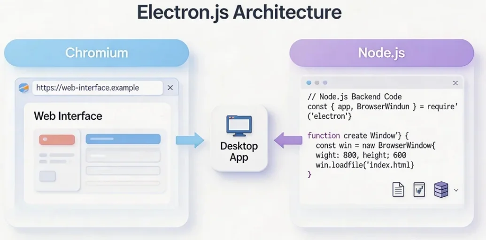
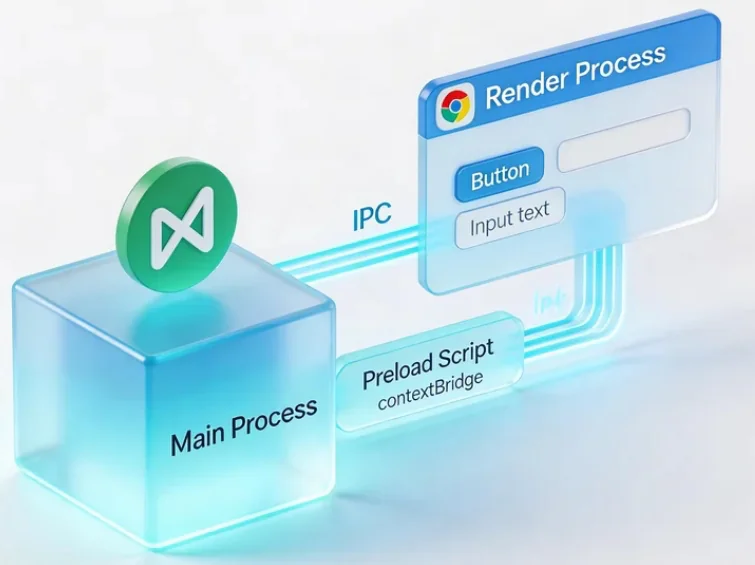
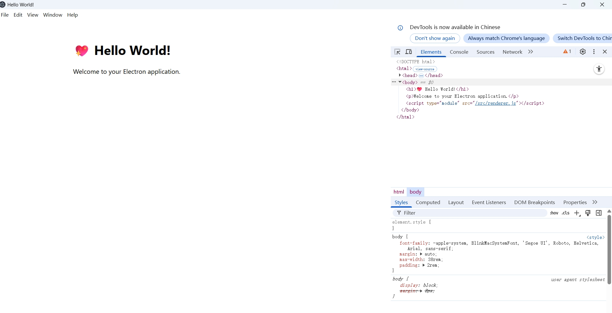
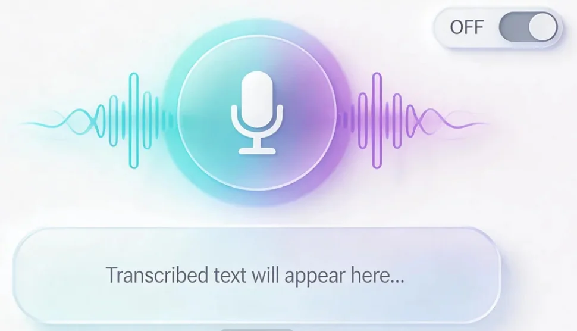
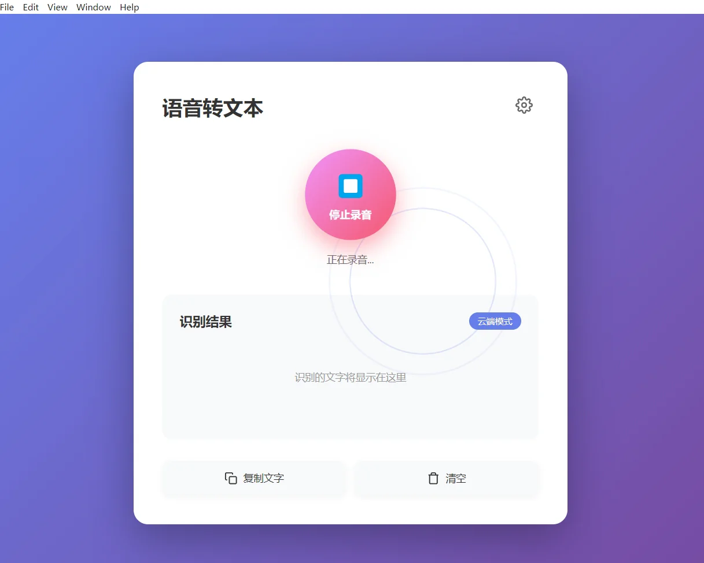
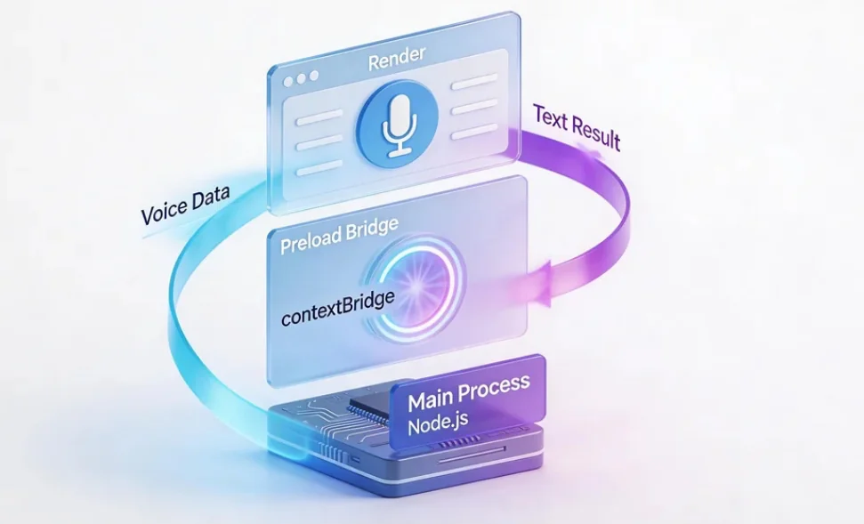
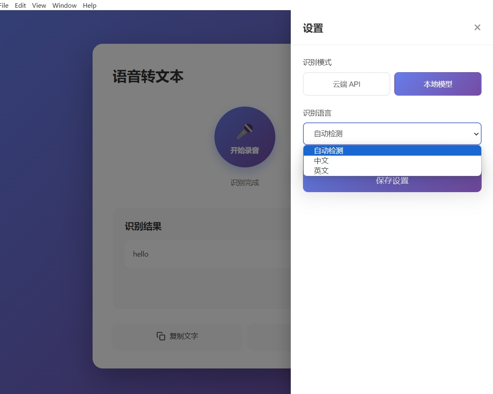
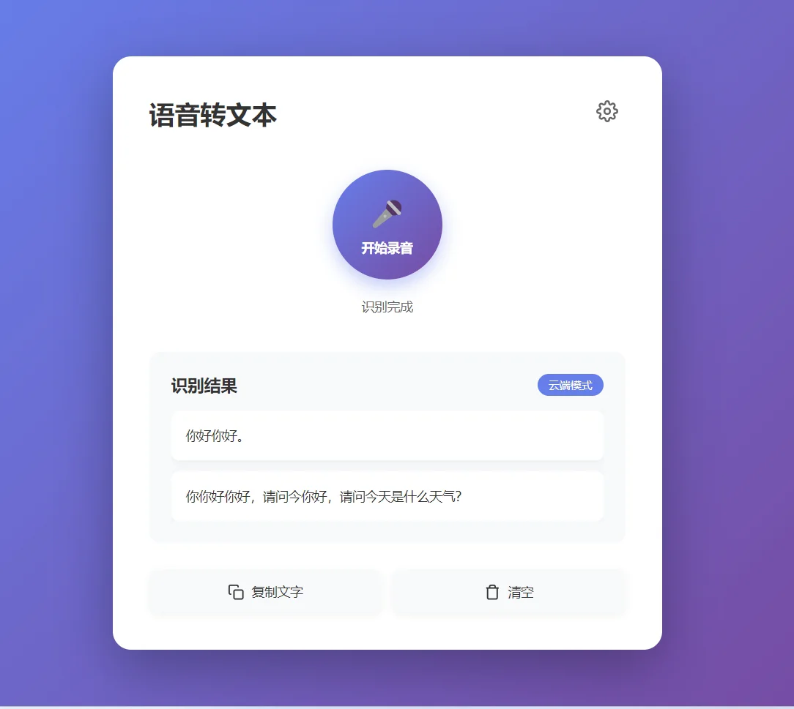
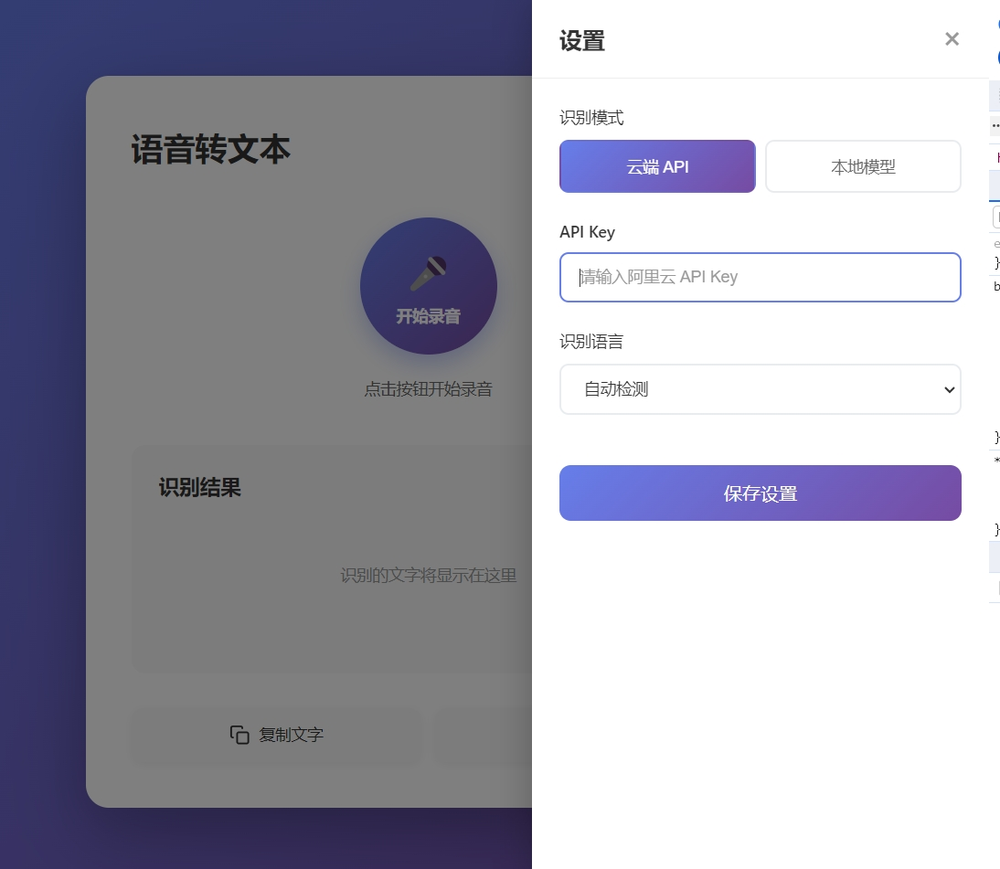
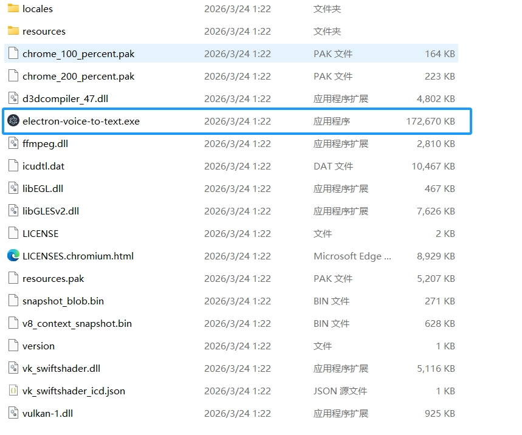

# 如何开发跨平台 Electron 桌面程序

网页技术也可以用来制作真正安装在电脑上的桌面软件。这里以一个能够录音、整理并保存现场记录的应用为例。

如果一家公司已经有 Web 前端团队，又想把产品做成 Windows、macOS 和 Linux 都能安装的桌面软件，Electron 往往是最容易想到的方案。界面继续使用 HTML、CSS 和 JavaScript，Electron 再补上窗口、菜单、文件、托盘、通知和本地进程这些浏览器里没有的能力。

它不是把网页随便套进一个窗口。一个能长期使用的 Electron 产品还要处理自动更新、离线状态、安装包、系统权限、进程隔离和本地数据安全。做好以后，用户看到的是普通桌面软件，不需要先打开浏览器。

## 企业里哪些软件在用 Electron

Electron 官网有一个很大的 [Showcase](https://www.electronjs.org/apps)，收录了数百个已经发布的产品。里面既有 Asana、Notion 和 Microsoft Teams 这类协作工具，也有 Figma、Visual Studio Code、GitHub Desktop、Postman 和 Docker Desktop 这类设计与开发工具。


图片来源：[Electron Showcase](https://www.electronjs.org/apps)。这张图里的 Asana、Discord 和 Figma 只是第一页的一小部分。

Electron 官方在“[为什么选择 Electron](https://www.electronjs.org/docs/latest/why-electron)”中还列出了 Slack、Discord、Signal、ChatGPT、Claude、Canva、Loom 和 Notion。把这些产品放在一起看，会发现 Electron 特别常见于几类软件：

- 团队聊天、会议和协作客户端；
- 代码编辑器、API 工具和数据库客户端；
- 设计、笔记、知识库和项目管理工具；
- 需要本地文件、通知、快捷键或离线能力的 AI 客户端；
- 企业内部需要同时支持 Windows 和 macOS 的工作台。

这些软件并不是因为“网页做不了”才选择 Electron。更常见的原因是已有 Web 技术和前端团队，希望一套主要代码同时服务多个桌面系统，同时又需要浏览器之外的系统能力。

## 什么时候适合用 Electron

如果产品的主要复杂度在界面和业务流程，而且团队熟悉 Web 开发，Electron 很合适。聊天工具、知识库、编辑器、运营工作台和桌面 AI 助手通常都符合这个特点。

它也不是所有桌面软件的默认答案。安装包通常不小，运行时还要带上 Chromium；对内存、启动速度和安装体积极其敏感的小工具，可以比较 Tauri 或系统原生方案。需要大量实时 3D、专业音视频处理或强依赖原生控件时，也要先验证性能和系统集成，不要只因为会写网页就直接决定。

## 要做的应用：现场语音记录

要做的成品叫 **Field Voice Log**，目标是在 Windows、macOS 和 Linux 上运行。

用户录一段现场说明，应用生成文字，再整理成问题、处理过程、风险和后续动作。企业里类似的软件会用在维修工单、保险查勘、物业巡检、客户拜访和护理记录中。


开发从演示文本和桌面界面开始，接着连接麦克风与识别服务，最后制作安装包。共享密钥不会写进桌面客户端。

## 1. Electron 的三个部分

Electron 把网页界面和桌面系统能力放在同一个应用中，但两者不能随便混在一起。



- Main Process 管理窗口、文件和应用生命周期；
- Renderer Process 显示页面，不直接开放 Node.js；
- Preload 只暴露页面真正需要的少量能力。



录音按钮在页面里，保存临时文件和调用本地模型放在主进程里，中间通过 Preload 传递有限的数据。

## 2. 创建项目

确认电脑已经安装当前 LTS 版本的 Node.js，然后新建空目录，用 AI 工具打开：

> 请在当前目录创建 Electron Forge 项目，使用 Vite 模板。先保留默认窗口，完成后告诉我怎样启动。

依赖安装完成后运行项目。看到 Electron 默认窗口，并且终端没有红色错误，说明基础环境正常。



如果启动失败：

> Electron 启动失败，错误是【粘贴错误】。请只修复启动问题，不增加业务功能。

## 3. 先做静态界面

> 请把当前窗口改成 Field Voice Log。页面包含录音按钮、录音时长、原始文字、结构化报告和保存状态，先用演示文本，不接麦克风。

这一轮只看布局。窗口缩窄以后，按钮和文字不能重叠；空白状态要告诉用户下一步做什么。



如果界面太复杂：

> 请简化首页，只保留录音、原始文字和结构化报告三个区域，保持现有配色。

## 4. 接入麦克风

录音由 Renderer 里的 `getUserMedia` 和 `MediaRecorder` 完成。不要让页面直接访问文件系统。

> 请给录音按钮接入麦克风。开始后显示时长和录音状态，停止后把音频交给 Preload，不要在 Renderer 开启 Node 集成。



第一次点击时，系统会询问麦克风权限。拒绝后应用应显示“没有麦克风权限”，不能一直停在加载中。

验证四种情况：

1. 允许权限后可以开始和停止。
2. 拒绝权限后能再次说明如何开启。
3. 连续点击不会同时创建两段录音。
4. 关闭窗口时会释放麦克风。

遇到问题时：

> 麦克风操作失败，系统是【系统】，错误是【错误】。请只修复权限或录音状态问题。

## 5. 先跑通假的识别结果

真实模型会增加网络、格式和模型依赖。先让主进程收到音频后返回一段固定文本：

> 请增加演示识别模式。主进程收到音频后返回一段固定的现场记录，让我先验证 IPC、加载状态和报告页面。



成功时，停止录音后先显示“处理中”，随后出现演示文字；快速开始第二次录音时，第一次结果不能覆盖新任务。

## 6. 选择识别方式

演示链路稳定后，再选本地识别或企业后端。第一版不要两条同时做。

### 6.1 本地 whisper.cpp

本地模式适合离线和隐私要求高的场景，但需要下载模型，也要处理不同操作系统的原生依赖。

> 请把演示识别替换为本地 whisper.cpp。录音先转成 16 kHz、单声道 PCM WAV，再交给模型；失败时保留原音频和错误提示。



先用小模型验证流程，再根据电脑性能选择更大的模型。模型大小、速度和硬件加速会随绑定库变化，不要把某个速度写成固定承诺。

验证时关闭网络，再录一段十秒中文：能生成文字、临时目录会清理、应用重启后没有残留录音，才算通过。

### 6.2 企业识别后端

企业版本应由受控后端调用云端转写服务。桌面应用只拿短期登录凭证，不保存组织共享密钥。

> 请把音频发送到企业后端完成转写。客户端不保存模型密钥，要有上传进度、取消、超时和重试。



不要把 API Key 放在 Renderer、`localStorage`、配置页或打包产物里。即使放在主进程，桌面安装包仍然能被用户读取；组织共享密钥必须留在服务器。

## 7. 生成结构化报告

转写稳定后，再把文字整理成业务字段：

> 请把转写结果整理成问题、处理过程、使用物料、风险和后续动作。保留原始文字，任何字段都允许人工修改。

模型整理结果不能直接覆盖真实工单。保存前让用户确认，并记录谁修改了哪些字段。

设置页只保存语言、识别方式和下载目录等非敏感选项。



## 8. 调试时看三个地方

- Renderer 错误：打开窗口开发者工具；
- Main Process 错误：看启动 Electron 的终端；
- IPC 问题：给每次录音生成请求编号，两边日志都记录编号。

日志可以记录状态、耗时和错误码，不能记录完整音频、报告正文、Token 和联系方式。

> 录音请求编号【编号】一直处理中。Renderer 日志是【内容】，主进程日志是【内容】。请只找出没有返回的原因。

## 9. 完整验收

1. 允许和拒绝麦克风权限各测试一次。
2. 连续录两段，确认结果不会串任务。
3. 本地模式下断网测试，或企业模式下测试取消与超时。
4. 修改结构化字段，确认原始文字没有被覆盖。
5. 重启应用，确认非敏感设置还在。
6. 检查日志中没有音频、密钥和完整业务正文。

一项失败时：

> 验收第【几】步失败，现象是【描述】。请只修复这一项，不改已经通过的功能。

## 10. 打包

先确认 Forge 配置里存在当前系统需要的 Maker，再执行：

```bash
npm run make
```

Forge 只会生成已经配置、并且当前操作系统支持的格式。一次命令不会自动在任意电脑上同时生成所有平台安装包。



拿生成物到一台没有 Node.js、没有项目源码的干净电脑测试：

- 能否安装和启动；
- 麦克风权限是否正常；
- 模型或后端不可用时是否有提示；
- 卸载后是否留下敏感临时文件。

macOS 面向外部用户分发时需要签名和公证；Windows 正式分发也建议代码签名。能生成安装文件，不等于已经可以公开发布。

## 11. 安装包能在另一台电脑打开，才算做完

开发窗口里录音成功，只能说明项目在你的电脑上能跑。把安装包拿到一台没有 Node.js、也没有项目源码的电脑上，重新允许或拒绝麦克风，再连续录两段现场说明。录音状态不能卡住，两次结果不能串在一起，识别失败时也要让用户知道下一步怎么办。

这一步通过以后，Field Voice Log 才像一件可以交给同事试用的桌面软件。以后无论接本地模型还是企业识别服务，都别破坏前面已经做好的边界：页面不能直接拿到 Node.js，Preload 只开放必要能力，共享密钥留在后端，用户永远可以修改机器整理出来的记录。

## 参考资料

- [为什么选择 Electron](https://www.electronjs.org/docs/latest/why-electron)
- [Electron Showcase](https://www.electronjs.org/apps)
- [Electron 官方文档](https://www.electronjs.org/docs/latest/)
- [Electron 安全建议](https://www.electronjs.org/docs/latest/tutorial/security)
- [Electron Forge Makers](https://www.electronforge.io/config/makers)
- [MDN getUserMedia](https://developer.mozilla.org/docs/Web/API/MediaDevices/getUserMedia)
- [whisper.cpp](https://github.com/ggml-org/whisper.cpp)
