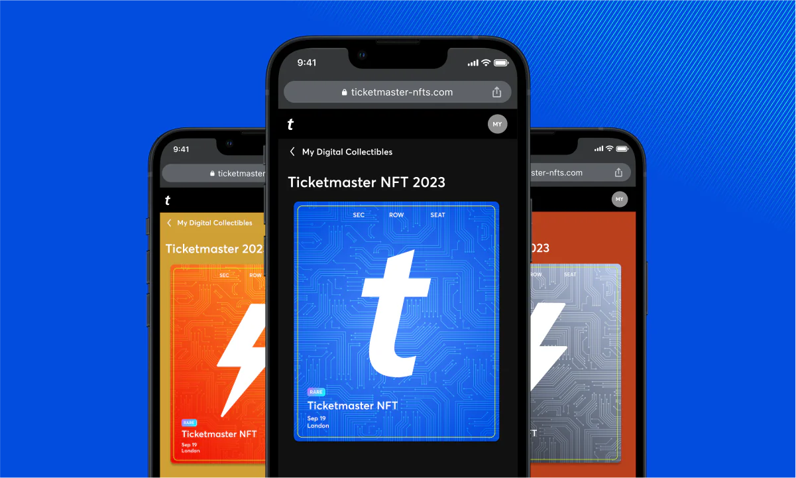

# 如何在本地模拟链铸造 NFT

第一次练习 NFT，不需要碰真钱和真实钱包。所有操作都在自己的电脑里完成，账户、余额和 NFT 都可以随时重置。

提到 NFT，很多人首先想到的是头像和数字图片。真正做产品时，图片只是其中一层。开发者更关心的是：谁发行、谁拥有、能不能转移、记录是否唯一，以及应用怎样根据这条记录提供门票、证书、会员权益或游戏道具。

如果“链、合约、Token”这些词还很陌生，可以先从下面的解释开始。这个练习不连接真实钱包，也不花真钱，只使用一套随时可以重置的本地环境。

## 先把几个词说明白

### 链：一本由很多电脑共同保存的账本

这里说的“链”，就是区块链。你可以先把它理解成一本账本：谁创建了一张数字证书、证书编号是多少、现在归谁，这些记录会按照顺序保存下来。

普通数据库通常由一家公司控制。公共区块链则由网络里的许多节点共同保存和核对记录。已经确认的内容不容易被某一个人单独修改，这也是它适合记录所有权和流转历史的原因。

以太坊官方的[技术入门](https://ethereum.org/developers/docs/intro-to-ethereum/)也把区块链解释为一份由网络中许多电脑共同更新和保存的公共数据库。

第一次练习不会直接使用以太坊主网。主网会接触真实钱包、真实资产和手续费。电脑里启动的 **本地模拟链** 只有自己使用，账户和余额都是假的，关掉以后还可以全部重置。

后面看到的 `链 ID 31337`，只是这条本地链的编号。它的作用类似网络名称，用来避免程序连错地方。

### 合约：放在链上自动执行的程序

这里的“合约”不是需要签字盖章的合同，而是一段运行在区块链上的程序。

合约里可以写下这些规则：只有管理员能发行证书；每张证书都有不同编号；任何人都能查询证书现在属于谁。程序被放到链上以后，用户调用它，链就按照这些规则处理结果。

把合约第一次放到链上叫作 **部署**。部署成功后会得到一个合约地址，可以把它理解成这段程序在链上的门牌号。

以太坊官方的[智能合约介绍](https://ethereum.org/developers/docs/smart-contracts/)给出的定义也很直接：智能合约就是运行在以太坊区块链上的程序，代码和数据保存在一个特定地址中。

### Token：合约管理的一条数字记录

Token 经常被翻译成“代币”，但它不一定是拿来付款的币。更准确地说，Token 是由合约创建和管理的一条数字记录。

例如创建两张证书后，合约里会出现：

- Token `0` 属于地址 A；
- Token `1` 属于地址 B。

这里的 `0` 和 `1` 是 Token ID，也就是每条记录的唯一编号。Token 本身可以代表证书、门票、会员资格、游戏道具，也可以代表某种可以交换的数量。

为什么第一张证书叫 Token `0`，而不是 Token `1`？只是因为这份合约的计数器从 `0` 开始，和很多编程语言的数组编号一样。它不代表价格，也不表示还有一张“第 0 等”的证书。合约也可以设计成从 `1` 开始；本篇从 `0` 开始，是为了和实际运行截图保持一致。

区块链原生币和 Token 不是一回事。以太坊里的 ETH 是网络原生资产，常用来支付手续费；练习中创建的 Token 由自己的合约管理，只代表 Vibe Certificate，不值真钱。

### NFT：每一个编号都可以不同的 Token

NFT 的全称是 Non-Fungible Token，中文常说“非同质化 Token”。“非同质化”听起来很绕，其实只是说每一枚都有自己的编号，可以分别记录主人和内容。

一元硬币和另一枚一元硬币通常可以互换；Token `0` 代表张三的结业证书，Token `1` 代表李四的结业证书，它们就不能当成完全相同的一份记录。

ERC-721 是以太坊生态中常用的一套 NFT 规则。它约定了怎样查询所有者、怎样查看一个地址拥有几枚 Token、怎样转移等。不同项目遵循同一套规则，钱包和应用才知道应该怎样读取它们。

可以对照以太坊官方的 [ERC-721 说明](https://ethereum.org/developers/docs/standards/tokens/erc-721)：一枚 NFT 由“合约地址 + Token ID”共同确定，标准还规定了 `ownerOf`、`balanceOf` 和转移等通用接口。

NFT 也不等于图片。图片、名称和说明通常放在 metadata（内容说明）中，合约只保存 Token ID、所有者和一个名为 `tokenURI` 的内容地址。

### 地址和钱包：一个公开账号，加上一把不能外泄的钥匙

链上账户有一串地址，可以把它理解成公开的收件地址。别人知道地址，只能查看或向它发送内容，不能直接控制账户。

真正能控制账户的是私钥。钱包软件负责保管私钥并代替用户签名。私钥和助记词一旦泄露，别人就可能控制账户，所以它们不能发给 AI、网站客服或其他人。

这次本地链会自动提供几组测试地址和测试私钥。它们只在本地有效，不需要安装真实钱包，也不能放真实资产。

### 铸造：创建一枚新的 Token

“铸造”对应英文 `mint`。它不是生成一张图片，而是调用合约，在链上创建一条新的 Token 记录，并指定它属于哪个地址。

完整过程可以先记成五句话：

1. 在电脑里启动一本练习账本，也就是本地链；
2. 把证书规则放进账本，也就是部署合约；
3. 管理员调用 `mint`；
4. 合约写入“Token 0 属于管理员地址”；
5. 再调用查询功能，把这条记录读回来。

读懂这五步，后面的编译、部署和权限测试就不会只是照着命令操作了。

## 真实产品里的 NFT 在做什么

先看两个已经出现过的真实产品。

### Ticketmaster：把活动纪念品放进购票体验

Ticketmaster 曾把 NFT 数字藏品直接接入活动体验。用户购票或入场后，可以领取一份与活动相关的数字纪念品，不需要先理解复杂的链上操作。

Ticketmaster 在 2023 年发布的 [AFLW 数字藏品案例](https://business.ticketmaster.com/digital-collectibles-go-global-with-the-aflw/)中写到，当时这套能力已经在 4,000 场活动中铸造超过 1,450 万份数字藏品。这里值得参考的不是交易，而是它把领取入口放进原有票务流程，普通用户看到的是活动纪念品，不是一串合约调用。

### POAP：活动参与凭证

POAP 是 Proof of Attendance Protocol 的缩写。活动组织者可以给到场者或参与者发一枚数字徽章，用户以后可以在自己的收藏中看到参加过哪些活动。

下面这枚 WNBA Commissioner’s Cup 徽章来自 POAP 官方首页展示的真实案例：

图片与产品说明来源：[POAP 官方网站](https://poap.xyz/)和 [POAP Help Center](https://help.poap.xyz/hc/en-us/articles/9494654007437-What-is-POAP-)。POAP 的官方说明把这类徽章定义为 ERC-721 Token，用来记录参加线下或线上活动、社区治理和协作项目等经历。

还有一些 NFT 根本不是图片。例如 ENS 官方文档说明，`.eth` 二级域名可以像 ERC-721 Token 一样转移。它代表的是一个名字的控制权，而不是一张插画。参考：[ENS ETH Registrar](https://docs.ens.domains/registry/eth/)。

## 把这些词放回一个真实产品

一枚 NFT 要真正变成用户可以领取和查看的产品，通常至少有四层：

- 合约记录 Token 编号、所有者和转移规则；
- metadata 保存名称、说明、图片和属性；
- 应用负责领取、查看、转移和展示；
- 后端负责发行资格、运营规则、密钥托管、监控和用户支持。

NFT 并不是把整张图片直接塞进链上。常见做法是由合约保存 `tokenURI`，应用再通过这个地址读取 metadata。Token 的所有权也不自动等于图片版权，品牌授权和使用范围仍然需要单独写清楚。

## 1. 要做的成品：一张数字证书

要做的成品叫 **Vibe Certificate**，可以把它理解成一张最小数字证书：

- 合约按照 ERC-721 规则编写；
- 只有部署合约的管理员可以铸造；
- 第一张证书是 Token `0`，以后依次增加；
- 可以查询持有人、某个地址拥有几张证书，以及 metadata 地址。

这一版不做售卖、支付、白名单、盲盒或批量铸造。先把“管理员发行一张证书，普通账户不能越权发行”验证清楚。

## 2. 准备本地模拟链

新建一个临时目录，让 AI 只在这个目录中工作。提示词不用很长：

> 请搭建一个最小 NFT 本地实验，使用 Solidity、OpenZeppelin ERC-721 和 Anvil 或 Hardhat 本地链，不连接钱包和公共网络。

这里又出现了三个工具名：Solidity 是编写合约的语言；OpenZeppelin 提供经过广泛使用的标准合约组件；Anvil 和 Hardhat 可以在电脑里提供本地链。第一次不需要分别研究它们，让 AI 先把最小环境跑起来即可。

新的项目可以选择 [Anvil](https://www.getfoundry.sh/anvil/index.html) 或 [Hardhat Network](https://v2.hardhat.org/)。它们都会提供本地测试账户、测试余额和即时出块，重启后可以重新开始。

这也是以太坊官方[开发网络指南](https://ethereum.org/developers/docs/development-networks)建议先使用本地网络的原因：它和在电脑上运行本地服务器很像，迭代更快，也不用先领取公共测试网资产。

本篇截图来自一次 Ganache 本地运行。Ganache 曾经是常用的个人模拟链，但 Consensys 已经停止维护 Truffle 和 Ganache，并把项目归档。它仍然可以解释本地链概念，新项目则不建议再把它当作长期工具。参考：[Consensys 关于 Truffle 与 Ganache 停止维护的公告](https://archive.trufflesuite.com/blog/consensys-announces-the-sunset-of-truffle-and-ganache-and-new-hardhat-partnership/)。

这次实际运行的链 ID 是 `31337`，Solidity 编译器是 `0.8.30`：

这些账户和余额只存在于本地实验中，不是真实资产。公开教程里也不要展示真实钱包的私钥或助记词。

## 3. 创建最小合约

环境正常后，再告诉 AI 要做什么：

> 请创建 Vibe Certificate。只有管理员能铸造，Token 编号从 0 开始，并支持 tokenURI。

完成后先检查权限和编号：

> 请检查管理员权限和 Token 编号，不要增加新功能。

这一轮越小越好。收费、升级、版税和批量铸造以后都能加，现在增加只会让第一次部署更难排查。

## 4. 编译并部署

合约先要“编译”，也就是把 Solidity 代码转换成链能执行的内容；然后才是“部署”，把编译结果写进本地链并得到合约地址。EVM 是 Ethereum Virtual Machine 的缩写，可以把它理解成专门执行合约的运行环境。

让 AI 直接在本地运行：

> 请编译合约并部署到本地链，告诉我链 ID 和合约地址。

我第一次运行时，部署虽然完成，但查询 `tokenURI` 出现了 `invalid opcode`。原因是编译器生成的 EVM 指令比当时的本地链版本更新。

遇到这种错误，不要重写整个合约：

> 本地链提示 invalid opcode，请只检查编译器和 EVM 版本。

调整到双方支持的 EVM 版本以后，合约成功部署，管理员也铸造了 Token `0`：

## 5. 把写入结果读回来

部署成功不等于功能正确。继续查询持有人、余额和 metadata 地址：

> 请铸造 Token 0，再查询 ownerOf、balanceOf 和 tokenURI。

这三个查询各自回答一个问题：`ownerOf` 查询某个 Token 属于谁，`balanceOf` 查询某个地址一共拥有几枚，`tokenURI` 查询这枚 Token 的名称、图片等内容应该去哪里读取。

这次实际返回的是：

- `ownerOf(0)` 与管理员测试账户一致；
- `balanceOf` 返回 `1`，表示管理员地址拥有一张证书，不是拥有 1 元钱；
- `tokenURI(0)` 为 `ipfs://vibe-certificate/0.json`。

三个结果同时正确，才能说明第一次铸造确实写进了本地链。

这里的 `ipfs://` 只是为了演示内容地址的写法，这次没有真的上传图片或 JSON。它现在更像证书上预留的“详情页地址”。

## 6. 换账户测试权限

合约里写了“只有管理员”还不够，必须真的换一个账户试一次：

> 请换第二个测试账户调用 mint，它应该失败。然后换回管理员再铸造一次。

实际结果是普通账户被拒绝，没有生成新 Token；管理员再次铸造后得到 Token `1`，下一个编号变成 `2`。

这里失败才是正确结果。权限测试如果只验证管理员成功，没有验证普通账户失败，就只完成了一半。

## 7. 从头运行一次

最后重新启动本地实验，从编译一直跑到第二次铸造。下面是这次完整运行结果：

合约地址和账户地址都是模拟链生成的测试地址。重启本地链以后，地址和状态可以全部重置。

## 8. 准备 metadata

刚才的 `tokenURI` 只是一个测试地址。可以把 metadata 理解成这张证书的“内容说明卡”，里面包含名称、说明、图片和属性。真正展示证书时，`tokenURI` 会指向这份说明卡。

> 请写一份最小 metadata，只保留名称、说明和图片地址。

这一步先检查格式，不需要上传文件。手机号、身份证号、内部工单和其他隐私信息不要写进公开 metadata。还要提前考虑文件能保存多久：如果图片服务器关闭，链上的 Token 仍然存在，页面却可能只剩一个失效地址。

## 9. 想用 Remix 也可以

不想先安装本地工具时，可以在 [Remix IDE](https://remix.ethereum.org/) 中选择 Remix VM，重复创建、编译、部署、铸造和查询。Remix VM 同样是浏览器里的临时测试环境，不需要连接真实钱包。

> 请告诉我怎样在 Remix VM 重复刚才的权限测试。

Remix 的界面会变化，认准文件、编译器和部署运行三个区域即可。不要因为页面弹出钱包连接，就改用真实主网账户。

## 10. 什么时候再上公共测试网

测试网是一条公开的练习链。它比本地链更接近真实网络，其他人也能看到上面的地址和交易，但测试币通常没有真实价值。即使如此，也应该单独准备测试钱包，不要把存有真实资产的主钱包拿来练习。

本地先确认管理员能铸造、普通账户不能铸造、编号不重复，三个查询结果也都正确。然后再考虑 Sepolia 等公共测试网。

> 本地测试已经通过，请告诉我怎样部署到当前测试网，不要索要私钥。

测试网入口、水龙头和钱包界面会变化，以当前官方文档为准。助记词和私钥永远不要发给 AI、网站客服或其他人。

## 11. 常见问题怎么问

编译失败：

> 编译失败，错误是【粘贴错误】。请只修当前错误。

查询出现 `invalid opcode`：

> 请检查 Solidity、EVM 版本和本地链是否兼容。

普通账户也能铸造：

> 第二个账户也能 mint，请只检查管理员权限。

Token 编号重复：

> Token 编号重复，请修复递增并重新查询 0 和 1。

## 12. 现在再看这枚 NFT

刚开始时，NFT 可能只像一张数字图片。现在再看本地运行结果，它其实是一条可以逐项查证的记录：

**本地链 → 合约部署 → 管理员铸造 → 查询所有权 → 普通账户被拒绝 → metadata 地址。**

这仍然只是一次合约实验，还不是可以直接运营的平台。Ticketmaster 和 POAP 这类真实产品还要准备领取页面、用户账户、发行后台、内容存储、密钥管理、监控、客服和合规，智能合约只负责其中一部分。

如果继续做 Vibe Certificate，下一步不是马上收费，而是先做一个领取页面和一个发行后台，再决定由谁保管密钥、证书内容放在哪里、错误铸造怎样处理。把这些问题回答清楚，才开始接近真正的产品。

## 参考资料

- [ERC-721 标准](https://eips.ethereum.org/EIPS/eip-721)
- [OpenZeppelin Contracts 5.x：ERC-721](https://docs.openzeppelin.com/contracts/5.x/erc721)
- [OpenZeppelin Contracts 5.x：权限控制](https://docs.openzeppelin.com/contracts/5.x/access-control)
- [Anvil 本地节点](https://www.getfoundry.sh/anvil/index.html)
- [Hardhat Network](https://v2.hardhat.org/)
- [Remix：创建并部署合约](https://remix-ide.readthedocs.io/en/latest/create_deploy.html)
- [Ticketmaster AFLW 数字藏品案例](https://business.ticketmaster.com/digital-collectibles-go-global-with-the-aflw/)
- [POAP 官方说明](https://help.poap.xyz/hc/en-us/articles/9494654007437-What-is-POAP-)
- [ENS ETH Registrar](https://docs.ens.domains/registry/eth/)
