# 如何开发 PWA 本地应用

要做的成品是 **番茄农场 PWA**：用户可以开始番茄钟、获得积分、种植作物，并把它安装到电脑或手机桌面。断网后，已经缓存的页面和本机数据仍然可以使用。

PWA 适合轻量工具、门店表单、活动应用、内部门户和离线采集页面。它仍然是网站，不等于所有系统能力都和原生 App 一样。

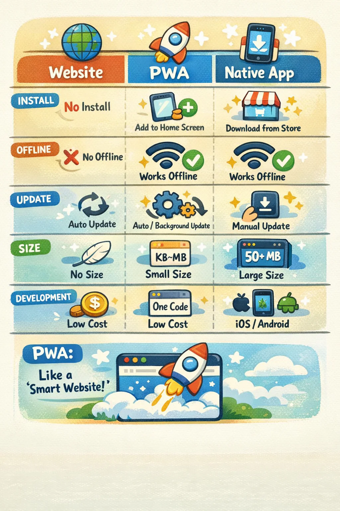

## 别人把 PWA 做成了什么

PWA 这个名字听起来像一种新的 App，其实它首先还是网页。用户可以先点开链接，用过以后再决定要不要安装到桌面；开发团队仍然用 HTML、CSS 和 JavaScript 维护同一套前端。

这套做法最适合这样的产品：用户想马上打开，网络偶尔会断，又没有必要为了一个轻量功能先安装几十兆的客户端。

### Starbucks：先点单，不先装 App

Starbucks 把点单、菜单、会员入口和门店选择放进了 PWA。用户在手机浏览器里就能打开，也可以把它加到主屏幕。下面这张真实界面里，地址栏显示的是网页地址，底部已经出现“添加到主屏幕”的入口。


它适合咖啡点单，是因为用户的目标很短：看菜单、选门店、下单，然后离开。菜单和购物车可以尽量在弱网时继续使用，真正提交订单和付款时再明确要求联网。

Microsoft 的 [PWA 企业案例汇总](https://learn.microsoft.com/en-us/microsoft-edge/progressive-web-apps/#success-stories)也把 Starbucks 列为代表案例。界面图来自 [MobiLoud 的 PWA 案例整理](https://www.mobiloud.com/fr/blog/progressive-web-app-examples)。

这种思路也常见于门店会员中心、预约排队、活动签到和临时服务页：先让用户完成眼前的事，再考虑是否长期安装。

### Pinterest：网页也能成为桌面应用

Pinterest 的情况不一样。它本来就有成熟的网站，希望 Windows 用户能从开始菜单和任务栏直接打开，同时继续复用网页团队已经维护的功能。


Pinterest 工程团队在[发布 Windows 应用时](https://medium.com/pinterest-engineering/building-the-pinterest-app-for-windows-10-5e29f2146f7d)明确说明，这个应用建立在 PWA 之上，并使用 Manifest、Service Worker、缓存和通知能力。这样既保留了熟悉的网页体验，也能进入 Microsoft Store，像普通桌面应用一样启动。界面图来自 [Codica 的 PWA 产品展示](https://www.codica.com/blog/codica-named-top-pwa-development-firm/)。

这类方案适合内容平台、知识库、报表中心和内部工作台：主体本来就是网页，桌面端需要的是独立窗口、固定入口和通知，不是重新做一套完全不同的客户端。

### PWABuilder：把现有网站检查并打包

微软还做了一个真实工具 [PWABuilder](https://www.pwabuilder.com/)。输入网站地址后，它会检查 Manifest、Service Worker、安全配置和应用信息，告诉你还缺什么。


报告通过以后，还可以继续生成不同应用商店需要的包。它不是把任何网站一键变成优秀 App，而是把“检查配置、补资料、生成商店包”这段重复工作做成了工具。微软官方的 [PWA 打包说明](https://learn.microsoft.com/en-us/windows/apps/publish/publish-your-app/pwa/turn-your-website-pwa)给出了完整流程。

### Power Pages：企业门户也可以装到桌面

PWA 也不只用来做面向消费者的产品。Microsoft Power Pages 可以把客户门户或内部站点安装到手机和电脑，还能让选定的页面在离线时只读打开。

不过，这不代表整套企业系统都被装进了手机。Power Pages 的[官方说明](https://learn.microsoft.com/en-us/power-pages/configure/progressive-web-apps)专门提到，表单提交和实时查询仍然会受到网络状态与数据规则的限制。哪些内容可以离线看，哪些操作必须联网，要在开发前分清楚。

看完这些例子，再判断自己的项目就容易多了。可以先问三件事：用户是不是经常从链接进入？断网时，有没有一小部分功能仍然值得继续使用？团队是不是希望网页、手机和桌面共用主要代码？如果答案大多是“是”，就值得考虑 PWA。

番茄农场正好符合这些条件：打开链接就能用，断网后计时和本机农场仍然有用，安装到桌面时也不需要再维护另一套客户端。先从普通网页、安装信息和离线缓存之间的关系看起。

## 1. 先看懂 PWA 的结构

PWA 不是一种新的编程语言，也不是把网页套进一个安装包就结束了。它仍然从普通网页开始，再由 Manifest 告诉系统“安装后叫什么、用哪个图标”，由 Service Worker 处理缓存和离线访问。

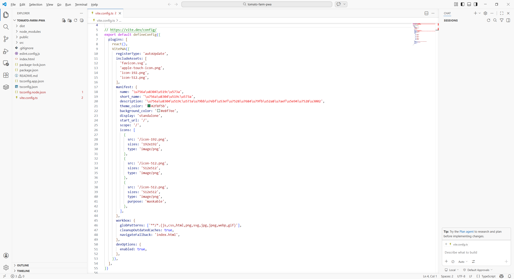

图里的四部分各管一件事：

- 网页负责用户真正看到和操作的界面；
- Manifest 保存应用名称、图标和启动方式；
- Service Worker 缓存页面外壳和必要资源，让它在断网时还能打开；
- IndexedDB 或 localStorage 保存当前设备的数据，需要登录和跨设备同步时才接后端。

这一版先不做账号和云同步，只把网页、安装、离线缓存和本机数据跑通。知道每一部分负责什么以后，就可以从一个普通的 React 页面开始了。

## 2. 创建 React 项目

确认已经安装当前 LTS 版本的 Node.js，再新建空目录：

> 请在当前目录创建 React、TypeScript 和 Vite 项目，名称 tomato-farm-pwa。完成后告诉我怎样启动空白页面。

安装依赖并启动开发服务器。看到 Vite 默认页，终端没有红色错误，说明基础环境正常。

## 3. 增加 PWA 配置

> 请给当前 Vite 项目增加 PWA。配置应用名称、主题色、192 和 512 图标，并让生产构建注册 Service Worker。

准备两张正方形图标，放进公开资源目录。


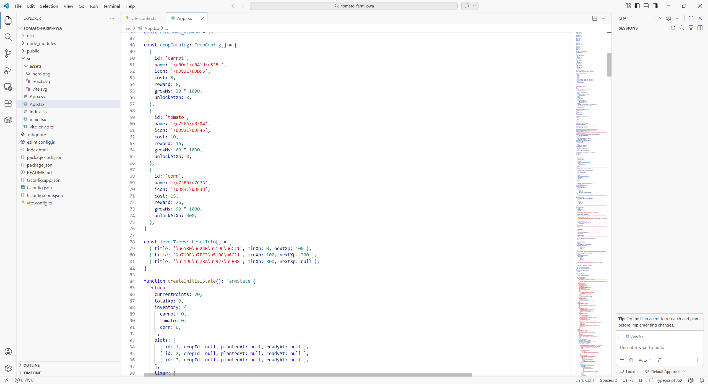

开发服务器里不一定能完整表现生产 Service Worker。先确认配置能编译，离线测试放到生产预览阶段。

## 4. 做出第一版番茄农场

> 请把首页改成番茄农场。包含 25 分钟计时器、积分、三块菜地和种子商店；先用本机数据，不做登录和云同步。

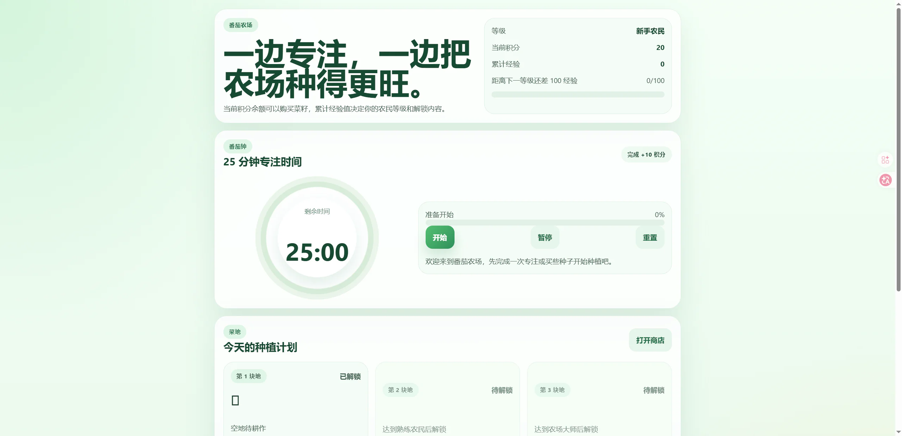

运行后应看到计时器、积分、菜地和商店。

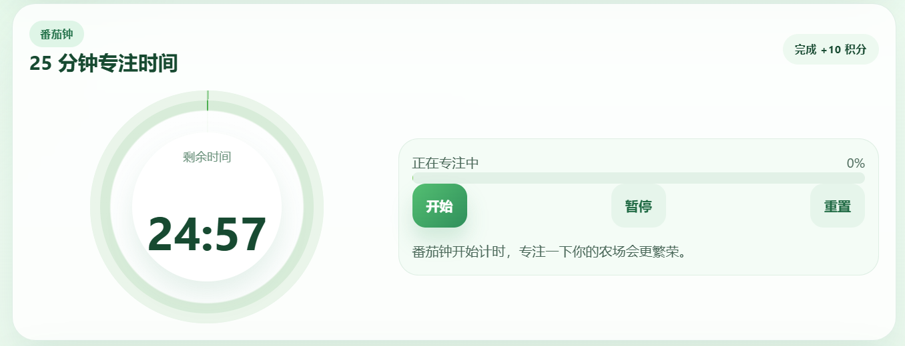

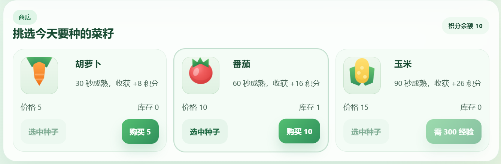

不要为了测试等 25 分钟。增加仅在开发环境可见的“立即完成一次”按钮，生产构建不显示。

> 请增加开发测试按钮，让我立即完成一次番茄钟。它只在开发环境出现。

## 5. 增加作物状态

> 请给作物增加幼苗、生长和成熟三种状态。收获后增加积分，并阻止同一块地重复种植。

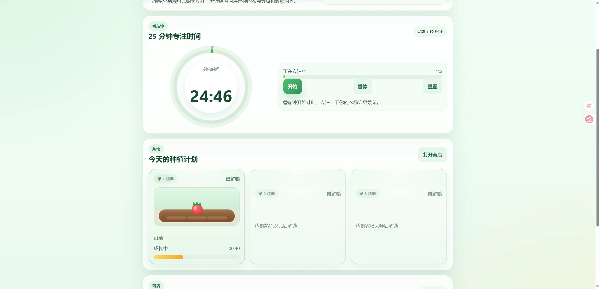

验证：积分不足不能购买；空地才能种植；未成熟不能收获；收获后积分只增加一次。

需要动效时只补一件事：

> 请给种植和收获增加轻微动画，并尊重系统的“减少动态效果”设置。

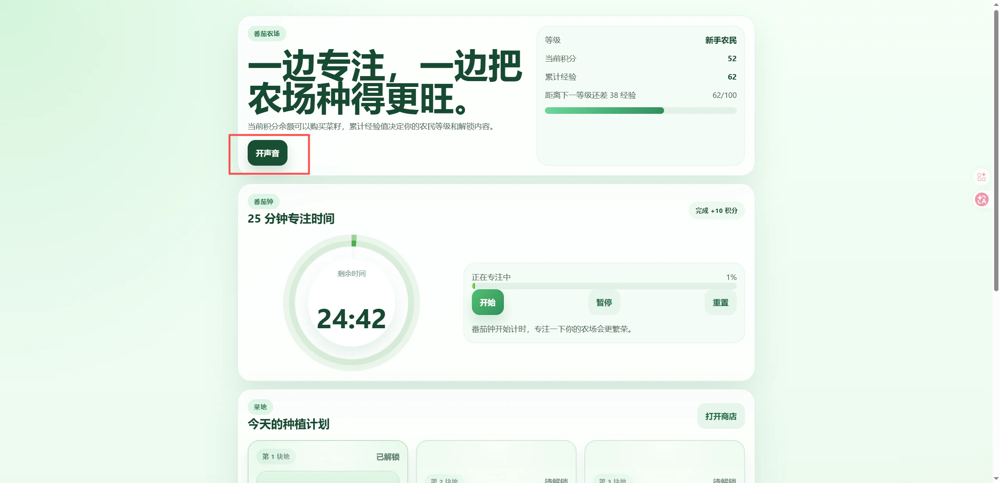

## 6. 保存本机数据

> 请把积分、菜地和计时状态保存在本机。刷新和关闭页面后可以恢复，并增加导出和导入备份。

先不要急着接云端。按顺序测试：

1. 修改积分和菜地状态。
2. 刷新页面，确认数据还在。
3. 关闭浏览器再打开，确认仍能恢复。
4. 导出备份。
5. 清空本机数据，再导入备份。

导入文件必须校验格式和版本，覆盖数据前要再次确认。

## 7. 构建并预览生产版本

执行：

```bash
npm run build
npm run preview
```

打开终端给出的本地预览地址。开发者工具的 Application 面板中应能看到 Manifest 和已注册的 Service Worker。

构建失败时：

> PWA 生产构建失败，错误是【粘贴错误】。请只修复 Manifest、图标或 Service Worker 配置。

## 8. 测试安装

支持安装的桌面浏览器可能在地址栏或菜单里显示“安装应用”。安装入口由浏览器、系统和站点状态共同决定，不要只检查某一个图标。

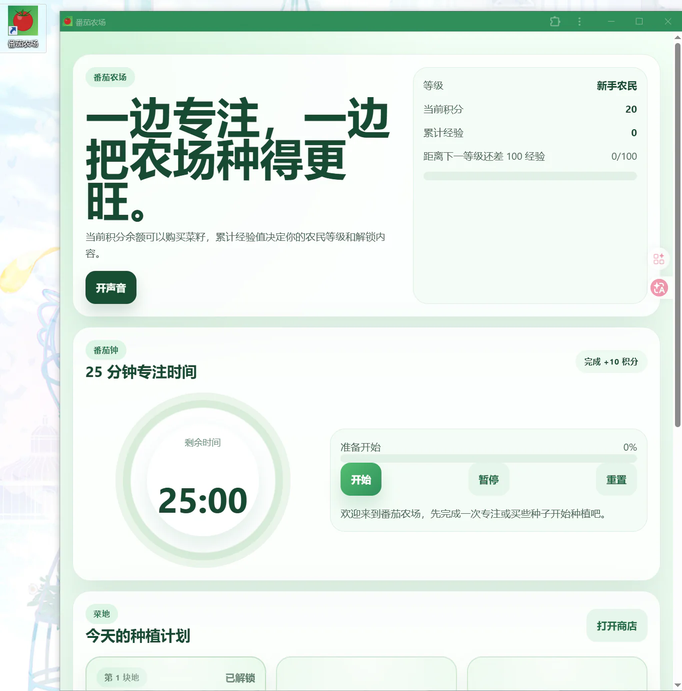

安装后从系统应用列表启动，确认它以独立窗口打开，名称和图标正确。

## 9. 测试离线

先在线打开一次生产预览，让 Service Worker 完成缓存。然后在开发者工具 Network 面板切换 Offline，再刷新。

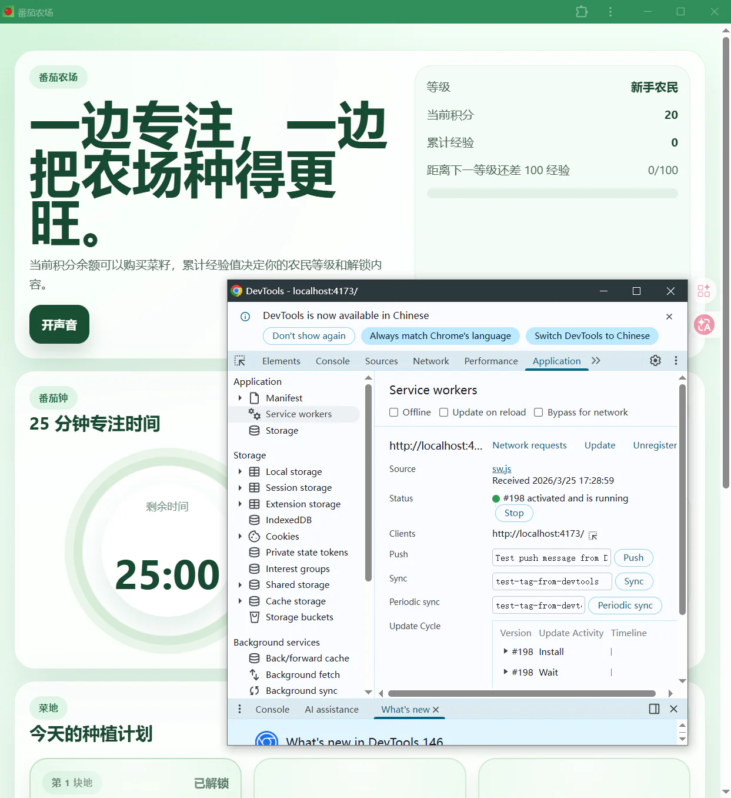

成功标准：

- 页面能打开；
- 已缓存的图标和样式存在；
- 计时器和本机数据仍能使用；
- 需要网络的操作明确显示离线；
- 恢复网络后不会重复提交。

不要只关闭 Wi-Fi后看一眼首页。至少刷新、修改一条数据、关闭再打开一次。

## 10. 可选：增加账号和同步

如果要跨设备同步，需要后端账号、数据权限和冲突处理。把 localStorage 换成云数据库，并不会自动解决这些问题。

> 请为现有 PWA 设计登录和跨设备同步。先说明数据表、用户权限、离线队列和冲突规则，不要直接修改代码。

方案确认后，再逐步实现：

> 请先完成登录和“只读自己的数据”，不要做实时同步。完成后告诉我怎么用两个账号测试。

确认账号隔离以后，再增加离线队列和同步。服务端规则必须保证用户只能读写自己的农场。

本机数据、服务端数据和待同步队列要分别显示状态；不能声称“数据永不丢失”，而应提供备份、失败提示和恢复办法。

## 11. 部署到 HTTPS

Service Worker 在生产环境需要安全上下文，常见托管平台会提供 HTTPS。选择团队正在使用的平台，连接仓库并设置构建命令 `npm run build`、输出目录 `dist`。

部署完成后，用线上地址重新测试 Manifest、Service Worker、安装和离线模式。本地预览通过，不代表线上路径配置一定正确。

> 线上页面能打开，但 PWA 没有安装入口。请检查 HTTPS、Manifest、图标路径和 Service Worker 范围，只修复部署配置。

## 12. 在手机安装

在 Android 浏览器中打开 HTTPS 地址，从浏览器菜单选择“安装应用”或“添加到主屏幕”。不同品牌菜单文字可能不同。

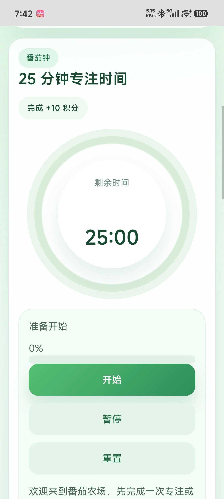

在 iPhone 上打开页面，通过浏览器分享菜单选择“添加到主屏幕”。系统和浏览器版本会影响入口位置，以当前界面为准。

安装后测试锁屏、切后台、断网、重新联网和清理浏览器数据后的表现。

## 13. 使用 Lighthouse

打开 Chrome DevTools 的 Lighthouse，检查性能、可访问性和最佳实践。新版 Lighthouse 的分类可能调整，不要把“PWA 必须满分”当成验收条件。

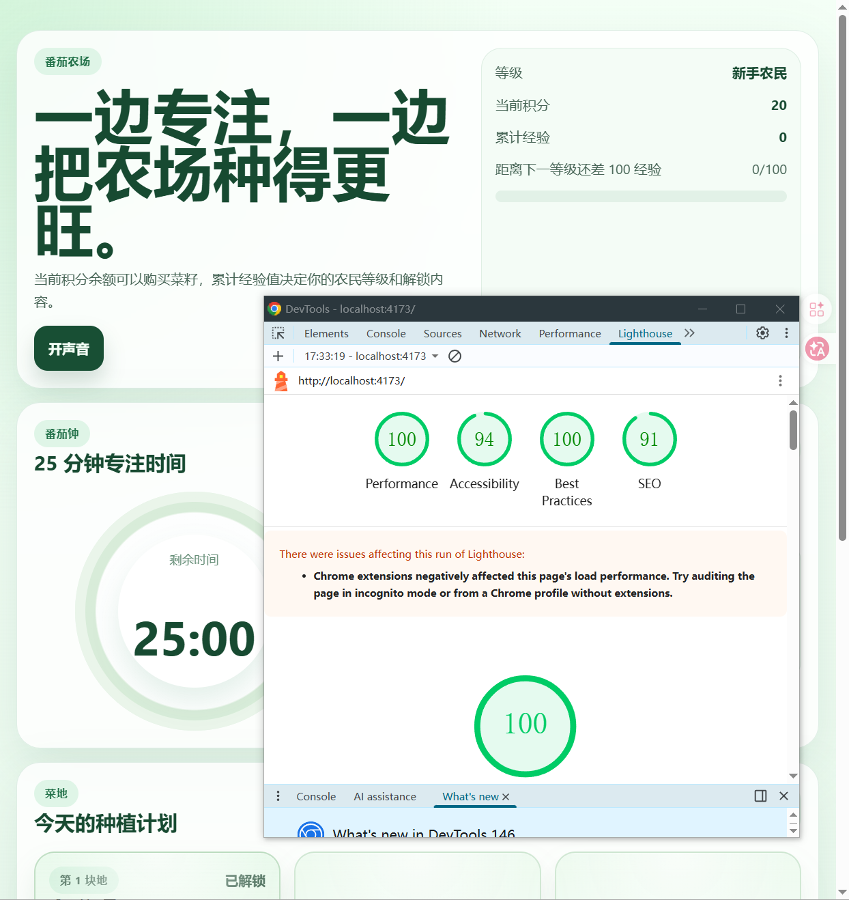

重点修复会影响真实用户的问题：图标缺失、离线白屏、按钮不可访问、资源过大和首屏加载慢。

## 14. 把番茄农场真正装起来

做到这里，就别只在开发页面里看它了。打开部署后的 HTTPS 地址，把番茄农场安装到电脑或手机桌面，再像普通用户一样从图标启动。种下一株作物，关掉网络，刷新页面，然后重新打开应用：页面没有白屏，计时和农场还在，才说明安装、缓存和本机数据真的连起来了。

如果你后来增加了云同步，还要再用两个账号试一次。两个账号应该各自看到自己的农场；断网时产生的修改，也要在恢复网络后给出明确结果。这个测试比 Lighthouse 上的一排绿色分数更重要。

这次做的虽然是番茄农场，换成巡店记录、活动签到、门店表单或内部工具，做法并没有太大变化：先让网页正常使用，再补安装和离线，最后才考虑账号与跨设备同步。PWA 的价值也正在这里——不用先做一套庞大的客户端，就能让一个网页更像用户随手可用的应用。

## 参考资料

- [Microsoft Edge：PWA 概览与企业案例](https://learn.microsoft.com/en-us/microsoft-edge/progressive-web-apps/)
- [Pinterest Engineering：Windows 应用如何建立在 PWA 上](https://medium.com/pinterest-engineering/building-the-pinterest-app-for-windows-10-5e29f2146f7d)
- [Microsoft Power Pages：把企业门户做成 PWA](https://learn.microsoft.com/en-us/power-pages/configure/progressive-web-apps)
- [Microsoft：使用 PWABuilder 检查和打包 PWA](https://learn.microsoft.com/en-us/windows/apps/publish/publish-your-app/pwa/turn-your-website-pwa)
- [Web App Manifest](https://developer.mozilla.org/docs/Web/Progressive_web_apps/Manifest)
- [Service Worker API](https://developer.mozilla.org/docs/Web/API/Service_Worker_API)
- [让 PWA 可以安装](https://developer.mozilla.org/docs/Web/Progressive_web_apps/Guides/Making_PWAs_installable)
- [Vite PWA](https://vite-pwa-org.netlify.app/)
