# 如何构建微信小程序（包含后端）

## 1. 什么是带后端的微信小程序开发

基础小程序只能处理当前页面里的内容。要保存用户数据、区分账号和上传文件，还需要后端。

前面已经用 Trae、HBuilderX 和微信开发者工具，做出了一个可以在微信里运行的贪吃蛇小程序。

但这时候，所有内容还只存在当前手机和当前页面里。如果用户换一台手机，之前的数据就找不到了；如果两个人同时使用，小程序也不知道哪一条记录属于谁；如果以后要接会员、订单、文件上传，单靠前端页面也没有办法安全地完成。

下面直接在原项目上增加后端。每次只接一项能力，然后同时去小程序页面和 CloudBase 控制台确认结果。

### 1.1 带后端的小程序多了什么

你可以把小程序前端理解成一个“服务窗口”。用户在窗口里填写信息、点击按钮、查看结果；但窗口本身不会决定这张工单属于谁、谁有权限修改、数据应该保存多久。

真正处理这些事情的，是后端。

比如用户点击“提交工单”以后，后端需要先确认当前是谁，再检查内容是不是完整，然后把工单保存到云端。用户下一次打开小程序时，后端还要只把属于他的记录返回回来。

同样的道理，下面这些事情也不能为了省事直接放在前端：

- AppSecret、支付密钥、AI Key 等真正的密钥；
- 用户身份、管理员权限和工单归属；
- 价格、库存、积分、订单状态等关键规则；
- 内容审核、操作日志和防止重复提交。

一句话理解：**前端负责让用户操作，后端负责让业务可信。**

### 1.2 要做的应用：企业售后服务中心

上一节的贪吃蛇不需要保存业务数据。这里换成企业里更常见的例子——**Northstar Service Hub**。

它是一个“会员 + 售后工单”小程序。用户打开首页以后，可以看到会员状态、常用服务和最近工单；遇到问题时，可以填写描述、上传图片，再查看后续处理进度。

这个例子不只适合某一个行业。你可以把它改成零售品牌的会员中心、酒店的住客报修、汽车品牌的车主服务、保险公司的材料补交入口，或者消费电子产品的维修进度查询。

你平时在微信里见到的品牌会员中心，大多也是这种思路：小程序负责让用户快速打开和操作，真正的订单、积分和售后记录则交给后端处理。

上一节看到的 Uber 小程序也是这样。用户看到的是地图、路线、叫车状态和付款页面，后端还要负责行程、司机匹配、订单状态和支付结果。

图片与案例来源：[Uber 携手微信上线官方小程序](https://www.tencent.com/en-us/articles/2202137.html)。另外，2026 夏季达沃斯的官方小程序把会议信息、直播和互动服务放进了微信，可以参考腾讯的[夏季达沃斯微信小程序案例](https://www.tencent.com/en-us/articles/2202375.html)。

### 1.3 小程序后端的几种做法

给小程序接后端，常见的有三条路。

先说结论：**小程序需要后端，不等于必须购买 CloudBase。** CloudBase 是这里选择的入门路线，因为它和微信身份、云函数、数据库的衔接最短。公司已经有后端时可以直接接入原来的服务；以后想换成其他云服务，也可以通过 HTTPS 接口连接。

第一种方式，是使用 **微信·云开发 / CloudBase 原生能力**。小程序直接调用云函数，云函数再去操作文档型数据库和云存储。这条路线和微信身份结合得最近，不需要你第一天就自己搭登录系统、买服务器和配置 HTTPS。

第二种方式，是使用 **CloudBase 云托管**。等项目以后需要同时服务小程序、网页和管理后台，或者已经有 Express、NestJS、FastAPI 这类完整后端时，再考虑这条路。

第三种方式，是接入企业原来就有的后端。腾讯云现在可以用 AnyService 把已有服务接进小程序；如果公司本来就有后端团队，不需要为了小程序再重做一套。

如果你在文档里还看到“HTTP 网关”，先别把它和 AnyService 当成同一个东西。AnyService 负责连接公司原来的服务，HTTP 网关主要给 CloudBase 里的云函数和云托管提供 HTTP 访问入口。

这三条路没有谁一定更高级。第一次做带后端小程序，先选择最容易跑通的一条：

**微信·云开发原生环境 → 云函数 → 文档型数据库 / 云存储。**

腾讯云现在还支持 PostgreSQL。这次先不使用；等项目真的遇到复杂关联、SQL 或强事务需求时，再考虑迁移。

这里有一个限制：PostgreSQL 只能在新建环境时选择，原来的传统环境不能直接切换，微信开发者工具当前也不能创建。真要使用，需要去 CloudBase 控制台新建环境，再迁移数据和调整接入方式。

这个练习先不增加这层难度。

### 1.4 腾讯云目前推荐的 AI 开发方式

如果你现在打开腾讯云最新版文档，会看到一个新的入口——**CloudBase AI 插件**。你可以把它理解成一个打包好的 AI 开发工具，一次帮你接上 MCP Server、Agent Skills 和 Hooks。你的 AI 工具如果已经支持一键安装，就优先选择这个入口。

你可以把这套插件理解成专门给 AI 准备的“云开发说明书和操作工具”。接好以后，AI 不只是知道怎样写页面，还能按照 CloudBase 当前的规范理解云函数、微信身份、数据库权限和部署流程。

开发工具继续使用 Trae。腾讯云当前给 Trae 的专门指南，仍然是先接入 CloudBase MCP，再按需要安装和读取 Skills，所以后面的操作沿用这条路线。以后 Trae 支持一键插件时，再直接换成插件即可，不需要两套一起安装。

这里需要注意一个容易混淆的名字：`mp-skills` 是把小程序业务能力开放给微信 AI 调用的另一套工具，并不是普通小程序接后端时必须安装的东西。这一章只使用 CloudBase 开发相关 Skills，不把两条路线混在一起。

## 2. 环境准备

如果已经完成上一节，就不需要重新安装所有软件。继续使用原来的项目，只多准备 CloudBase 这一块。

### 2.1 本教程会用到的四个工具

Northstar Service Hub 会同时用到四个工具，它们各自负责不同的环节：

1. 第一个是 **Trae**。它仍然负责打开真实项目、和 AI 对话、修改文件，并连接 CloudBase MCP。
2. 第二个是 **HBuilderX**。它继续负责 uni-app 项目的构建，把源项目运行到微信小程序模拟器。
3. 第三个是 **微信开发者工具**。除了预览页面，它还负责开通云开发、查看环境、部署云函数和上传版本。
4. 第四个是 **CloudBase 控制台**。你会在这里看到数据库记录、云函数日志、存储文件和环境状态。

后面如果一时分不清该看哪个窗口，就按这个办法找：代码在 Trae，构建在 HBuilderX，小程序页面在微信开发者工具，云端数据和日志在 CloudBase 控制台。

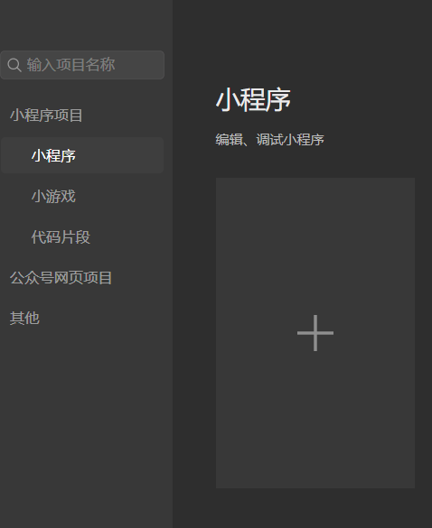

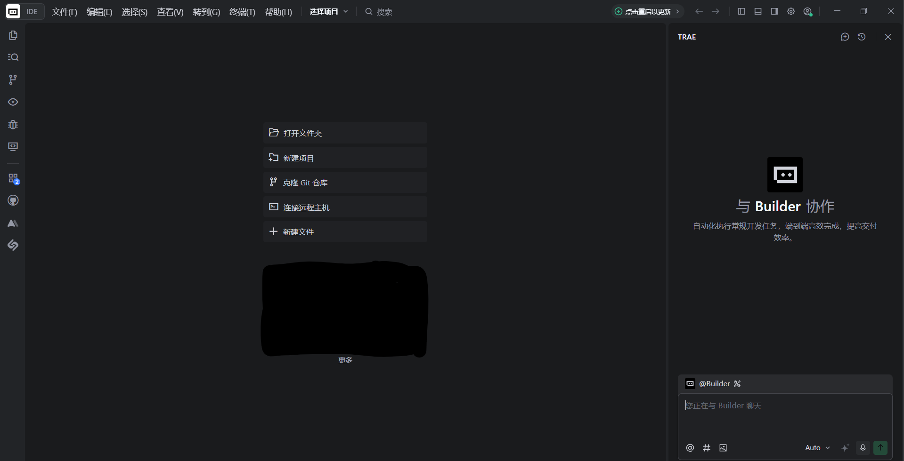

### 2.2 确认小程序账号和 AppID

开始接后端之前，先回到微信公众平台确认一次 AppID。

这一步和上一节完全相同：打开[微信公众平台](https://mp.weixin.qq.com/)，进入“开发管理 → 开发设置”，找到小程序唯一的 AppID。

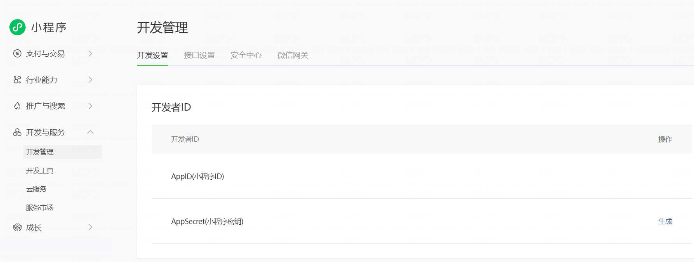

接着检查 HBuilderX 项目里的 AppID 是否和它一致，再确认微信开发者工具登录的是有这个小程序开发权限的账号。

如果 AppID 填错，后面最常见的现象就是：看不到正确的云环境，或者上传后的版本出现在另一个项目里。遇到这类问题时，不要急着让 AI 重写代码，先把小程序身份确认好。

### 2.3 在 Trae 中接入 CloudBase MCP 和 Skills

CloudBase 整体优先推荐一键插件。Trae 当前仍按照腾讯云的专门指南接入 MCP 和 Skills。

打开腾讯云官方的 [Trae 配置指南](https://docs.cloudbase.net/ai/cloudbase-ai-toolkit/ide-setup/trae)，按照页面说明在 Trae 的 MCP 设置中加入 CloudBase。第一次使用时，优先选择官方的登录和环境选择流程，不要为了省一步把 SecretID、SecretKey 或 CloudBase API Key 粘贴进提示词。

连接完成以后，我先没有急着让 AI 做页面，而是对它说：

> 请检查 CloudBase 是否连接成功，并告诉我当前环境。只检查，不要修改项目。

如果 AI 能正确识别当前项目类型、当前环境，并列出准备使用的 Skills，就说明这一层已经准备好了。

如果你的 Trae 暂时不能使用 MCP，也不用紧张。后面的提示词仍然可以直接使用，只是部署、查看日志和数据库这些操作需要你自己在控制台中完成。

### 2.4 在微信开发者工具中开通云开发

打开上一节的项目，然后找到微信开发者工具顶部的“云开发”入口。

这里先不要去购买 19.9 元/月的个人版。如果页面让你选择上海或新加坡、PostgreSQL 和付费套餐，说明进入了 CloudBase 控制台的新购流程，不是本次操作要走的入口。直接退出购买页，不要点击“立即购买”。

腾讯云当前的创建环境指南会先让你根据场景选择入口。微信小程序从微信开发者工具里创建，环境会自动和当前小程序关联。

如果你从 CloudBase 控制台进入，会先看到下面的登录页。这里可以使用腾讯云账号，也可以使用当前小程序所属的微信公众平台账号登录。

第一次点击时，开发者工具会引导你创建环境。环境名称可以写成容易辨认的名字，例如 `northstar-dev`。

截至 2026 年 8 月，CloudBase 为每个云开发账号提供一个免费体验环境，每月包含 3000 资源点，足够完成这一章的云函数、数据库、权限和日志练习。免费环境用于开发体验；小程序正式发布以后，到期时间会变成上线后的第 15 天。如果只是跟着教程操作和补截图，现在不需要付费；准备长期上线时，再决定升级个人版还是接入企业已有后端。具体限制以腾讯云的[价格文档](https://cloud.tencent.com/document/product/876/75213)为准。

如果微信开发者工具仍然只把你带到购买页，可以先到“微信公众平台 → 行业能力 → 小程序成长计划”报名。当前第二期活动时间为 2026 年 7 月 1 日至 12 月 31 日；符合条件的新用户可以获得一个有效期 6 个月的个人版环境。报名条件和权益以[小程序成长计划](https://docs.cloudbase.net/ai/ai-inspire-plan)页面为准。

这里不要把环境名称、环境 ID 和 AppID 混在一起：

- AppID 是小程序的身份；
- 环境名称是给人看的名字；
- 环境 ID 是这个后端环境的唯一编号。

开始创建以后，平台通常需要几分钟初始化资源。只要最后能进入环境总览，并看到数据库、云函数和存储入口，就说明创建成功。

正式项目一般会把开发、测试和生产环境分开。练习时只使用开发环境，不需要为了截图额外创建可能产生费用的环境。

### 2.5 打开上一节的基础项目

环境创建完成以后，回到 HBuilderX 和 Trae，打开上一节已经能运行的小程序项目。确认你修改的是源项目，而不是 HBuilderX 自动生成的 `unpackage` 编译结果。

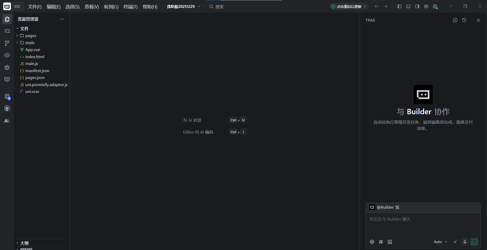

然后先运行一次原项目：

1. 在 HBuilderX 中选择“运行 → 运行到小程序模拟器 → 微信开发者工具”；
2. 等待输出区域显示编译完成；
3. 确认原来的页面还可以正常打开。

这一步相当于先记住“接后端之前项目是什么样子”。如果后面出现问题，你就知道是这一轮改动带来的，而不是旧环境本身已经坏了。

这一章只验证“编译到微信小程序”这一条链路。如果同一个 uni-app 项目还要运行到 H5、App 或其他小程序，后端身份和 SDK 接入方式会不同，需要再按腾讯云的 UniApp 指南分别处理。

## 3. 小程序页面开发

后端和 CloudBase 环境准备好以后，就可以开始修改小程序页面。

和上一节一样，先做出能运行的页面，再逐步接入后端。每加一项，都回到微信开发者工具和 CloudBase 控制台确认结果。

### 3.1 让 AI 先做页面

打开 Trae，载入前面已经准备好的小程序项目之后，我先没有急着让 AI 写云函数，而是先把整个产品目标告诉它：

> 请把当前项目改成客户服务小程序。先做会员首页、创建服务请求和我的工单三个页面，使用演示数据。

也就是说，我不是让 AI 一上来就同时处理登录、数据库、上传和支付，而是先抛出一个完整目标，让它把用户能看到的第一版搭起来。

### 3.2 看清 AI 修改了哪些文件

Trae 收到这条指令以后，会先阅读当前项目结构，判断应该增加哪些页面、在哪里放数据访问，再直接修改真实文件。

你可以在对话区看到它的计划，也可以看到每一次文件变更。

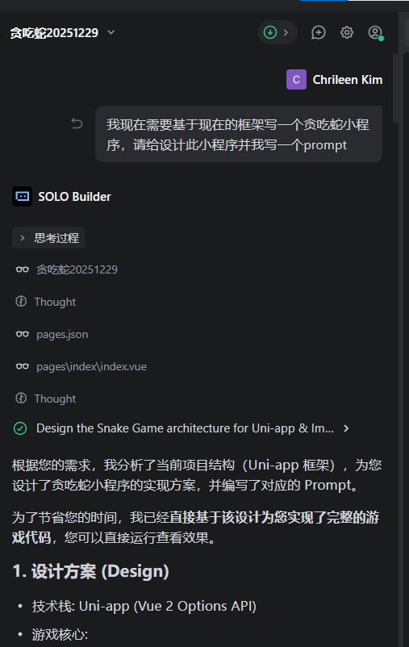

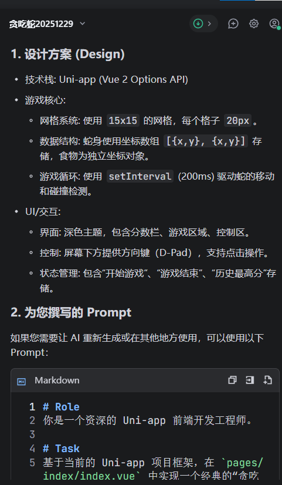

如果你发现 AI 准备新建另一个项目，可以马上告诉它：“不要另建项目，只修改当前工作区。”

如果这一轮结果不满意，也不用紧张。Trae 仍然提供回退能力，可以把工程恢复到本次修改之前。

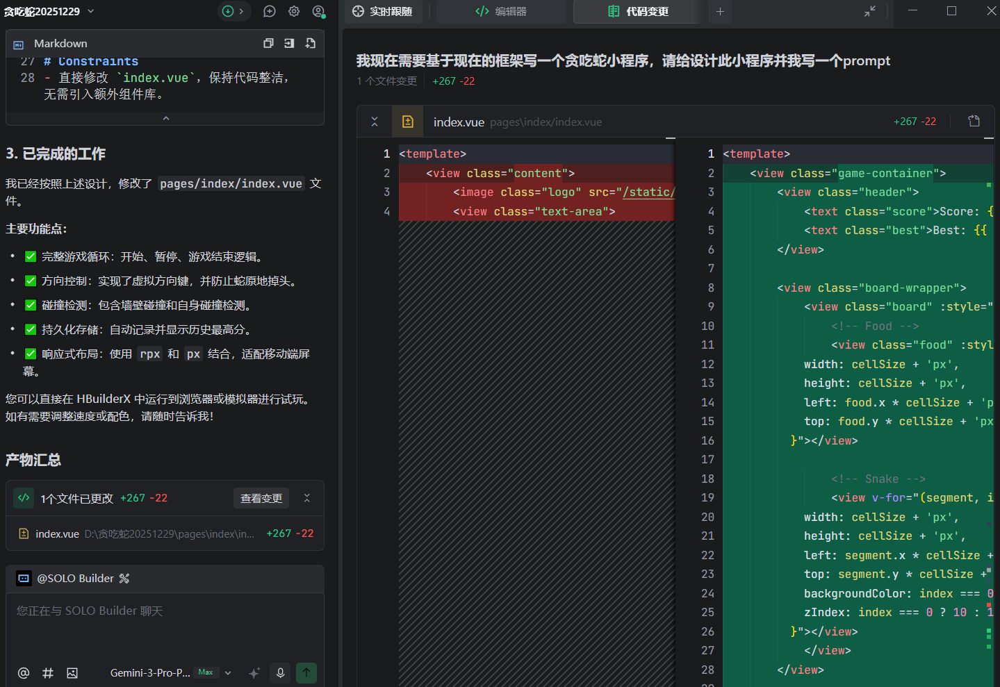

### 3.3 在 HBuilderX 和微信开发者工具中查看效果

AI 完成第一轮开发之后，代码已经落在项目里，但还没有看到用户视角的效果。现在回到开发者工具把它跑起来。

回到 HBuilderX，选择“运行 → 运行到小程序模拟器 → 微信开发者工具”。

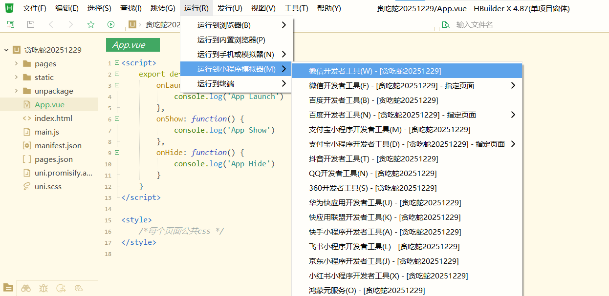

底部输出窗口会显示编译过程。如果最终没有报错，就可以切到微信开发者工具查看首页、创建工单和我的工单页面。

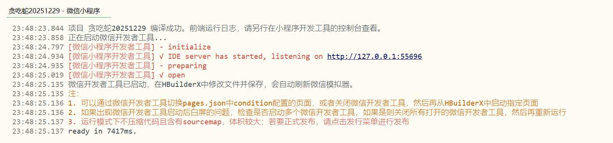

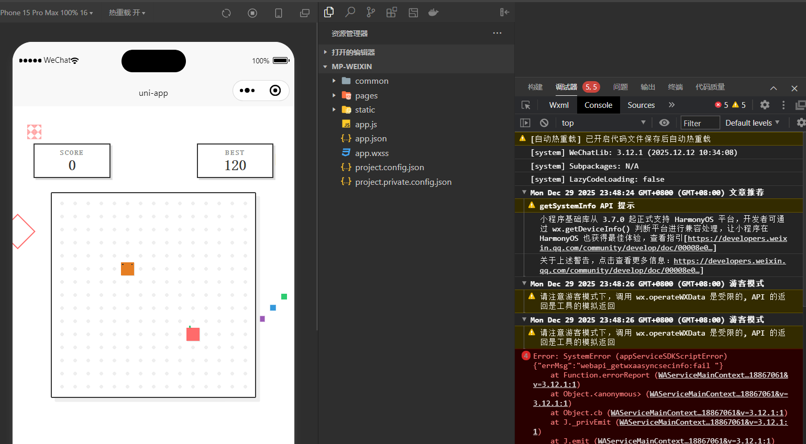

这一轮先只看界面：按钮好不好点、表单清不清楚、空状态有没有告诉用户下一步做什么。后端还没有真正接上，所以暂时看到演示数据是正常的。

### 3.4 用自然语言继续调整页面

AI 一开始生成的页面不一定刚好符合你的想法。在我这次尝试里，我希望首页更像一个真实品牌的客户服务入口，而不是把所有功能都堆在第一屏。

所以我继续对 AI 说：

> 请简化首页，只保留会员状态、三个常用服务和最近一条工单。

首页清楚以后，再改表单：

> 请把工单的问题信息和联系方式分开，页面不要出现技术词。

修改完成后，再回到微信开发者工具刷新页面。如果没有立刻变化，可以先在 HBuilderX 中停止运行，再重新运行到微信小程序模拟器。

### 3.5 第一版页面效果

经过几轮 **自然语言描述 → AI 修改 → 模拟器查看 → 继续调整**，你应该先得到一个页面逻辑清楚的前端版本。

下面是 Northstar Service Hub 的页面效果：

页面完成后，里面的工单仍然只是演示数据。下一步才让它真正保存到云端。

## 4. 小程序后端开发

页面能够在微信开发者工具中正常打开后，就可以连接最重要的一条后端链路：

**用户点击提交 → 小程序调用云函数 → 后端识别当前用户 → 工单保存到数据库 → 页面显示工单编号。**

这一部分仍然采用提示词驱动。每次只给 AI 一个小任务，看到成功结果以后，再继续下一步。

### 4.1 先让页面成功调用一次云函数

第一次接后端时，不要马上创建十几个函数。先做一个最简单的连接测试。

这时候，我继续在 Trae 里对 AI 说：

> 请把当前小程序接到 CloudBase，并在首页增加“检查后端连接”按钮。连接成功时显示当前时间。完成后告诉我需要部署哪个云函数。

AI 修改完成以后，你还需要在微信开发者工具或 CloudBase 控制台中部署这个云函数。

如果点击检查以后，页面显示“服务正常”，同时云函数日志里出现了一次调用，就说明第一条“前端 → 后端 → 返回结果”的链路已经跑通。

### 4.2 让后端知道“当前是谁”

连接跑通以后，再处理用户身份。

这里有一个地方需要特别提醒 AI：不能让前端自己说“我是用户 A”。小程序前端提交的用户标识或“我是管理员”都可能被修改，真正可信的身份要由云函数从微信调用上下文中获取。

我继续对 AI 说：

> 请让云函数识别当前用户，不要使用前端传来的身份。页面和日志不要显示完整 OpenID。

在微信·云开发原生链路里，大多数小程序不需要自己再搭一套登录系统。当前用户是谁，应该由云函数从微信可信上下文里识别。

### 4.3 让第一张工单真正保存下来

首页虽然已经能调用云函数，但它现在只返回一句“服务正常”，还没有真正保存任何东西。

现在只做一件事：让用户填写一张工单，点击提交之后，把它保存到云端。先不要同时做会员积分、支付和客服后台，否则一旦出错，你很难判断问题到底发生在哪里。

这时候，我继续在 Trae 里对 AI 说：

> 请把“创建服务请求”接到云端。提交后保存工单，并在页面显示工单编号。

AI 修改完成后，再确认部署位置：

> 请告诉我需要部署哪个云函数，以及去哪里查看保存结果。

部署完成后，打开 CloudBase 的文档型数据库，在“集合管理”中找到或创建工单集合。腾讯云当前的入口说明如下：

接着在模拟器里提交一张工单。页面如果显示了工单编号，同时数据库里出现了一条记录，就说明第一张工单已经真正保存成功。

第一张工单保存成功后，我又故意快速点了两次。这时候，我继续对 AI 说：

> 请防止重复提交。同一次提交即使请求两次，也只能生成一张工单。完成后告诉我怎么测试。

要注意，只在页面上快速点两次还不够，因为这可能只是按钮做了防重复点击。再按提示词用同一个请求编号请求两次，结果仍然只有一张工单，才说明后端也处理好了。

### 4.4 让用户只能看到自己的工单

工单保存成功以后，还有一个很重要的问题：用户 A 能不能看到用户 B 的工单？

这时候你可能会想，我已经在数据库里设置了权限，云函数里是不是就不用再检查了？答案是不行。数据库规则挡的是小程序直接操作数据；云函数就像后台真正办理业务的人，它仍然要再确认一次“这张工单是不是当前用户的”。

我继续对 AI 说：

> 请完成“我的工单”页面，保证每个用户只能看到自己的工单。把相关权限设置好，完成后告诉我怎么用两个微信账号测试。

这里还有一个容易踩坑的地方：通过云函数或管理端保存记录时，系统不会自动生成 `_openid`。提示词已经要求 AI 主动写入从可信上下文取得的归属信息，不让前端自己决定。

修改完成后，先用自己的微信提交一张工单，再把另一位同事加入体验成员，用他的微信打开体验版。如果两个账号看到的内容完全分开，就说明这一层权限已经生效。

### 4.5 接入图片凭证

文字工单稳定以后，再增加图片。这样就算上传出现问题，也不会影响你判断文字工单本身是否已经成功。

我继续对 AI 说：

> 请给工单增加图片上传。上传失败时保留已经填写的内容，并告诉用户怎样重试。

上传能用以后，再处理保存方式和限制：

> 请把图片放在云存储里，数据库只保存文件标识。

> 请限制图片的数量、大小和格式。

如果现在只是你自己和同事使用的体验版，内容审核可以先不打开。准备给真实用户使用时，再让 AI 给文字、图片、音频和文档增加审核流程：新内容先进入“待审核”，通过以后再展示，可疑内容交给人工检查。腾讯云内容审核会单独计费，确认需要以后再开启即可。

### 4.6 出现问题怎么办：继续把现象告诉 AI

AI 生成的后端也不一定第一次就能完全跑通。有时候页面看起来没有问题，真正点击提交以后，却可能遇到云函数没有部署、环境 ID 填错、数据库拒绝写入等情况。

在这些时候，不要只对 AI 说一句“提交不了”，也不要让它立刻重写整个项目。你可以把自己刚才点了什么、页面显示了什么，以及控制台里最相关的一条错误一起告诉它。

例如：

> 提交工单后一直显示“处理中”。这是页面错误和已脱敏的云函数日志：【粘贴内容】。请找出原因，只修改出错的地方。

CloudBase 当前也提供日志检索。你可以按时间、资源和关键词找到刚才那一次调用，而不是在几百行输出里盲找。当前操作入口如下：

让 AI 输出日志时，可以保留请求编号、动作、工单编号、结果、耗时和错误码，但不要记录完整 OpenID、手机号、Token、密钥和工单敏感正文。

### 4.7 同时检查页面与云端记录

经过一轮又一轮的 **自然语言叙述 → AI 修改 → 部署云函数 → 在前端操作 → 去数据库和日志中确认**，你最终应该得到这样一个版本：

- 用户可以看到会员首页；
- 用户可以提交一张真实工单；
- 工单会保存到云端；
- 连续点击不会创建重复工单；
- 两个微信账号只能看到各自的数据；
- 图片进入云存储，数据库只保存文件标识；
- 出现问题时，可以在日志中找到对应调用。

这一次的验证和贪吃蛇不太一样。贪吃蛇只要在屏幕上能玩就基本说明成功；带后端的小程序则要同时看两个地方：**页面上的结果**和**云端留下的记录**。

## 5. 小程序发布

页面和后端链路完成以后，把这个版本上传成体验版，再让两个真实账号在手机上验证。

普通的 AppID、备案、服务类目和审核步骤与上一节相同，这里重点讲带后端版本多出来的检查。

### 5.1 上传前先检查环境

上传以前，先回到 Trae 对 AI 说：

> 请检查这个小程序能不能上传体验版。重点检查环境、云函数、演示数据、调试功能、密钥和权限，只列出上传前必须修改的问题。

现在只有一个开发环境时，你可能暂时感觉不到区别。等项目准备给更多人使用以后，再分别建立开发、测试和生产环境，并让 AI 把环境 ID 集中配置。环境 ID 本身不是密钥，但截图给别人看时，仍然建议遮住一部分。

### 5.2 在微信开发者工具中上传体验版

确认 AppID、云环境和云函数版本都正确以后，在微信开发者工具中点击“上传”，填写版本号和项目备注。

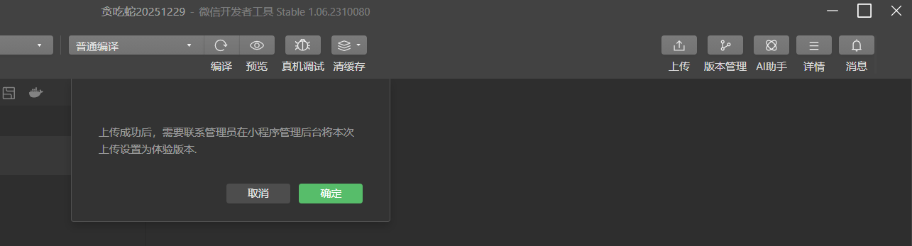

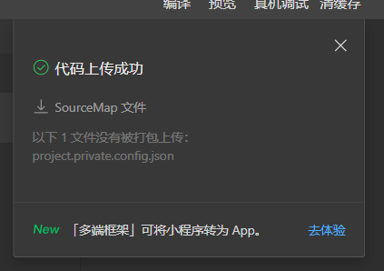

上传完成后，回到微信公众平台的“版本管理”，把刚上传的开发版本设为体验版。

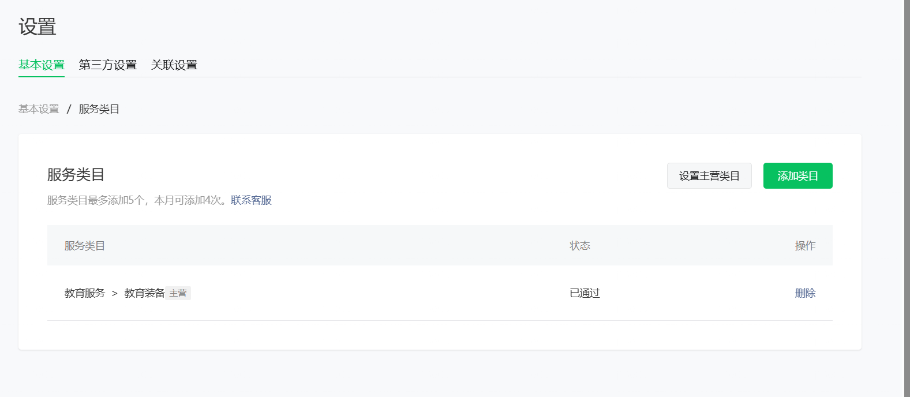

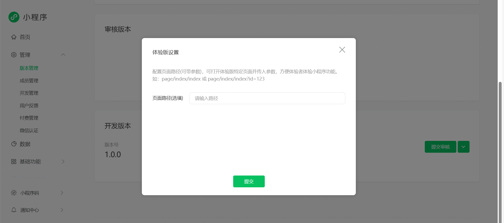

注意：小程序前端上传成功，不代表云函数也自动更新了。每次修改后端以后，都要单独确认云函数已经部署到体验版正在使用的环境。

### 5.3 用两个真实账号再试一次

体验版阶段不要只让开发者自己试。把另一位同事加入体验成员，然后按下面的顺序走一遍：

1. 账号 A 创建一张工单，并记住工单编号；
2. 账号 A 在“我的工单”里看到这条记录；
3. 账号 B 打开小程序，确认看不到账号 A 的工单；
4. 账号 B 再创建一张自己的工单；
5. 回到账号 A，确认两个人的数据没有混在一起。

真机上还要顺手测试网络断开、图片权限、返回页面和重复点击。发现问题以后，仍然按照“描述现象 → AI 最小修复 → 重新部署 → 再次验证”的方式继续迭代。

### 5.4 体验版能打开以后，先别急着正式发布

这一次的小程序和贪吃蛇不太一样，因为它会保存用户的联系方式、问题描述和图片。正式给用户使用之前，你还需要在公众平台上把隐私说明、服务类目和备案信息补充完整。

如果后面继续加入支付、CRM 或客服后台，也不要把这些能力一次全部塞进当前版本。先让文字工单稳定运行，再一项一项增加。每增加一项，都重新在模拟器和体验版里走一遍完整流程。

以后如果想增加实时聊天或流式返回，也不用一看到 WebSocket、SSE 就马上迁移云托管。腾讯云当前的 HTTP 云函数已经支持这些能力，可以先看看现有方式能不能满足。

等项目真的需要完整后端框架、自定义运行环境或容器时，再考虑云托管；真的需要复杂关联、SQL 或强事务时，再考虑 PostgreSQL。技术越重，不一定越适合第一版。

正式发布以前，还可以把下面这段话交给 AI：

> 请检查这个小程序收集的联系方式、问题描述和图片。告诉我哪些必须收集、保存多久，以及用户怎么删除。不必要的数据不要收集。

## 6. 第一张真实工单已经跑通了

现在用账号 A 提交一张工单，能在数据库里找到它；换成账号 B，又看不到账号 A 的记录。做到这一步，页面、云函数、微信身份、数据库和权限才算真正接在了一起。

以后换成预约、会员、课程或报修小程序，也可以从这样一条很小的真实记录开始。先让页面能操作，再一次只接一个后端能力，每次同时看前台结果和云端记录，确认以后再上传体验版。

功能会变，底线不会变：密钥不要放在前端，用户是谁不能听前端自己说，关键数据要经过后端检查并留下记录。

## 参考资料

- [上一节：如何构建一个最简单的微信小程序](../wechat-miniprogram/)
- [CloudBase 快速开始](https://docs.cloudbase.net/quick-start/)
- [创建 CloudBase 云开发环境](https://docs.cloudbase.net/quick-start/create-env)
- [CloudBase AI Toolkit](https://docs.cloudbase.net/ai/cloudbase-ai-toolkit/)
- [CloudBase AI 一键插件](https://docs.cloudbase.net/ai/cloudbase-ai-toolkit/ai-agent-plugins)
- [Trae 接入 CloudBase 官方指南](https://docs.cloudbase.net/ai/cloudbase-ai-toolkit/ide-setup/trae)
- [CloudBase Skills 使用指南](https://docs.cloudbase.net/ai/cloudbase-ai-toolkit/prompts/how-to-use)
- [微信小程序 Skill 当前推荐方式](https://docs.cloudbase.net/ai/cloudbase-ai-toolkit/plugins/miniprogram)
- [微信小程序调用 CloudBase 云函数](https://docs.cloudbase.net/recipes/add-cloud-function-wechat-miniprogram)
- [CloudBase 数据库安全规则](https://docs.cloudbase.net/database/security-rules)
- [CloudBase 云函数安全规则](https://docs.cloudbase.net/cloud-function/security-rules)
- [CloudBase 数据库事务](https://docs.cloudbase.net/database/transaction)
- [CloudBase 云存储安全规则](https://docs.cloudbase.net/storage/security-rules)
- [CloudBase 环境模式选型](https://docs.cloudbase.net/quick-start/env-overview)
- [CloudBase AnyService](https://docs.cloudbase.net/anyservice/intro)
- [CloudBase HTTP 网关](https://docs.cloudbase.net/service/introduce)
- [CloudBase 云函数类型选型](https://docs.cloudbase.net/cloud-function/quickstart/select-types)
- [CloudBase UniApp 接入](https://docs.cloudbase.net/quick-start/frameworks/uniapp)
- [CloudBase 内容审核](https://docs.cloudbase.net/storage/ci-cos-moderation)
- [CloudBase 日志检索](https://docs.cloudbase.net/logger/search)
- [CloudBase 密钥与环境变量管理](https://docs.cloudbase.net/recipes/secure-secrets-in-cloud-function)
- [CloudBase 2026 更新日志](https://docs.cloudbase.net/changelog/)
