# 如何构建微信小程序

一个小程序从空项目到手机体验版，要依次经过创建、开发者工具调试、真机预览和版本上传。

你平时扫码点单、查快递、开电子发票，或者从微信群里打开一个活动页面，用到的很可能就是小程序。它不需要先去应用商店安装，用户在微信里搜索、扫码或点开分享卡片就能使用。

对企业来说，小程序适合承接“现在就要办”的服务：点单、会员、售后、预约、购票、出行和现场活动。用户已经在微信里，打开服务的步骤比下载一个新 App 少得多。

## 1. 先认识微信小程序

### 企业通常用小程序做什么

真实产品不只是在微信里放几个网页。Uber 的微信小程序允许出境用户查询路线、叫车并使用微信支付，不需要另外下载 Uber App 或重新准备当地支付方式。

图片与案例来源：[Uber 携手微信上线官方小程序](https://www.tencent.com/en-us/articles/2202137.html)。从这张图可以看到，地图、路线、车辆状态和支付都留在微信里的同一段流程中。

企业里常见的小程序还包括：

- 餐饮点单、排队取号和会员积分；
- 零售商城、优惠券和门店自提；
- 酒店、景区、医院和政务预约；
- 快递、售后、维修和现场工单；
- 展会、赛事、课程和社区活动；
- 只想让用户偶尔使用一次的轻量工具。

如果产品需要长时间后台运行、深度使用系统硬件，或者用户每天高频使用，原生 App 往往更合适；只是展示内容或填写简单表单，普通网页也可能更省事。小程序的优势不是“什么都能做”，而是用户正在微信里时，可以很快进入一项服务。

### 小程序和小游戏不是一回事

贪吃蛇体量小，操作结果容易检查，适合用来练习页面、交互、状态和发布流程。

不过，正式发布时要注意：普通小程序和微信小游戏有不同的产品入口、类目和审核要求。这个练习先使用普通 uni-app 小程序项目；如果你准备长期运营游戏、接入广告或排行榜，应按微信公众平台当前的小游戏规则重新确认账号和类目，不要把游戏随便填成教育、工具或其他不相符的类别。

### 为什么使用 uni-app

小程序常见的开发方式有两种：

- 直接使用微信原生项目，最贴近微信官方文档；
- 使用 uni-app 这类多端框架，以后还可以继续发布到 H5 或其他小程序平台。

项目使用 HBuilderX 创建，再让 Trae 修改当前文件。每次修改后，都回到微信开发者工具查看真实结果。你不需要先学完全部语法，但要看得懂页面有没有运行、控制有没有失效，以及错误出现在什么位置。

操作从空项目开始，先做出贪吃蛇，再换成摇杆控制；每改一步，就去模拟器和手机上试一次，最后把能玩的版本上传成体验版。

## 2. 环境准备

下面依次安装三个工具。每安装一个就先打开确认，不要全部装完以后再一起排错。

### 2.1 会用到的三个工具

开发会用到三个工具：

- [HBuilderX](https://www.dcloud.io/hbuilderx.html) 创建 uni-app 项目并负责构建；
- [Trae](https://www.trae.cn) 打开项目，让 AI 直接修改当前文件；
- [微信开发者工具](https://developers.weixin.qq.com/miniprogram/dev/devtools/download.html) 运行模拟器、预览、调试和上传版本。

记住各自的工作就行：HBuilderX 建项目和构建，Trae 修改项目，微信开发者工具看结果。

### 2.2 注册微信公众平台账号并获取 AppID

有了工具，还需要一个小程序账号和 AppID。AppID 是这个小程序在微信里的唯一编号，后面导入和上传项目都会用到。

1. 在浏览器地址栏输入 https://mp.weixin.qq.com ，打开微信公众平台网页，用你的微信扫码登录。

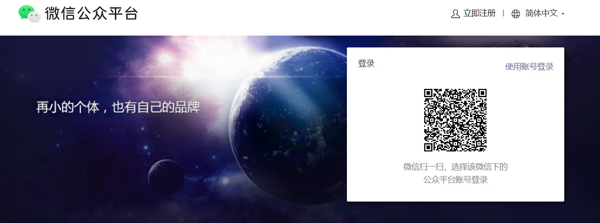

2. 在首页选择「小程序」，按照页面提示完成注册流程，填写邮箱、手机号以及主体类型（个人或企业）。
   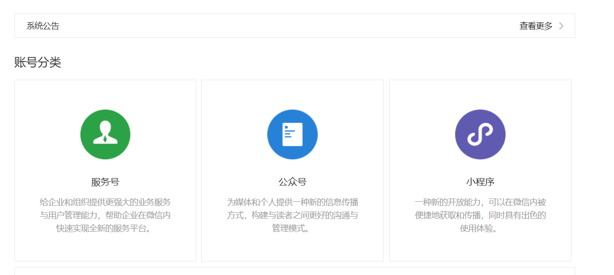
3. 注册成功并进入后台后，找到「开发管理」或「开发设置」页面，就能看到一个唯一的编号，名字叫 AppID 。这个编号后面会用在项目配置里，相当于你这个小程序在微信里的身份证。

把 AppID 保存在团队的项目配置记录里，不要把 AppSecret 截图、提交到公开仓库或发给 AI。

### 2.3 安装微信开发者工具

1. 打开[微信开发者工具下载页](https://developers.weixin.qq.com/miniprogram/dev/devtools/download.html)，选择与电脑系统匹配的稳定版。
2. 下载完成后，双击安装包，按照安装向导一步步点击下一步。如果你不清楚要改什么设置，保持默认选项就可以。
3. 安装结束后，从桌面或开始菜单启动微信开发者工具。首次启动时，它会在屏幕上显示一个二维码，提示你用手机微信扫码登录。用自己的微信扫码并确认授权后，就可以进入主界面。

登录后先停在主界面。项目构建完成以后，再回到这里查看运行效果。

### 2.4 准备 Trae 和 HBuilderX

打开 [Trae 官网](https://www.trae.cn)，安装与当前系统匹配的版本。安装完成后先确认它能打开一个本地文件夹。

接着从 [HBuilderX 官网](https://www.dcloud.io/hbuilderx.html) 下载对应版本。安装后能进入欢迎页即可，暂时不用研究其他功能。

小程序账号、AppID、Trae、HBuilderX 和微信开发者工具都准备好以后，就可以创建项目了。

### 2.5 创建基础项目

1. 在 HBuilderX 中点击“新建项目”。

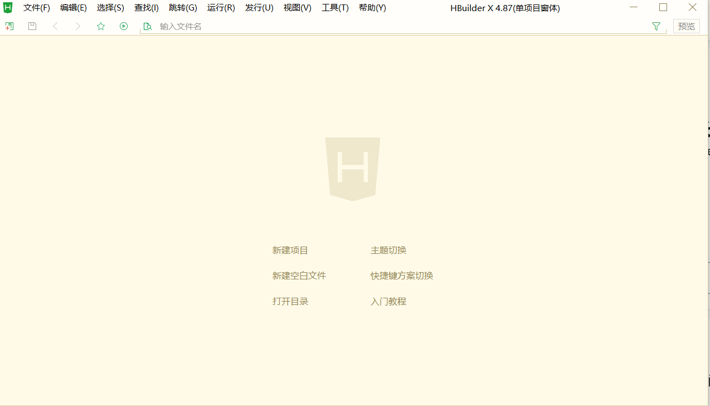

2. 选择 uni-app 默认模板，填写项目名和保存位置，然后点击右下角“创建”。

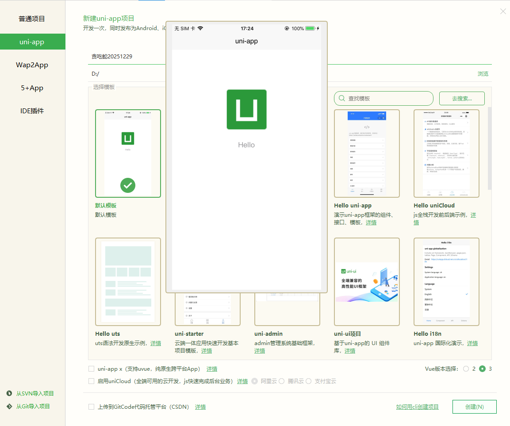

3. 等待 HBuilderX 创建项目。

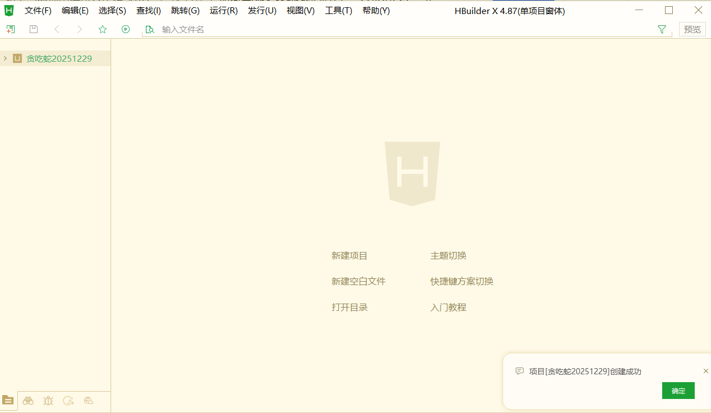

4. 在 Trae 中打开刚才创建的项目文件夹。左侧能看到项目文件，说明准备完成。

## 3. 小程序开发

项目已经创建好了。下面先让 AI 做出一个能玩的版本，再到微信开发者工具中亲自操作。发现问题以后，一次只改一件事。

### 3.1 让 AI 做第一版

在 Trae 中打开项目，然后说：

> 请把当前 uni-app 项目改成贪吃蛇。先做首页和游戏页，游戏能开始、移动、吃食物、计分和重新开始。

先让 AI 读取当前项目并直接修改文件。不要让它只贴一大段代码，再让你逐行复制。

### 3.2 看清 AI 改了什么

执行以后，先看它准备修改哪些文件。路径应该都在刚才打开的项目中，不要让它在其他目录重新创建一套工程。

1. 对话区会说明准备增加哪些页面和游戏逻辑。

2. 修改会直接落到当前项目文件。
3. 完成后检查修改摘要，确认没有删除与任务无关的内容。

如果方向明显不对，可以使用 Trae 的回退功能恢复这一轮修改。回退以后重新描述问题，不要在错误版本上继续叠加功能。

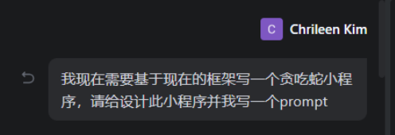

### 3.3 在 HBuilderX 和微信开发者工具中查看效果

回到 HBuilderX，选择“运行 → 运行到小程序模拟器 → 微信开发者工具”。HBuilderX 会先构建项目，再把结果交给微信开发者工具。

底部输出窗口出现 `ready` 且没有红色错误后，再切到微信开发者工具。

如果没有自动打开微信开发者工具：

1. 先在 HBuilderX 中停止当前运行。
2. 手动启动微信开发者工具，让它处于打开状态。
3. 回到 HBuilderX，再次点击「运行 → 运行到小程序模拟器 → 微信开发者工具」。

看到首页以后，先点击开始，确认蛇能移动、吃到食物、增加分数并重新开始。

### 3.4 把方向按钮改成摇杆

第一版使用四个方向按钮，游戏已经能玩。下一轮只替换控制方式：

> 请把四个方向按钮换成摇杆。松开摇杆后，蛇继续沿最后方向移动。不要修改计分和碰撞逻辑。

AI 修改完成后，重点验证快速转向、反方向操作和松开摇杆三个情况。

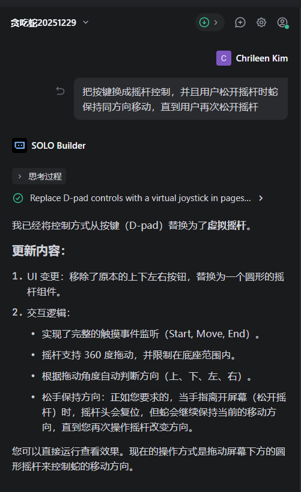

修改完成后重新运行。没有看到变化时，先停止 HBuilderX 当前任务，再执行一次“运行到小程序模拟器”，不要只反复刷新旧构建。

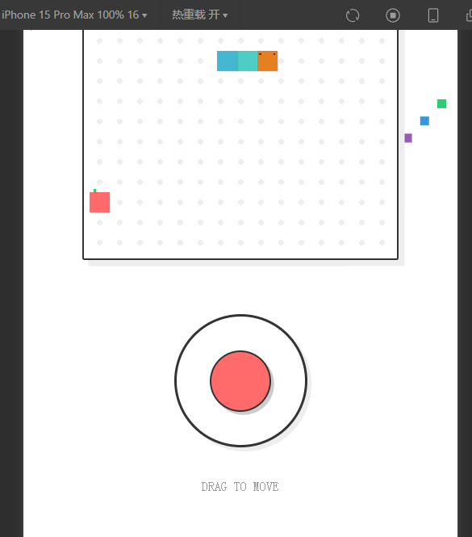

### 3.5 出现问题时怎样描述

把“什么时候发生、看到什么、正确结果是什么”说清楚，提示词就够了。例如摇杆偶尔失效：

> 摇杆偶尔会让蛇停住。请只修复这个问题，并告诉我怎样复现和验证。

如果只是小屏幕太拥挤：

> 页面在小屏手机上太拥挤。请增加上下留白，不要修改游戏逻辑。

每次修改后都重新操作一次。问题没有解决就把实际现象和开发者工具里的相关错误继续发给 AI；结果更差时先回退，再换一种描述。

功能稳定以后，可以提供一张有权使用的风格参考图，让 AI 只调整颜色、背景和按钮：

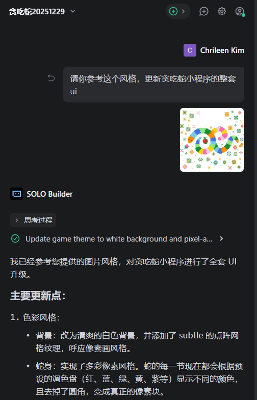

### 3.6 最终成品

最后得到首页、游戏页和结束状态。蛇能移动、吃食物和计分，摇杆松开后仍会沿最后方向继续移动。

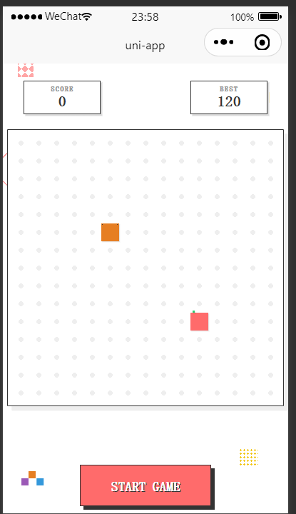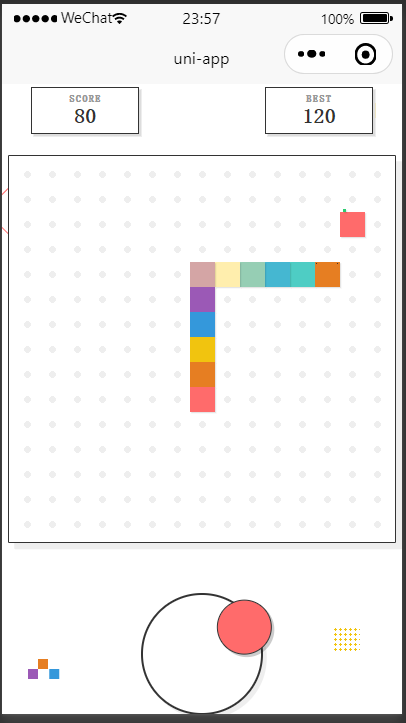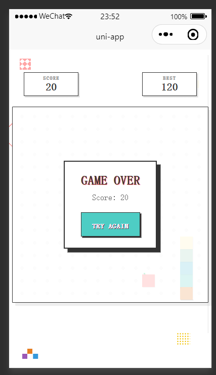

不要只看截图判断完成。至少连续玩三局，测试快速转向、撞墙、吃到食物、重新开始和小屏显示。都正常以后再上传体验版。

## 4. 小程序发布

模拟器里的版本只有开发者自己能看到。想在手机微信里测试，需要先上传开发版本，再把它设为体验版。

体验版只对管理员和体验成员开放，不等于已经公开上线。先用它完成真机测试，稳定以后再准备备案、类目和正式审核。

### 4.1 先上传体验版

按照下面四步操作：

1. 在微信公众平台找到并确认自己的 AppID。
2. 在项目里把这个 AppID 配置好。
3. 用微信开发者工具上传当前版本。
4. 回到公众平台，把这次上传的版本设置为「体验版」。

#### 4.1.1 在微信公众平台确认 AppID

1. 打开浏览器，访问 `https://mp.weixin.qq.com`，登录你的小程序后台。
2. 在左侧菜单中找到「开发管理」，进入其中的「开发设置」。
3. 在页面上方，你会看到一块叫做「开发者 ID」的区域，里面有一行「AppID（小程序 ID）」——这就是你的小程序唯一编号。

项目中的 AppID 必须和后台一致。截图时像下面这样遮住具体值，也不要展示 AppSecret。

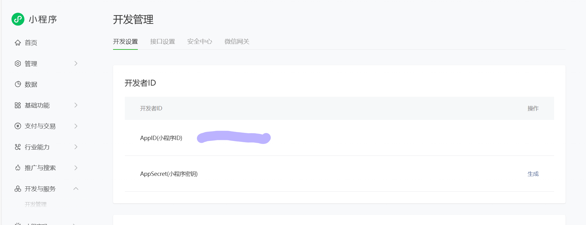

#### 4.1.2 在项目中填写 AppID

1. 打开 HBuilderX，载入你的贪吃蛇项目。
2. 在左侧文件树中找到 `manifest.json`，双击打开。
3. 下拉到「微信小程序配置」这一栏，你会看到一个输入框，提示类似「微信小程序 AppID（请在微信开发者工具中获取）」。
4. 把刚才在公众平台上看到的 AppID 原样粘贴进来，保存文件。
   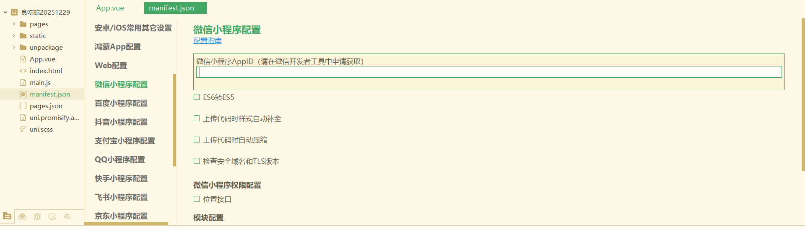

保存后重新构建项目，微信开发者工具会按这个 AppID 识别上传目标。

#### 4.1.3 在微信开发者工具中上传一个版本

1. 在微信开发者工具顶部工具栏的右侧，你会看到一个「上传」按钮，点击它。
2. 弹出的窗口中，需要填写两个关键字段：
   1. 版本号：例如 `1.0.0`，只允许数字和小数点。
   2. 项目备注：写一段简短说明，比如「完成基本功能的开发」。
3. 检查无误后，点击「上传」按钮。下面的输出区域会显示编译过程，所有步骤变成绿色并提示上传完成，就说明这一版已经成功提交到了微信服务器。

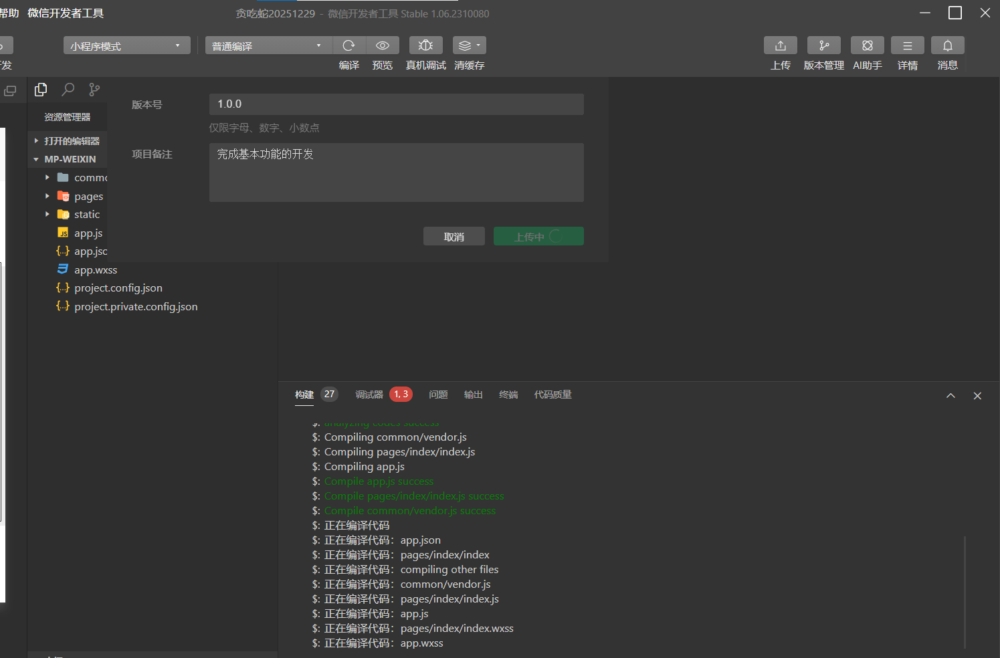

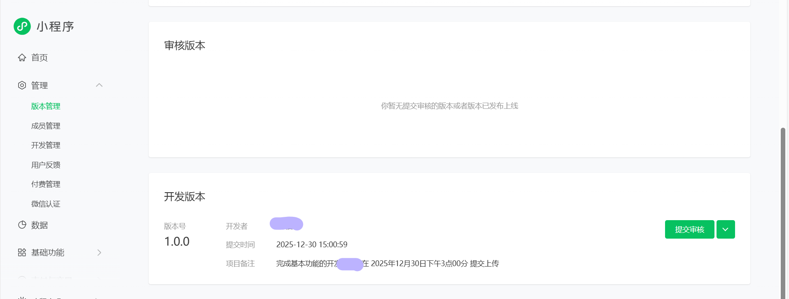

#### 4.1.4 在管理后台中把版本设为体验版

1. 再次打开 `https://mp.weixin.qq.com`，进入你的小程序后台。
2. 在左侧找到「管理」下面的「版本管理」，点击进入。
3. 在页面的「开发版本」一栏，你应该能看到刚刚上传的那个版本：版本号是 `1.0.0`，备注是你写的那一段说明，时间是刚刚的上传时间。
4. 在这一行右侧选择「设为体验版」。如果后台要求先补充主营类目，按实际功能选择后再回来操作。

   

   

完成后生成体验二维码，把测试同事加入体验成员。至少用两台不同尺寸的手机测试摇杆、重新开始、前后台切换和分享入口。

### 4.2 小程序正式上线

准备公开发布时，再补充小程序信息、选择真实类目、完成备案并提交审核。后台页面和费用可能变化，最终以当前提示为准。

#### 4.2.1 进入小程序发布流程

首先回到微信公众平台后台，登录你的小程序账号。 在左侧导航里找到与「版本管理 / 发布」相关的入口（不同时间界面可能略有调整），展开后会看到「小程序发布流程」这一项。

点击进入之后，界面上方会显示一个进度条，下面依次列出几个步骤，例如：

1. 小程序信息
2. 小程序类目
3. 运营信息 / 小程序备案
4. 微信认证（视你的主体而定）

一开始进度会显示 0%，随着你完成每一步，系统会自动把进度向前推进。

#### 4.2.2 填写小程序基本信息

在“小程序信息”页面准备名称、简介、图标、页面截图和后台要求的其他资料。名称和简介要准确描述当前功能；截图只放真实存在的页面，不要写没有做完的排行榜、联机或奖励功能。

图标和截图的尺寸以后台当前提示为准，图片、字体和音效也要确认有权公开使用。

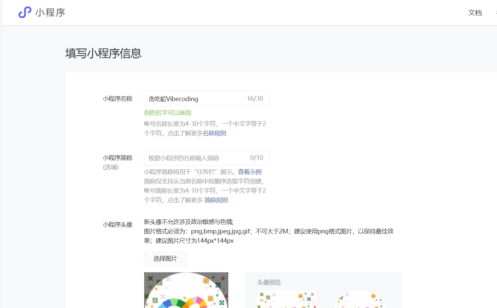

全部填写完毕后，点击保存或下一步，发布流程中的第一步就完成了。

#### 4.2.3 选择小程序服务类目

类目决定平台按什么业务审核，也会影响需要提交的资质。它必须和实际功能一致。

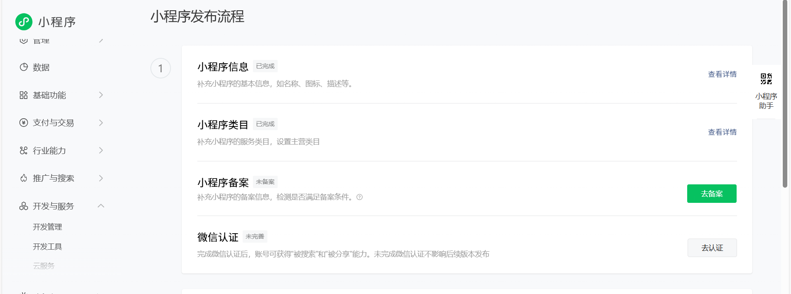

点击“添加类目”后，后台会显示当前账号可以选择的分类：

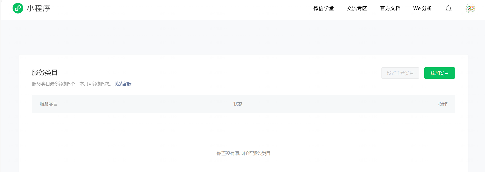

下面的截图只展示类目选择界面，不代表贪吃蛇应该选择“教育器具”。如果准备公开运营游戏，应先确认是否需要使用微信小游戏账号、对应类目和额外规则；不要为了通过审核把游戏描述成教育工具。

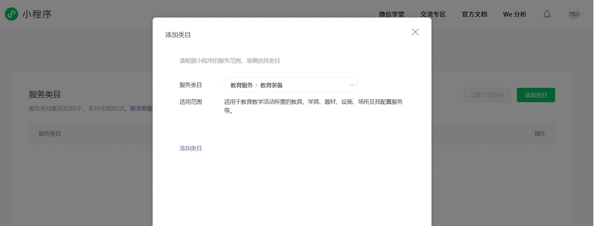

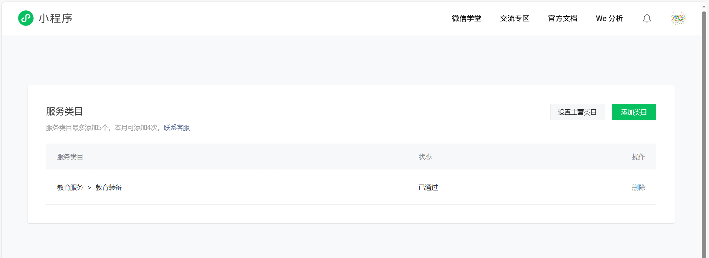

确认类目后，点击保存。如果页面提示「创建类目成功」，并在列表中显示你刚刚添加的那一项，就说明这一步已经完成。

#### 4.2.4 完成小程序备案信息

发布流程还会要求完成运营信息和小程序备案，用来确认主体与负责人。

1. 选择与注册账号一致的主体类型。
2. 按后台提示填写主体和负责人信息。
3. 上传当前页面要求的证明材料并完成核验。
   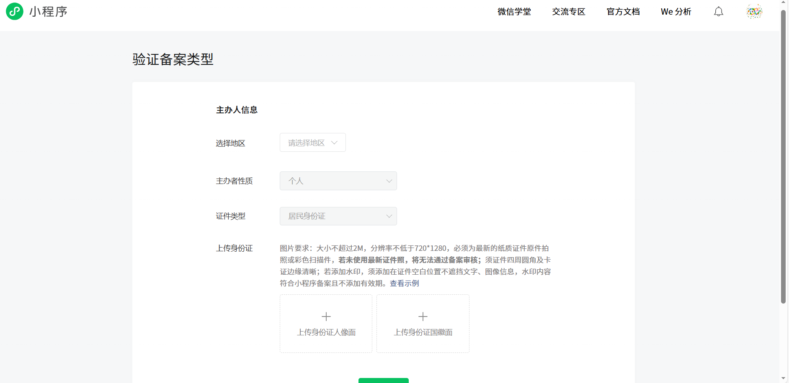

身份证、手机号、验证码和证件照片都不要发给 AI，也不要出现在教程截图里。提交后回到后台查看实际状态；需要短信或工信部核验时，按收到的官方通知在有效期内完成。

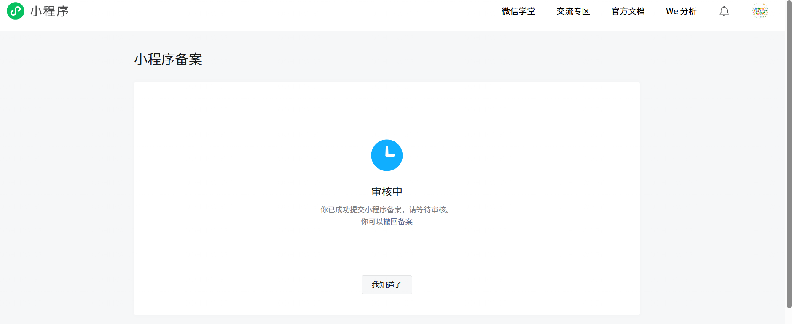

#### 4.2.5 提交审核并等待正式发布

1. 回到「小程序发布流程」总览页面，确认每一项都显示为已完成，进度条接近 100%。
2. 根据页面提示，点击「提交审核」或类似按钮，把当前开发版本送交微信团队审核。
3. 在「版本管理」中，你会看到这次提交的版本状态变为「审核中」。通过后，会变成「已发布」或可选择「上线」的状态。

审核如果要求补充操作视频、页面截图或资质，就按退回原因修改后重新提交。通过以后，仍要在版本管理中确认是否需要手动点击“发布”。不要只看到“审核通过”就以为用户已经能搜索到。

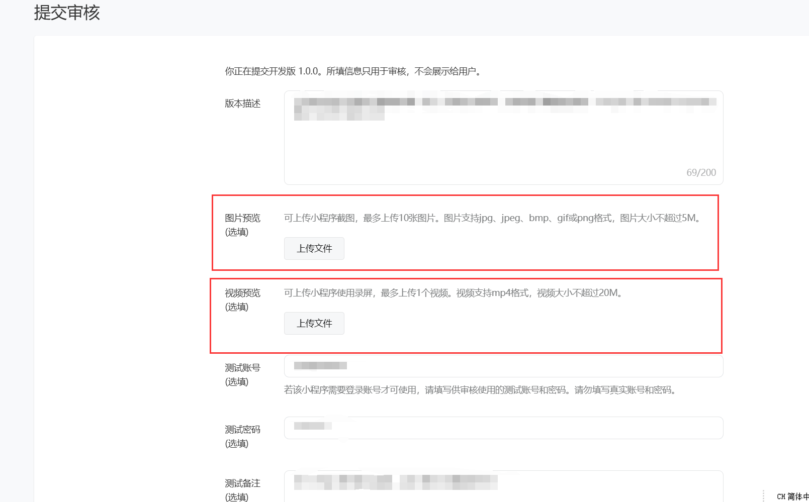

## 5. 从贪吃蛇走到第一个真实小程序

现在再回头看，贪吃蛇本身并不复杂，真正重要的是你已经走过一次小程序的完整过程：创建项目、让 AI 修改、在模拟器里找问题、拿手机体验，再把版本上传。

以后换成预约、活动报名或内部工具，仍然可以照这个节奏来：一次只改一件事，改完马上回到微信开发者工具里试，不要把“AI 说完成了”当成真的完成。等页面需要保存用户身份、云端数据或图片时，再继续做下一篇带后端的小程序。

## 参考资料

- [微信小程序开发者工具](https://developers.weixin.qq.com/miniprogram/dev/devtools/download.html)
- [微信公众平台](https://mp.weixin.qq.com/)
- [uni-app 文档](https://uniapp.dcloud.net.cn/)
- [腾讯：微信小程序业务介绍](https://www.tencent.com/en-us/business/wechat-mini-program.html)
- [腾讯：Uber 微信小程序案例](https://www.tencent.com/en-us/articles/2202137.html)
