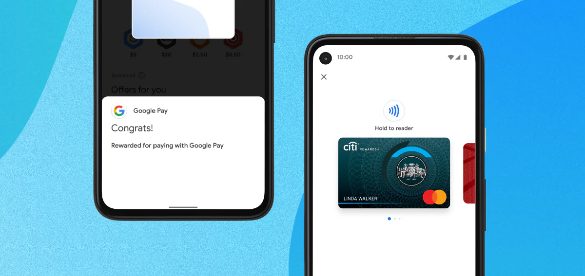

# 如何用 Flutter 開發跨平台 App

Flutter 適合 Android、iOS 需要大致相同功能與視覺風格的產品。它使用 Dart 語言，並由自己的繪製系統呈現介面。這次我們做一個門市費用簿：輸入支出、更新今日總額，重新開啟後記錄仍然存在。

## 1. 從正式產品理解 Flutter

My BMW 把車況、充電、保養與遠端操作放在同一個 App。它先顯示車輛與目前狀態，再提供次要入口。


Google Pay 在付款或取得獎勵後立即顯示明確結果；Nubank 則用安靜的資訊層級整理帳戶和服務入口。




費用簿也採用同樣的順序：今日總額、最新記錄、明確的新增按鈕。

## 2. 建立並執行專案

安裝穩定版 Flutter 後，先檢查環境：

```bash
flutter doctor
flutter create store_expense_ledger
cd store_expense_ledger
flutter run -d chrome
```

`flutter doctor` 只會列出這台電腦真正準備好的平台。Web 可以執行，不代表 Android SDK、Xcode、簽名與手機測試也完成了。

## 3. 做出第一個費用首頁

> 把計數器範例改成門市費用首頁。顯示今日總額、費用清單和「新增費用」按鈕。


> 點擊按鈕後開啟表單，加入類別、說明、金額、保存與取消。


## 4. 讓錯誤與成功都看得懂

> 空白欄位或小於等於零的金額，要在欄位下方顯示簡短說明，而且不能保存。


> 保存成功後關閉表單，把記錄放到清單最上方，更新總額並顯示成功訊息。

輸入「辦公用品」、「影印紙」與 `56`，確認總額、清單和提示只更新一次。


## 5. 關閉後仍要找得到資料

> 把費用記錄保存在本機，程式啟動時再載入。先不要加入帳號和伺服器。

保存兩筆資料，重新整理，再關閉瀏覽器後重開。總額與兩筆記錄都回來，才算通過。

之後再逐步加入編輯、刪除確認、穩定的記錄 ID，以及連接公司後端。使用者能看哪些門市和費用，必須由伺服器決定，不能讓 App 自己修改角色。

## 6. 測試與建置

```bash
flutter analyze
flutter test
flutter build web
```

Android 需要 Android Studio、SDK、簽名與真機；iOS 需要 Mac、Xcode、Simulator Runtime 或真機與簽名。桌面版也要在沒有開發環境的乾淨電腦安裝測試。

本章使用 Flutter 3.44.9 與 Dart 3.12.2，靜態分析、Widget Test 和 Web 建置都通過，並實際驗證表單錯誤、保存成功與重新整理後資料仍在。這台電腦缺少 Android SDK，也沒有可用的 iOS Simulator Runtime 和 CocoaPods，所以沒有宣稱手機建置與上架已完成。

先把一筆費用從輸入、驗證、保存到重新開啟都做穩，再接帳號、同步與正式發布。
